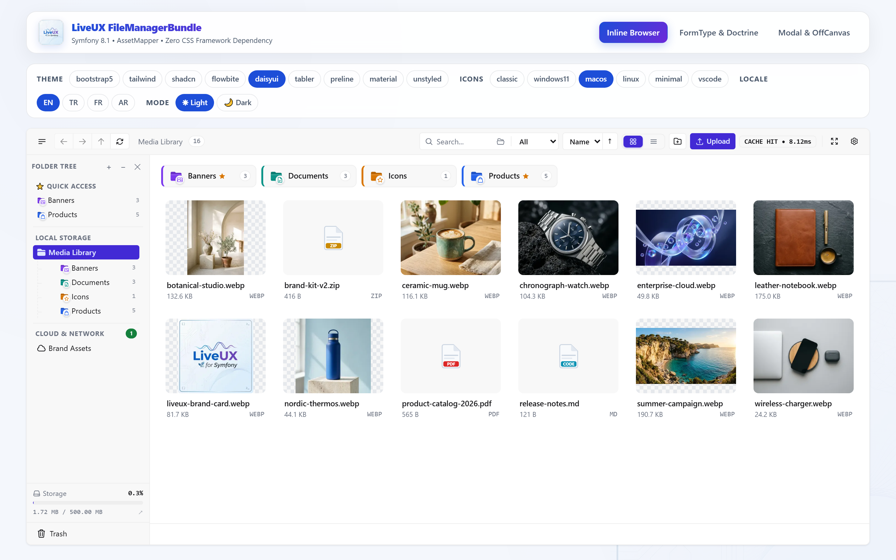

# 04 — السمات والوضع الداكن وتخصيص المجلدات وحزم الأيقونات والتصميم المخصص

[← السابق: 03 — أوضاع الاستخدام وواجهة JavaScript البرمجية](03-usage-modes-and-js-api.md) | [الفهرس](README.md) | [التالي: 05 — حقل النموذج (`FormType`) وتكامل المحررات →](05-formtype-and-editor-integrations.md)

صُممت حزمة LiveUX FileManagerBundle بـ **صفر اعتمادات (100% Zero Dependencies) على أي إطار عمل CSS**. سواء كان مشروعك يستخدم **Bootstrap 5، أو Tailwind CSS v3/v4، أو Shadcn/UI، أو Flowbite 4، أو DaisyUI 5، أو Tabler، أو Preline، أو Material**، أو **لا يستخدم أي إطار CSS على الإطلاق**، فإن الحزمة تعمل فورًا دون أي خطوات بناء إضافية (لا حاجة لإعداد `@source` أو تنقية الأنماط purge في Tailwind).

> **نظرة سريعة: ماذا ستتعلم في هذا الدليل؟**  
> 1. **9 سمات مدمجة والوضع الداكن:** طابق الهوية البصرية ونظام الألوان لتطبيقك بخيار YAML واحد فقط.  
> 2. **تلوين المجلدات وتعيين شاراتها (الأيقونات):** خصّص المجلدات من واجهة المستخدم أو برمجيًا عبر PHP وقاعدة البيانات باستخدام أكثر من 18 لونًا و14 شارة مدمجة (إضافةً إلى عدد غير محدود من شارات SVG المخصصة).  
> 3. **إنشاء حزمة أيقونات خاصة بك:** خطوات عملية لبناء حزمة أيقونات مخصصة تغطي 9 أيقونات للملفات و49 أيقونة لواجهة المستخدم وعددًا غير محدود من شارات المجلدات المخصصة.  
> 4. **بناء سمة مخصصة (3 مستويات من الحرية):** تخصيص ألوان الهوية التجارية بمتغيرات CSS فقط، أو تخصيص جزئي لقوالب Twig عبر ``، أو بناء تخطيط مستقل بالكامل (Headless) من الصفر.

---

## 1. السمات الـ 9 المدمجة (أيّها يناسب مشروعك؟)

يمكنك ضبط السمة عبر `defaults.theme`، أو `profiles.<name>.ui.theme`، أو الخاصية `theme` في مكوّن TwigComponent، أو الخيار `theme` في `FileManagerPickerType`. **جميع السمات الـ 9 مُختبرة ومطابقة لمعايير تباين الألوان WCAG 2.1 AA في كلا الوضعين الفاتح والداكن.**

| مفتاح السمة | الأنسب لـ | ملخص التصميم |
| :--- | :--- | :--- |
| `bootstrap5` *(الافتراضي)* | Bootstrap 5 ولوحات تحكم Symfony التقليدية | أزرق كلاسيكي (`#0d6efd`)، حواف دائرية `10px / 8px / 6px`، وحدود محايدة واضحة |
| `tailwind` | تطبيقات الويب الحديثة المبنية بـ Tailwind CSS v3/v4 | لون تمييز نيلي (`#6366f1`)، حواف سلسة `14px / 12px / 8px`، ولوحة ألوان Slate |
| `shadcn` | لوحات SaaS أحادية اللون ذات التصميم البسيط (أبيض وأسود) | أسطح Zinc أحادية اللون (`#18181b` / `#fafafa` في الوضع الداكن)، وزوايا حادة `8px / 6px` |
| `flowbite` | لوحات الإدارة التي تعتمد على Flowbite 4 + Tailwind CSS | أزرق Flowbite (`#1a56db`) وأسطح Gray-50/800/900، وعناصر تحكم بحواف `8px` |
| `daisyui` | المشاريع المبنية باستخدام DaisyUI 5 | **يرث تلقائيًا** `--color-primary` و`--color-base-100/200/300` و`--radius-box` بمجرد تحميل DaisyUI في الصفحة |
| `tabler` | واجهات Tabler.io أو لوحات EasyAdmin المؤسسية | خلفية Slate مؤسسية، لون تمييز أزرق `#066fd1`، وزوايا دقيقة `4px / 6px` |
| `preline` | تطبيقات Preline UI | أسطح محايدة نقية (`#fafafa` / `#171717`) مع لون تمييز أزرق حيوي (`#2563eb`) |
| `material` | تطبيقات Google Material Design 3 | أسطح بنفسجية متدرجة (`#6750a4` / `#f3edf7`) وأزرار دائرية بالكامل (Pill Buttons) |
| `unstyled` | تنسيق مدير الملفات بالكامل باستخدام أنماط CSS الخاصة بك | يرث خط التطبيق المستضيف والأسطح الشفافة مع الحفاظ على تباين `--liveux-fm-elevated-bg` / `--liveux-fm-elevated-text` للنوافذ المنبثقة وعارض الوسائط |

| الوضع الداكن (`bootstrap5` + داكن) | جسر سمة DaisyUI 5 (`daisyui`) |
| :---: | :---: |
|  |  |

> [!IMPORTANT]
> **قاعدة أمنية (قيمة `theme` في YAML مقابل وقت التشغيل):**  
> - في `liveux_file_manager.yaml`، يمكنك تحديد أيٍّ من السمات الـ 9 المدمجة، أو اسم سمة CSS مخصصة (مثل `'corporate'` المطابق للنمط `/^[a-zA-Z0-9_-]{1,40}$/`)، أو مسار قالب Twig مخصص (مثل `'file_manager/custom.html.twig'` أو `'@App/file_manager'`).  
> - لأسباب أمنية، فإن قيم `theme` الديناميكية الواردة من المتصفح أو معاملات استعلام URL أو `window.LiveUXFileManager.open({ theme: ... })` **تقبل مفاتيح السمات الـ 9 المدمجة فقط** (`FileManagerThemes::sanitizeDynamic()`).

---

## 2. الوضع الداكن واتجاه RTL وتقليل الحركة

تدعم جميع السمات الـ 9 (بما فيها `unstyled`) **الوضع الداكن التلقائي واليدوي معًا**:

### أ) الاكتشاف التلقائي من الصفحة المستضيفة (`color_scheme: 'auto'`)
بمجرد تفعيل أيٍّ من السمات أو الفئات التالية على عنصر `<html>` أو `<body>` في صفحتك، يتحوّل مدير الملفات ونافذة `<dialog>` وحقول `FileManagerPickerType` فورًا إلى الوضع الداكن:
- `data-bs-theme="dark"` *(Bootstrap 5)*
- فئة `.dark` *(Tailwind CSS / Shadcn / Flowbite / Preline)*
- `data-theme="dark"` *(DaisyUI / السمات المخصصة)*

### ب) نظام الألوان الافتراضي أو لكل ملف تعريف عبر YAML
```yaml
liveux_file_manager:
    defaults:
        color_scheme: 'auto'          # 'auto' (يتبع الصفحة المستضيفة) | 'light' | 'dark'
    profiles:
        default:
            ui:
                color_scheme: 'dark'  # بدء ملف التعريف هذا فقط بالوضع الداكن
```

### ج) تفضيل المستخدم النهائي (قائمة الإعدادات: `تلقائي / فاتح / داكن`)
يمكن للمستخدمين التبديل بين **تلقائي (Auto) / ☀ فاتح (Light) / 🌙 داكن (Dark)** بنقرة واحدة من قائمة **⚙ الإعدادات** في شريط الأدوات العلوي، ويُحفظ اختيارهم في `localStorage` بالمتصفح تحت المفتاح `liveux_fm_color_scheme`.

### د) الدعم الشامل لاتجاه RTL و`prefers-reduced-motion`
- يُطبَّق `dir="rtl"` تلقائيًا على 15 لغة تكتب من اليمين إلى اليسار، من بينها العربية (`ar`) والفارسية (`fa`) والعبرية (`he`) والأردية (`ur`). وتعتمد جميع المسافات في `core.css` على الخصائص المنطقية في CSS (`inset-inline`، `padding-inline`، `border-inline-end`).
- تُقلَّل الحركات والانتقالات تلقائيًا للمستخدمين الذين يفعّلون خيار *"تقليل الحركة"* (`prefers-reduced-motion: reduce`) في نظام التشغيل.

---

## 3. تلوين المجلدات وتعيين شاراتها (الأيقونات) خطوةً بخطوة


يمكنك تعيين **لون مخصص** و**أيقونة شارة** و**حالة تثبيت (⭐ تثبيت)** لأي مجلد. تعمل هذه الميزات عند تفعيل `defaults.metadata.enabled: true` وامتلاك المستخدم لصلاحية `permissions.edit_metadata`.

### الطريقة الأولى: من واجهة المستخدم (للمستخدم النهائي)
1. انقر **بزر الفأرة الأيمن** على أي مجلد واختر **تخصيص (Customize)** (أو اضغط مفتاح **`I`** أثناء تحديد مجلد، أو انقر **تخصيص** في لوحة المعاينة والخصائص Inspector).
2. في نافذة **تخصيص**، اضبط الخيارات الثلاثة مع معاينة فورية:
   - **لوحة من 18 لونًا جاهزًا:** أزرق (`#2563eb`)، سماوي (`#0284c7`)، سيان (`#0891b2`)، أزرق مخضر (`#0d9488`)، زمردي (`#059669`)، أخضر (`#16a34a`)، ليموني (`#65a30d`)، كهرماني (`#d97706`)، برتقالي (`#ea580c`)، أحمر (`#dc2626`)، وردي داكن (`#e11d48`)، وردي (`#db2777`)، فوشي (`#c026d3`)، أرجواني (`#9333ea`)، بنفسجي (`#7c3aed`)، نيلي (`#4f46e5`)، أردوازي (`#475569`)، فحمي (`#1e293b`).
   - **منتقي ألوان مخصص + حقل HEX:** اختر أي لون خاص بهويتك عبر منتقي الألوان الأصلي أو أدخل رمز اللون بصيغة `#RRGGBB` مباشرة. انقر **إعادة تعيين للافتراضي (Reset to Default)** لإزالة التخصيص.
   - **شبكة شارات المجلدات (Badges):** تعرض **الشارات الـ 14 المدمجة** (`archive`, `bag`, `cart`, `code`, `doc`, `globe`, `heart`, `image`, `lock`, `pen`, `star`, `tag`, `users`, `video`) إلى جانب أي ملفات SVG مخصصة تضيفها إلى مجلد `badges/` في حزمة أيقوناتك.
3. انقر **حفظ (Save)** — فيتحدث مظهر المجلد فورًا في عرض الشبكة والقائمة وفي شجرة المجلدات الجانبية.

### الطريقة الثانية: برمجيًا من PHP (مثلاً عند إنشاء مجلد جديد لعميل)
باستخدام `FolderMetadataStorageInterface` و`PathNormalizer::buildCanonicalKey()`، يمكنك تعيين الألوان والشارات والتثبيت مباشرةً من كود PHP (ويعمل الكود نفسه بسلاسة مع كلا المحركين `json_file` و`doctrine`):

```php
<?php
// src/Service/CustomerFolderInitializer.php

declare(strict_types=1);

namespace App\Service;

use LiveUX\FileManagerBundle\Config\ConfigProviderInterface;
use LiveUX\FileManagerBundle\Metadata\FolderMetadata;
use LiveUX\FileManagerBundle\Metadata\FolderMetadataStorageInterface;
use LiveUX\FileManagerBundle\Security\PathNormalizer;
use LiveUX\FileManagerBundle\Storage\VolumeRegistry;

final readonly class CustomerFolderInitializer
{
    public function __construct(
        private ConfigProviderInterface $configProvider,
        private VolumeRegistry $volumeRegistry,
        private PathNormalizer $pathNormalizer,
        private FolderMetadataStorageInterface $metadataStorage,
    ) {
    }

    public function decorateInvoiceFolder(string $relativeFolderPath): void
    {
        $profile = $this->configProvider->getProfile('default');
        $volume = $this->volumeRegistry->getVolumeForProfile($profile, 'local_uploads');

        // بناء المفتاح القياسي الموحّد (مثال: "local::invoices/2026")
        $canonicalKey = $this->pathNormalizer->buildCanonicalKey($volume, $relativeFolderPath, $profile->basePath);

        $this->metadataStorage->save($canonicalKey, new FolderMetadata(
            color: '#0d9488',   // أزرق مخضر (#RRGGBB)
            icon: 'lock',       // إحدى الشارات الـ 14 المدمجة أو شارة مخصصة badges/invoice.svg -> 'invoice'
            pinned: true,       // إضافة إلى ⭐ المجلدات المثبّتة في الشريط الجانبي
        ));
    }
}
```

### الطريقة الثالثة: مباشرةً في `metadata.json` (عند استخدام `driver: 'json_file'`)
```json
{
    "local::products": { "color": "#2563eb", "icon": "bag",   "pinned": true  },
    "local::images":   { "color": "#0d9488", "icon": "image", "pinned": false },
    "local::invoices": { "color": "#64748b", "icon": "lock",  "pinned": false }
}
```

---

## 4. حزم الأيقونات وبناء حزمة أيقونات خاصة بك من الصفر

تُقدَّم **جميع الأيقونات** في الحزمة — أنواع الملفات، المجلدات، شريط الأدوات العلوي، قائمة السياق، مؤشرات الأقراص السحابية، لوحة المعاينة، وشارات المجلدات — من خلال سجل موحّد واحد هو `IconSetRegistry`. وتُخزَّن حزم الأيقونات الـ 6 المدمجة مؤقتًا في ذاكرة التخزين المؤقت PSR-6 لمدة 24 ساعة (`liveux_fm_iconset_*`).

### حزم الأيقونات الـ 6 المدمجة (`profiles.<name>.ui.icon_set`)
| حزمة الأيقونات | النمط البصري | لون المجلد الافتراضي (`meta.json`) |
| :--- | :--- | :--- |
| `classic` *(الافتراضي)* | أيقونات متجهة مسطّحة وواضحة | `#2563eb` |
| `windows11` | مجلدات صفراء دافئة ثنائية الدرجة على طراز Windows 11 وأيقونات مستندات حديثة | `#f59e0b` |
| `macos` | مجلدات زرقاء ناعمة مستوحاة من macOS Finder | `#3b82f6` |
| `linux` | تصميم مفتوح المصدر نظيف بطابع GNOME / Adwaita | `#3584e4` |
| `minimal` | أيقونات خطّية رفيعة (Outline) بسيطة وأنيقة | `#475569` |
| `vscode` | أيقونات حادة موجّهة للمطورين بأسلوب VS Code | `#dcb67a` |

### خطوةً بخطوة: إنشاء حزمة أيقونات مخصصة

#### الخطوة 1: إنشاء مجلد للأيقونات في مشروعك
على سبيل المثال، أنشئ المجلد `assets/fm-icons/`. **لا تحتاج إلى نسخ الأيقونات التي لا ترغب في تعديلها** — فأي أيقونة غير موجودة تعود تلقائيًا إلى الحزم المدمجة `classic` / `_ui` / `_folder_badges`!

```text
assets/fm-icons/
├── meta.json               # لون المجلد الافتراضي: { "defaultFolderColor": "#7c3aed" }
├── folder.svg              # (اختياري) أيقونة المجلد الرئيسية المخصصة
├── pdf.svg                 # (اختياري) استبدال أيقونة PDF فقط
├── ui/                     # (اختياري) استبدال أو إضافة أيقونات شريط الأدوات وقائمة السياق ووحدات التخزين
│   ├── upload.svg          # استبدال أيقونة الرفع
│   ├── new_folder.svg      # استبدال أيقونة مجلد جديد
│   └── company_cloud.svg   # إضافة أيقونة وحدة تخزين جديدة -> volumes.<name>.icon: 'company_cloud'
└── badges/                 # (اختياري) استبدال شارات المجلدات الحالية أو إضافة شارات جديدة
    ├── lock.svg            # استبدال شارة "lock" المدمجة
    └── invoice.svg         # إضافة شارة جديدة -> تظهر تلقائيًا في نافذة تخصيص المجلد!
```

#### الخطوة 2: إنشاء `meta.json` وأيقونة `folder.svg` ذات لون ديناميكي

> [!TIP]
> **القاعدة الذهبية (`currentColor`):** لضمان تكيّف أيقونة `folder.svg` المخصصة تلقائيًا كلما غيّر المستخدم لون المجلد، استخدم **`fill="currentColor"`** (أو `stroke="currentColor"` للأيقونات الخطّية) بدلًا من ألوان HEX ثابتة!

```json
// assets/fm-icons/meta.json
{
    "defaultFolderColor": "#7c3aed"
}
```

```xml
<!-- assets/fm-icons/folder.svg -->
<svg xmlns="http://www.w3.org/2000/svg" viewBox="0 0 24 24" fill="none">
    <path d="M3 6.5A2.5 2.5 0 0 1 5.5 4h4.17a2 2 0 0 1 1.42.59l1.32 1.32A2 2 0 0 0 13.83 6.5H18.5A2.5 2.5 0 0 1 21 9v8.5a2.5 2.5 0 0 1-2.5 2.5h-13A2.5 2.5 0 0 1 3 17.5v-11Z"
          fill="currentColor" fill-opacity="0.92"/>
</svg>
```

```xml
<!-- assets/fm-icons/badges/invoice.svg (شارة مجلد مخصصة جديدة) -->
<svg xmlns="http://www.w3.org/2000/svg" viewBox="0 0 24 24" fill="none" stroke="currentColor" stroke-width="2" stroke-linecap="round" stroke-linejoin="round">
    <path d="M4 2v20l2-1 2 1 2-1 2 1 2-1 2 1 2-1 2 1V2l-2 1-2-1-2 1-2-1-2 1-2-1-2 1Z"/>
    <path d="M8 8h8M8 12h8M8 16h5"/>
</svg>
```

#### الخطوة 3: ربط ملف التعريف في YAML بمجلد الأيقونات
```yaml
# config/packages/liveux_file_manager.yaml
liveux_file_manager:
    volumes:
        company_disk:
            label: 'أرشيف الشركة'
            icon: 'company_cloud' # يستخدم assets/fm-icons/ui/company_cloud.svg تلقائيًا!
            driver: 'LocalFileSystem'
            path: '%kernel.project_dir%/public/uploads'
            url_prefix: '/uploads'

    profiles:
        default:
            volumes: ['company_disk']
            ui:
                icon_set: '%kernel.project_dir%/assets/fm-icons'
```

#### قيود وأمان الأيقونات المخصصة (`IconSetRegistry`)
- الحد الأقصى لحجم كل ملف `.svg` هو **256 كيلوبايت** (`262,144` بايت)، وتجري تنقيته تلقائيًا عبر **`SvgSanitizer`** عند التحميل (إزالة `<script>` ومعالجات الأحداث `on*` وغيرها).
- يفحص كلٌّ من `ui/` و`badges/` ما يصل إلى **200 ملف `.svg` مخصص** بالإضافة إلى المفاتيح المدمجة.
- يجب أن تطابق أسماء الملفات المخصصة (دون الامتداد `.svg`) النمط **`/^[a-zA-Z0-9_-]{1,32}$/`** (أحرف ASCII وأرقام و`-` و`_` بحد أقصى 32 حرفًا).

#### المرجع الكامل لمفاتيح الأيقونات القابلة للاستبدال
- **9 أيقونات للملفات والمجلدات (في جذر المجلد `<dir>/<key>.svg`):**  
  `folder`, `file`, `pdf`, `excel`, `word`, `zip`, `video`, `audio`, `code`
- **49 أيقونة لواجهة المستخدم (`<dir>/ui/<key>.svg`):**
  - *التنقل والتخطيط:* `menu`, `back`, `forward`, `up`, `refresh`, `search`, `search_deep`, `grid`, `list`, `sort`, `fullscreen`, `exit_fullscreen`, `settings`, `close`, `more`, `sun`, `moon`
  - *إجراءات الملفات والمجلدات:* `new_folder`, `upload`, `cloud_upload`, `download`, `open`, `preview`, `edit_image`, `rename`, `move`, `duplicate`, `cut`, `copy`, `paste`, `trash`, `archive`, `select_all`, `link`, `share`, `color`, `tag`, `star`, `sparkles`, `quota`
  - *التخزين ومزوّدو السحابة:* `disk`, `cloud`, `aws_s3`, `cloudflare_r2`, `supabase`, `backblaze_b2`, `minio`, `gcs`, `sftp`
- **14 شارة مجلدات مدمجة (`<dir>/badges/<key>.svg`):**  
  `archive`, `bag`, `cart`, `code`, `doc`, `globe`, `heart`, `image`, `lock`, `pen`, `star`, `tag`, `users`, `video` *(إضافةً إلى أي ملفات `*.svg` مخصصة تضيفها!)*

---

## 5. بناء سمة مخصصة خاصة بك (3 مستويات من الحرية)

يُحدد القالب `Browser.html.twig` كيفية تفسير قيمة `theme` المضبوطة في ملف التعريف وفق **ترتيب الأولوية الدقيق التالي**:
1. ينتهي بـ `.html.twig` ← يعرض قالب Twig الخاص بك مباشرةً (``).
2. يبدأ بـ `@` ← يعرض `layout.html.twig` داخل مساحة أسماء Twig تلك (``).
3. يطابق إحدى السمات الـ 9 المدمجة ← يعرض السمة المدمجة في الحزمة.
4. أي مُعرّف قصير آخر (مثل `'corporate'` المطابق لـ `/^[a-zA-Z0-9_-]{1,40}$/`) ← يغلّف التخطيط الأساسي الافتراضي داخل `<div data-liveux-theme="corporate">`.

### المستوى 1: سمة هوية تجارية بمتغيرات CSS فقط (الأسرع — دون أي قوالب!)

#### المرجع الكامل لمتغيرات CSS المخصصة (`--liveux-fm-*`)
| الفئة | متغيرات CSS |
| :--- | :--- |
| **الخطوط** | `--liveux-fm-font`, `--liveux-fm-mono` |
| **الأسطح والحدود** | `--liveux-fm-bg`, `--liveux-fm-surface-muted`, `--liveux-fm-surface-subtle`, `--liveux-fm-hover`, `--liveux-fm-border`, `--liveux-fm-border-strong`, `--liveux-fm-border-hover` |
| **ألوان النصوص** | `--liveux-fm-text`, `--liveux-fm-text-secondary`, `--liveux-fm-text-muted`, `--liveux-fm-elevated-bg`, `--liveux-fm-elevated-text` |
| **ألوان التمييز والهوية** | `--liveux-fm-accent`, `--liveux-fm-accent-hover`, `--liveux-fm-accent-fg`, `--liveux-fm-accent-soft`, `--liveux-fm-accent-border`, `--liveux-fm-ring` |
| **ألوان الحالة الدلالية (WCAG AA)** | `--liveux-fm-danger`, `--liveux-fm-danger-hover`, `--liveux-fm-danger-solid`, `--liveux-fm-danger-soft`, `--liveux-fm-danger-border`, `--liveux-fm-success`, `--liveux-fm-success-solid`, `--liveux-fm-success-soft`, `--liveux-fm-warning`, `--liveux-fm-warning-soft` |
| **الزوايا والظلال** | `--liveux-fm-radius-shell`, `--liveux-fm-radius-card`, `--liveux-fm-radius-ctrl`, `--liveux-fm-radius-modal`, `--liveux-fm-shadow-sm`, `--liveux-fm-shadow-card`, `--liveux-fm-shadow-float`, `--liveux-fm-shadow-modal`, `--liveux-fm-z-base` |

#### مثال جاهز للنسخ واللصق لسمة هوية مخصصة (`assets/styles/app.css`)
```css
/* 1) لوحة ألوان الهوية في الوضع الفاتح */
[data-liveux-theme="corporate"] {
    --liveux-fm-bg: #ffffff;
    --liveux-fm-surface-muted: #f8f7ff;
    --liveux-fm-surface-subtle: #ede9fe;
    --liveux-fm-hover: #f3f0ff;
    --liveux-fm-border: #ddd6fe;
    --liveux-fm-border-strong: #c4b5fd;
    --liveux-fm-text: #1e1b4b;
    --liveux-fm-text-secondary: #3b2f6e;
    --liveux-fm-text-muted: #6d28d9;
    --liveux-fm-accent: #7c3aed;
    --liveux-fm-accent-hover: #6d28d9;
    --liveux-fm-accent-fg: #ffffff;
    --liveux-fm-accent-soft: #f5f3ff;
    --liveux-fm-accent-border: rgba(124, 58, 237, 0.28);
    --liveux-fm-ring: rgba(124, 58, 237, 0.30);
    --liveux-fm-radius-shell: 16px;
    --liveux-fm-radius-card: 12px;
    --liveux-fm-radius-ctrl: 8px;
}

/* 2) المقابل في الوضع الداكن (يغطي كلاً من المتصفح ومنتقي FormType في الوضعين التلقائي واليدوي) */
[data-bs-theme="dark"] .liveux-fm-root:not([data-fm-color-scheme="light"]) [data-liveux-theme="corporate"],
.dark .liveux-fm-root:not([data-fm-color-scheme="light"]) [data-liveux-theme="corporate"],
[data-theme="dark"] .liveux-fm-root:not([data-fm-color-scheme="light"]) [data-liveux-theme="corporate"],
[data-bs-theme="dark"] [data-liveux-theme="corporate"].liveux-fm-picker:not([data-fm-color-scheme="light"]),
.dark [data-liveux-theme="corporate"].liveux-fm-picker:not([data-fm-color-scheme="light"]),
[data-theme="dark"] [data-liveux-theme="corporate"].liveux-fm-picker:not([data-fm-color-scheme="light"]),
.liveux-fm-picker[data-fm-color-scheme="dark"][data-liveux-theme="corporate"],
[data-fm-color-scheme="dark"] [data-liveux-theme="corporate"] {
    --liveux-fm-bg: #13111c;
    --liveux-fm-surface-muted: #1b1829;
    --liveux-fm-surface-subtle: #242038;
    --liveux-fm-hover: #2d2846;
    --liveux-fm-border: #2e2948;
    --liveux-fm-text: #ede9fe;
    --liveux-fm-text-secondary: #d8d0fc;
    --liveux-fm-text-muted: #a78bfa;
    --liveux-fm-accent: #a78bfa;
    --liveux-fm-accent-hover: #8b5cf6;
    --liveux-fm-accent-fg: #13111c;
    --liveux-fm-accent-soft: rgba(167, 139, 250, 0.16);
}
```

```yaml
# config/packages/liveux_file_manager.yaml
liveux_file_manager:
    defaults:
        theme: 'corporate'
```

---

### المستوى 2: التخصيص الجزئي باستخدام `` في Twig (موصى به!)

يعتمد التخطيط الأساسي على **10 كتل ``** و**7 أجزاء فرعية معيارية (`parts/`)**. يمكنك تعديل الشريط العلوي أو التذييل فقط دون تكرار القالب بالكامل:

| اسم الكتلة (`Block`) | النطاق | الجزء الفرعي الافتراضي |
| :--- | :--- | :--- |
| `fm_shell` | الغلاف الخارجي للواجهة (`.liveux-fm-shell`) | يحيط بجميع الكتل الداخلية |
| `fm_topbar` | شريط الأوامر العلوي (التنقل، مسار التنقل، البحث، الفرز، الإجراءات) | `parts/_topbar.html.twig` |
| `fm_settings_popover` | قائمة الإعدادات المنسدلة (وضع الألوان، حجم العناصر، نمط المجلد، الذاكرة المؤقتة، الاختصارات) | `parts/_settings_popover.html.twig` |
| `fm_banners` | شريط إشعارات الحالة + قائمة انتظار الرفع | ترميز HTML مدمج |
| `fm_body` | المنطقة الوسطى الرئيسية (غلاف الشريط الجانبي + المحتوى الرئيسي + لوحة المعاينة) | `.liveux-fm-body` |
| `fm_sidebar` | شجرة المجلدات الجانبية + المجلدات المثبّتة + شريط الحصة التخزينية + سلة المحذوفات | `parts/_sidebar.html.twig` |
| `fm_main` | شبكة/قائمة الملفات + شريط التحديد والحافظة العائم + منطقة الإفلات + ترقيم الصفحات | `parts/_main.html.twig` |
| `fm_inspector` | لوحة المعاينة والبيانات الوصفية الجانبية | `parts/_inspector.html.twig` |
| `fm_footer` | شريط التذييل للنافذة المنبثقة أو اللوحة المنزلقة | `parts/_footer.html.twig` |
| `fm_overlays` | قائمة السياق، النوافذ المنبثقة، عارض الوسائط، وقوالب الاختصارات وحول الحزمة | `parts/_overlays.html.twig` |

#### مثال — شريط عنوان بالهوية التجارية + تذييل تحديد مخصص
```twig
{# templates/file_manager/corporate_layout.html.twig #}



    <div style="padding: 6px 12px; background: #1e293b; color: #f8fafc; font-size: 0.75rem; display: flex; justify-content: space-between; align-items: center;">
        <span>📁 مركز الأصول الرقمية للشركة</span>
        <span>ملف التعريف: <strong>{{ this.profile }}</strong></span>
    </div>
    {{ parent() }}



    
        <div class="liveux-fm-footer">
            <span class="liveux-fm-muted" data-{{ ctrl }}-target="footerStatus"></span>
            <div class="liveux-fm-row-sm">
                <button type="button" class="liveux-fm-btn" data-action="{{ ctrl }}#closeDialog">إلغاء</button>
                <button type="button" class="liveux-fm-btn liveux-fm-btn-primary"
                        data-{{ ctrl }}-target="confirmSelectionBtn"
                        data-action="{{ ctrl }}#confirmSelection">تأكيد الاختيار</button>
            </div>
        </div>
    

```

```yaml
# config/packages/liveux_file_manager.yaml
liveux_file_manager:
    profiles:
        default:
            ui:
                # 1) مسار مباشر لقالب .html.twig:
                theme: 'file_manager/corporate_layout.html.twig'
                # 2) أو مجلد مساحة أسماء Twig (يحمّل layout.html.twig داخله تلقائيًا):
                # theme: '@App/file_manager'
```

---

### المستوى 3: تخطيط مستقل بالكامل (100% Headless) من الصفر (أهداف Stimulus المطلوبة)

إذا أردت بناء بنية HTML الخاصة بك بالكامل من الصفر دون استخدام ``، يكفي ربط سمات `data-{{ ctrl }}-target` التالية باستخدام البادئة `ctrl = 'liveux--file-manager-bundle--browser'`:

| الهدف (`data-...-target`) | مطلوب؟ | الغرض |
| :--- | :---: | :--- |
| `shell` | موصى به | مقياس حجم العناصر (`--liveux-fm-card-min`) و`data-size-tier` و`data-folder-style` و`data-sidebar-open` |
| `contentArea` | **مطلوب** | المساحة الرئيسية التي تُعرض فيها بطاقات وصفوف الملفات والمجلدات |
| `modalBackdrop`, `modalTitle`, `modalBody` | **مطلوب** | حاوية النوافذ المنبثقة لإنشاء مجلد، والرفع، والحذف، والتخصيص، والحصة، والبيانات الوصفية |
| `breadcrumbs` | موصى به | مسار التنقل القابل للنقر |
| `confirmSelectionBtn`, `footerStatus` | موصى به (Modal/OffCanvas) | زر تأكيد الاختيار (يتعطّل تلقائيًا بـ `disabled` عند عدم وجود تحديد) ومؤشر الحالة |
| `statusBanner`, `uploadQueue` | موصى به | إشعارات النجاح/الخطأ وقائمة تقدم الرفع المجزّأ |
| `tree` + `sidebar` + `pinnedFolders` | اختياري | شجرة المجلدات الجانبية والمجلدات المثبّتة |
| `contextMenu` | اختياري | حاوية قائمة السياق عند النقر بزر الفأرة الأيمن |
| `inspector` | اختياري | لوحة المعاينة والبيانات الوصفية الجانبية |
| `lightbox`, `lightboxStage`, `lightboxCaption`, `lightboxCounter`, `lightboxControls` | اختياري | عارض الوسائط الشامل (Lightbox) |

---

## 6. 7 دوال Twig مساعدة للقوالب المخصصة

| دالة Twig | الوظيفة | مثال للاستخدام |
| :--- | :--- | :--- |
| `liveux_fm_icon(key, iconSet, size, class, group, fallbackKey)` | تعرض أيقونة SVG مضمّنة وآمنة من ثغرات XSS (دون الحاجة إلى `\|raw`). قيم `group`: `'ui'`، `'icons'`، `'badges'`. | `{{ liveux_fm_icon('upload', this.resolvedIconSet, 14, '', 'ui', 'file') }}` |
| `liveux_fm_thumb_url(profile, volume, path, w, h)` | تنشئ رابط صورة مصغّرة آمن للملف. | `` |
| `liveux_fm_download_url(profile, volume, path, inline)` | تنشئ رابط تنزيل آمن أو رابط معاينة مباشرة في المتصفح. | `<a href="{{ liveux_fm_download_url('default', 'customer_vault', 'invoice.pdf', false) }}">تنزيل</a>` |
| `liveux_fm_trans(key, params, locale)` | تترجم مفتاح رسالة من الحزمة مع ضمان الرجوع إلى `'en'` كخيار احتياطي. | `{{ liveux_fm_trans('ui.upload', {}, 'en') }}` |
| `liveux_fm_bcp47_locale(locale)` | تحوّل رموز اللغات في PHP/ICU مثل `en_US.UTF-8` إلى وسوم `lang="..."` صالحة وفق BCP-47 (`en-US`). | `<div lang="{{ liveux_fm_bcp47_locale(fmLocale) }}">` |
| `liveux_fm_is_rtl(locale)` | تعيد `true` إذا كانت اللغة تكتب من اليمين إلى اليسار (العربية، الفارسية، العبرية، إلخ). | `dir="{{ liveux_fm_is_rtl(fmLocale) ? 'rtl' : 'ltr' }}"` |
| `liveux_fm_normalize_field_items(value)` / `liveux_fm_describe_field_item(item)` | تطبّع قيم النماذج وEasyAdmin بأمان إلى واصفات صور/ملفات جاهزة للعرض (مع حظر روابط `javascript:` و`data:`). | صفحات Index/Detail في EasyAdmin والقوالب المخصصة |

---

[← السابق: 03 — أوضاع الاستخدام وواجهة JavaScript البرمجية](03-usage-modes-and-js-api.md) | [الفهرس](README.md) | [التالي: 05 — حقل النموذج (`FormType`) وتكامل المحررات →](05-formtype-and-editor-integrations.md)
