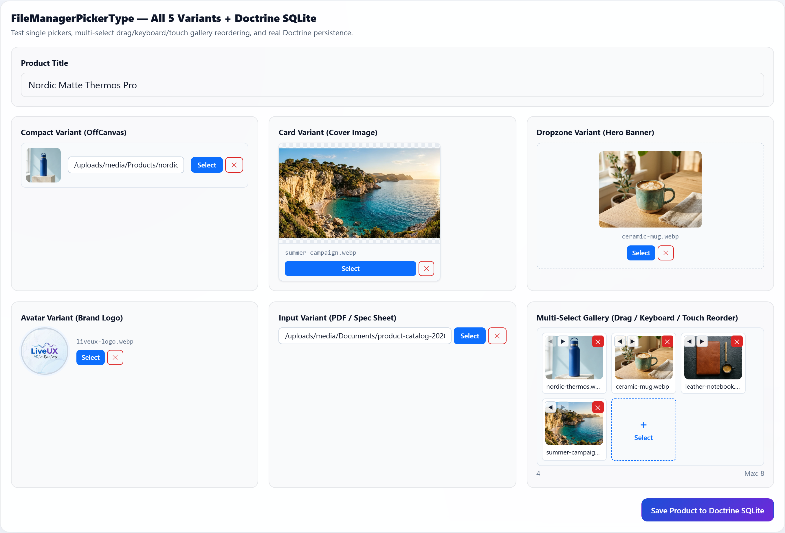

# 05 — حقل النموذج (`FileManagerPickerType`) وتكامل المحررات

[← السابق: 04 — السمات والأيقونات والتخصيص](04-themes-icons-and-customization.md) | [الفهرس](README.md) | [التالي: 06 — الأمان والتفويض والصلاحيات →](06-security-and-authorization.md)

يتكامل `FileManagerPickerType` بسلاسة تامة مع مكوّن النماذج في Symfony (`Symfony Form`). يدعم كلاً من **الملفات المفردة (`?string`)** و**معارض الملفات المتعددة (`list<string>` / JSON)**، ويأتي مزوّدًا بـ **9 سمات** و**5 أنماط عرض جاهزة** و**إعادة ترتيب للمعرض تدعم السحب والإفلات ولوحة المفاتيح واللمس**، إلى جانب دعم كامل **لقوالب Twig المخصصة (`template`)**.

> **نظرة سريعة: ماذا يغطي هذا الدليل؟**  
> عند بناء نموذج منتج أو مقال أو ملف شخصي، فبدلًا من استخدام `<input type="file">` التقليدي، يمنحك `FileManagerPickerType` حقل نموذج Symfony جاهزًا **يفتح مدير الملفات ليتمكن المستخدمون من اختيار ملفات موجودة مسبقًا أو رفع ملفات جديدة**.  
> ستتعلم أيضًا كيفية التكامل مع **`CollectionType` / `LiveCollectionType`**، و**7 محررات نصوص منسّقة وكتل شهيرة** (TinyMCE وCKEditor 5 وTiptap وQuill 2 وTrix وSummernote وEditor.js)، بالإضافة إلى **EasyAdmin 4/5** بأسطر برمجية قليلة فقط.

> [!NOTE]
> تسجّل الحزمة تلقائيًا سمة النموذج (`@LiveUXFileManager/form/picker.html.twig`) وتحقن حاوية `DialogHost` في الصفحة — دون أي حاجة لتعديل `twig.yaml` أو `base.html.twig`.

---

## 1. جميع خيارات `FileManagerPickerType`

| الخيار | النوع | القيمة الافتراضية | الوصف |
| :--- | :--- | :--- | :--- |
| `profile` | `string` | `'default'` | ملف تعريف مدير الملفات الذي سيُفتح. |
| `locale` | `?string` | `null` | القيمة `null` ترث لغة ملف التعريف؛ مرّر أيًّا من لغات الواجهة الـ 12 المدمجة (`'en'`, `'tr'`, `'fr'`, `'de'`, `'es'`, `'ar'`, `'it'`, `'pt'`, `'nl'`, `'pl'`, `'ja'`, `'zh_CN'`) لتجاوز اللغة لكل حقل على حدة. |
| `volume` | `?string` | `null` | اسم وحدة التخزين الابتدائية (`null` يستخدم أول وحدة تخزين في ملف التعريف). |
| `multiple` | `bool` | `false` | `false` = ملف مفرد (`?string`)، `true` = معرض ملفات متعددة (`list<string>`). |
| `max_files` | `?int` | `null` | الحد الأقصى لعدد الملفات المسموح بها عند تفعيل `multiple: true` (`null` = غير محدود؛ كما يُفرض صارمًا من جهة الخادم أيضًا). |
| `mode` | `'modal'\|'offcanvas'` | `'modal'` | أسلوب عرض نافذة الحوار. |
| `position` | `'start'\|'end'\|'top'\|'bottom'` | `'end'` | جهة انزلاق اللوحة عند استخدام `mode: 'offcanvas'`. |
| `mobile_mode` | `null\|'auto'\|'fullscreen'\|'sheet'` | `null` | القيمة `null` ترث `ui.mobile_dialog_mode` من ملف التعريف؛ يتيح تجاوز تخطيط النافذة على الهواتف (`<= 767px`) لكل حقل. |
| `return_type` | `'url'\|'path'` | `'url'` | هل يُحفظ في قاعدة البيانات رابط كامل (`/uploads/a.jpg`) أم مسار نسبي (`a.jpg`) *(راجع دليل الاختيار أدناه)*. |
| `preview` | `bool` | `true` | يتحكم في عرض الصور المصغّرة لمعاينة الصور/الملفات في **جميع الأنماط** (المفرد والمتعدد). عند ضبطه على `false` يُعرض اسم الملف أو مساره فقط. |
| `button_label` | `?string` | `null` | نص مخصص لزر المنتقي (مثل `'اختر صورة'`، `'تغيير الشعار'`). |
| `placeholder` | `?string` | `null` | النص البديل الظاهر عند عدم اختيار أي ملف. |
| `theme` | `?string` | `null` | القيمة `null` ترث سمة ملف التعريف. يقبل أيًّا من السمات الـ 9 المدمجة أو اسم سمة CSS مخصصة (مثل `'corporate'`). |
| `color_scheme` | `?string` | `null` | القيمة `null` ترث نظام الألوان من ملف التعريف أو الإعدادات الافتراضية (`'auto'`، `'light'`، `'dark'`). |
| `variant` | `string` | `'compact'` | نمط العرض المدمج: `'compact'`، `'card'`، `'dropzone'`، `'avatar'`، `'input'`. |
| `template` | `?string` | `null` | مسار إلى **قالب Twig مخصص بالكامل** يحل محل الأنماط المدمجة (مثل `'forms/custom_picker.html.twig'`). |
| `disabled` | `bool` | `false` | خيار قياسي في Symfony Form: عند ضبطه على `true` يصبح الحقل للقراءة فقط وتُقفل أزرار الفتح والمسح وإعادة الترتيب. |

### هل أختار `return_type: 'url'` أم `'path'`؟
- **`'url'` (الافتراضي — الأبسط):** يحفظ `/uploads/products/thermos.webp` أو `https://cdn.example.com/thermos.webp` في قاعدة البيانات. وفي Twig يمكنك عرضه مباشرة عبر `` دون أي منطق إضافي.
- **`'path'` (مرن ومناسب لتغيير CDN مستقبلًا):** يحفظ المسار النسبي فقط `products/thermos.webp`. وإذا بدّلت قرص التخزين أو نطاق الـ CDN لاحقًا فلن تحتاج إلى ترحيل بيانات قاعدة البيانات — يكفي العرض عبر `{{ liveux_fm_thumb_url('products', 'local_uploads', product.coverImage) }}` أو إضافة بادئة نطاق الـ CDN.

### الأمان المدمج وإعادة ترتيب المعرض المتاحة للجميع
- **تحصين طلبات POST من جهة الخادم:** حتى لو عبث أحدهم بحقل `<input>` المخفي عبر أدوات المطور في المتصفح لحقن `javascript:alert(1)`، أو `../../etc/passwd`، أو `.trash/...`، أو JSON تالف يتجاوز 256 كيلوبايت، أو أكثر من 500 عنصر، أو ترميز UTF-8 غير صالح، أو قيم تتجاوز `max_files`، أو مصفوفات HTTP Parameter Pollution (HPP)، فإن `FileManagerPickerType` **يعترضها ويرفضها تلقائيًا على الخادم**.
- **إعادة ترتيب المعرض بسهولة الوصول (`multiple: true`):** يمكن للمستخدمين إعادة ترتيب عناصر المعرض بـ **3 طرق**:
  1. **السحب والإفلات (Drag & Drop)** على أجهزة سطح المكتب،
  2. **مفتاحا الأسهم `←` / `→`** عند التركيز على بطاقة (وينعكس الاتجاه تلقائيًا في لغات RTL مثل العربية)،
  3. **زرا `◀` / `▶`** على كل بطاقة لأجهزة الهاتف واللمس.

---

## 2. أنماط العرض الـ 5 المدمجة (`variant`)

خيارا `variant` و`theme` مستقلان تمامًا؛ إذ يعمل كل نمط عرض في كلٍّ من الوضع **المفرد** و**المتعدد** عبر جميع السمات:

| نمط العرض | الوضع المفرد (`multiple: false`) | الوضع المتعدد (`multiple: true`) | أفضل حالة استخدام |
| :--- | :--- | :--- | :--- |
| `compact` *(الافتراضي)* | صورة مصغّرة مربعة `60×60` + حقل نصي + صَفّ أزرار اختيار/مسح | بطاقات معرض متجاورة + مربع إضافة `+` بحدود متقطعة | حقول النماذج العامة، ومعارض المنتجات |
| `card` | بطاقة معاينة غلاف بنسبة `16:10` + اسم الملف + أزرار سفلية | شبكة بطاقات | أغلفة المقالات والمدونات، والبانرات الرئيسية، والصور المميزة |
| `dropzone` | صندوق كبير قابل للنقر بحدود متقطعة + معاينة فورية | صندوق إضافة كبير في الأعلى + بطاقات المعرض أسفله | مناطق رفع الوسائط والملفات البارزة |
| `avatar` | معاينة دائرية `82×82` للصورة الشخصية/الشعار + أزرار جانبية | شرائح دائرية `72×72` + زر إضافة `+` دائري | الصور الشخصية للمستخدمين، وشعارات العلامات التجارية |
| `input` | مجموعة إدخال مبسّطة من سطر واحد دون صور مصغّرة | قائمة وسوم/شرائح قابلة للإزالة + زر `+ إضافة` | النماذج المدمجة، وملفات PDF، والمستندات، والعقود |



---

## 3. مثال متكامل: كيان Doctrine + فئة FormType

### كيان Doctrine (`src/Entity/Product.php`)
```php
<?php
// src/Entity/Product.php

declare(strict_types=1);

namespace App\Entity;

use Doctrine\DBAL\Types\Types;
use Doctrine\ORM\Mapping as ORM;

#[ORM\Entity]
class Product
{
    #[ORM\Column(length: 255, nullable: true)]
    private ?string $coverImage = null;

    /** @var list<string> */
    #[ORM\Column(type: Types::JSON)]
    private array $galleryImages = [];

    public function getCoverImage(): ?string
    {
        return $this->coverImage;
    }

    public function setCoverImage(?string $coverImage): self
    {
        $this->coverImage = $coverImage;

        return $this;
    }

    /** @return list<string> */
    public function getGalleryImages(): array
    {
        return $this->galleryImages;
    }

    /** @param list<string> $galleryImages */
    public function setGalleryImages(array $galleryImages): self
    {
        $this->galleryImages = $galleryImages;

        return $this;
    }
}
```

### فئة نموذج Symfony (`src/Form/ProductType.php`)
```php
<?php
// src/Form/ProductType.php

declare(strict_types=1);

namespace App\Form;

use App\Entity\Product;
use LiveUX\FileManagerBundle\Form\FileManagerPickerType;
use Symfony\Component\Form\AbstractType;
use Symfony\Component\Form\FormBuilderInterface;
use Symfony\Component\OptionsResolver\OptionsResolver;

final class ProductType extends AbstractType
{
    public function buildForm(FormBuilderInterface $builder, array $options): void
    {
        $builder
            ->add('coverImage', FileManagerPickerType::class, [
                'label' => 'صورة غلاف المنتج',
                'profile' => 'products',
                'theme' => 'flowbite',
                'variant' => 'card',
                'mode' => 'offcanvas',
                'position' => 'end',
                'button_label' => 'اختر الغلاف',
                'placeholder' => 'لم يتم اختيار صورة غلاف بعد…',
            ])
            ->add('galleryImages', FileManagerPickerType::class, [
                'label' => 'معرض صور المنتج',
                'profile' => 'products',
                'theme' => 'flowbite',
                'variant' => 'dropzone',
                'multiple' => true,
                'max_files' => 8,
                'mode' => 'modal',
                'button_label' => 'إضافة صور',
            ]);
    }

    public function configureOptions(OptionsResolver $resolver): void
    {
        $resolver->setDefaults(['data_class' => Product::class]);
    }
}
```

---

## 4. بناء واجهة مخصصة لحقل النموذج (3 طرق)

لست مقيّدًا أبدًا بأنماط العرض الـ 5 أو السمات الـ 9 المدمجة — يمكنك بناء **تصاميم HTML / Bootstrap / Tailwind / Alpine مخصصة بالكامل** مع ربط كامل بوحدة تحكم Stimulus.

### الطريقة 1: الخيار `template` لكل حقل (الأسرع والأكثر مرونة)

مرّر مسار `'template'` في تعريف الحقل. ستتكفّل الحزمة تلقائيًا بربط وحدة تحكم Stimulus المغلّفة (`liveux--file-manager-bundle--picker`) وتفويض كامل ترميز HTML الداخلي إلى ملف Twig الخاص بك:

```php
$builder
    ->add('heroBanner', FileManagerPickerType::class, [
        'profile' => 'default',
        'theme' => 'unstyled',
        'template' => 'forms/custom_single_picker.html.twig',
        'button_label' => 'اختر البانر',
        'placeholder' => 'لم يتم اختيار صورة غلاف بعد',
    ])
    ->add('productGallery', FileManagerPickerType::class, [
        'profile' => 'default',
        'multiple' => true,
        'max_files' => 8,
        'theme' => 'unstyled',
        'template' => 'forms/custom_gallery_picker.html.twig',
        'button_label' => 'إضافة إلى المعرض',
    ]);
```

#### مثال أ — قالب مخصص لمنتقي ملف مفرد (`templates/forms/custom_single_picker.html.twig`)
```twig
{# templates/forms/custom_single_picker.html.twig #}
<input type="hidden"
       id="{{ id }}"
       name="{{ full_name }}"
       value="{{ value }}"
       data-{{ ctrl }}-target="input"
       {{ isDisabled ? 'disabled' : '' }}
       {{ k|e('html_attr') }}="{{ v }}"  />

<div class="my-custom-banner-card">
    <div class="my-banner-preview"
         data-{{ ctrl }}-target="singlePreview"
         data-action="click->{{ ctrl }}#open"
         style="height: 180px; cursor: pointer;">
    </div>

    <div class="my-banner-bar">
        <span data-{{ ctrl }}-target="fileLabel">{{ value ?: emptyPlaceholder }}</span>
        <div>
            <button type="button" {{ isDisabled ? 'disabled' : '' }} data-action="click->{{ ctrl }}#open">{{ btnLabel }}</button>
            <button type="button" {{ isDisabled ? 'disabled' : '' }} data-{{ ctrl }}-target="clearBtn" data-action="click->{{ ctrl }}#clearSingle">{{ clearLabel }}</button>
        </div>
    </div>
</div>
```

#### مثال ب — قالب مخصص لمعرض ملفات متعددة (`templates/forms/custom_gallery_picker.html.twig`)
```twig
{# templates/forms/custom_gallery_picker.html.twig #}
<input type="hidden"
       id="{{ id }}"
       name="{{ full_name }}"
       value="{{ value|default('[]') }}"
       data-{{ ctrl }}-target="input"
       {{ isDisabled ? 'disabled' : '' }}
       {{ k|e('html_attr') }}="{{ v }}"  />

<div class="my-gallery-header">
    <span>الصور المختارة: <strong data-{{ ctrl }}-target="countLabel">0</strong> / {{ max_files }}</span>
    <button type="button" {{ isDisabled ? 'disabled' : '' }} data-action="click->{{ ctrl }}#open">+ {{ btnLabel }}</button>
</div>

{# يعرض picker_controller.js العناصر المختارة كبطاقات قابلة لإعادة الترتيب داخل هذه الحاوية #}
<div class="my-gallery-grid" data-{{ ctrl }}-target="galleryGrid"></div>
```

#### مرجع قالب `FormType` المخصص

| السمة / الحدث | الوصف |
| :--- | :--- |
| `data-{{ ctrl }}-target="input"` | **مطلوب** — عنصر `<input>` الذي يُرسَل إلى الخادم مع النموذج. |
| `data-{{ ctrl }}-target="singlePreview"` | الحاوية التي تُعرض فيها معاينة الصورة/الملف المختار تلقائيًا في الوضع المفرد. |
| `data-{{ ctrl }}-target="fileLabel"` | العنصر النصي الذي يُحدَّث باسم الملف أو مساره المختار. |
| `data-{{ ctrl }}-target="clearBtn"` | زر المسح؛ يُعطَّل تلقائيًا بـ `disabled` عندما يكون الحقل فارغًا أو عندما تكون `isDisabled` تساوي `true`. |
| `data-{{ ctrl }}-target="galleryGrid"` | الحاوية المسؤولة عن عرض بطاقات الملفات المختارة وإعادة ترتيبها في الوضع المتعدد. |
| `data-{{ ctrl }}-target="countLabel"` | عنصر العداد الذي يعرض العدد الحالي للملفات المختارة في الوضع المتعدد. |
| `data-action="click->{{ ctrl }}#open"` | يفتح نافذة مدير الملفات (`Modal` / `OffCanvas`). |
| `data-action="click->{{ ctrl }}#clearSingle"` | يمسح الاختيار الحالي في الوضع المفرد. |
| **حدث JS:** `liveux:file-manager:picker-changed` | يُطلَق كلما تم اختيار عناصر أو مسحها أو إزالتها أو إعادة ترتيبها، ويحتوي `event.detail` على `{ values, value, multiple }`. |

**متغيرات Twig المُمرَّرة تلقائيًا إلى قالبك المخصص:**  
`id`, `full_name`, `value`, `attr`, `ctrl`, `isDisabled`, `btnLabel`, `emptyPlaceholder`, `clearLabel`, `removeLabel`, `profile`, `volume`, `multiple`, `max_files`, `mode`, `position`, `mobile_mode`, `return_type`, `preview`, `button_label`, `placeholder`, `theme`, `resolvedTheme`, `color_scheme`, `variant`, `resolvedVariant`, `locale`, `fmLocale`, `bcp47_locale`, `is_rtl`, `thumb_url`, `preview_url_prefix`.

---

### الطريقة 2: تجاوز سمة النماذج (`form_themes`) على مستوى التطبيق بالكامل

لتخصيص مظهر **جميع** حقول `FileManagerPickerType` في كامل مشروعك من مكان واحد، تجاوز الكتلة `liveux_file_manager_picker_widget` في سمة النماذج الخاصة بك:

```yaml
# config/packages/twig.yaml
twig:
    form_themes:
        - 'form/my_custom_file_manager_theme.html.twig'
```

```twig
{# templates/form/my_custom_file_manager_theme.html.twig #}

    {# ترميز HTML وCSS المخصص على مستوى المشروع بالكامل #}

```

---

### الطريقة 3: إنشاء فئة `FormType` فرعية قابلة لإعادة الاستخدام

بدلًا من تكرار خيارات `profile` و`theme` و`template` و`mode` نفسها في عدة نماذج، أنشئ فئة نموذج فرعية مخصصة:

```php
<?php

declare(strict_types=1);

namespace App\Form\Type;

use LiveUX\FileManagerBundle\Form\FileManagerPickerType;
use Symfony\Component\Form\AbstractType;
use Symfony\Component\OptionsResolver\OptionsResolver;

final class ProductCoverImageType extends AbstractType
{
    public function configureOptions(OptionsResolver $resolver): void
    {
        $resolver->setDefaults([
            'profile' => 'product_catalog',
            'theme' => 'corporate',
            'variant' => 'card',
            'mode' => 'offcanvas',
            'position' => 'end',
            'template' => 'forms/custom_single_picker.html.twig',
            'button_label' => 'اختر غلاف المنتج',
            'placeholder' => 'لم يتم اختيار صورة غلاف بعد…',
        ]);
    }

    public function getParent(): string
    {
        return FileManagerPickerType::class;
    }
}
```

ثم استخدمها في أي نموذج بسطر واحد فقط:
```php
$builder->add('coverImage', ProductCoverImageType::class);
```

---

## 5. العمل مع `CollectionType` و`LiveCollectionType` من Symfony UX


يعمل `FileManagerPickerType` بسلاسة مع كلٍّ من **`CollectionType`** التقليدي في Symfony (الإضافة والحذف الديناميكي عبر `data-prototype`) و**`symfony/ux-live-component` (`LiveCollectionType`)**:

- **`CollectionType`:** تتصل وحدة تحكم Stimulus `picker` تلقائيًا فور إدراج أي صف جديد في DOM — دون الحاجة إلى أي تهيئة JavaScript يدوية.
- **`LiveCollectionType`:** حتى عندما يعيد Idiomorph تشكيل شجرة DOM أثناء إضافة الصفوف أو حذفها، يعيد `picker_controller.js` (`render:finished` + `MutationObserver`) رسم كل معاينة مفردة وبطاقة معرض متعدد تلقائيًا انطلاقًا من أحدث قيمة لحقل `<input>`.
- **أنواع العناصر المركّبة مقابل القياسية المباشرة:**
  - عند استخدام **نموذج فرعي مركّب** مثل `entry_type: SlideItemType::class`، ترسل الدالة `LiveCollectionTrait::addCollectionItem()` القيمة `[]` للصف الجديد ويتعامل معها النموذج الفرعي بسلاسة — دون أي كود إضافي.
  - عند استخدام `entry_type: FileManagerPickerType::class` المباشر لملف مفرد (`multiple: false`)، يرفض مستمع `PRE_SUBMIT` المدمج القيم المصفوفية كجزء من الحماية ضد هجمات HPP. لذلك فإن إضافة مستمع `PRE_SUBMIT` المكوّن من 4 أسطر على المجموعة (كما في المثال أدناه) تطبّع الصفوف الفارغة المضافة حديثًا من `[]` إلى `''`.

### أ. مثال `CollectionType` القياسي في Symfony

```php
// src/Form/SlideItemType.php
use LiveUX\FileManagerBundle\Form\FileManagerPickerType;
use Symfony\Component\Form\AbstractType;
use Symfony\Component\Form\Extension\Core\Type\TextType;
use Symfony\Component\Form\FormBuilderInterface;

final class SlideItemType extends AbstractType
{
    public function buildForm(FormBuilderInterface $builder, array $options): void
    {
        $builder
            ->add('title', TextType::class, ['label' => 'العنوان'])
            ->add('image', FileManagerPickerType::class, [
                'label' => 'صورة الغلاف',
                'profile' => 'default',
                'variant' => 'compact',
            ])
            ->add('gallery', FileManagerPickerType::class, [
                'label' => 'المرفقات',
                'profile' => 'default',
                'multiple' => true,
                'variant' => 'input',
            ]);
    }
}
```

```php
// داخل FormType الأب:
use Symfony\Component\Form\Extension\Core\Type\CollectionType;

$builder->add('slides', CollectionType::class, [
    'entry_type' => SlideItemType::class,
    'allow_add' => true,
    'allow_delete' => true,
    'prototype' => true,
    'by_reference' => false,
]);
```

```twig
<div id="slides-holder"
     data-index="{{ form.slides|length }}"
     data-prototype="{{ form_widget(form.slides.vars.prototype)|e('html_attr') }}">
    
        <div class="slide-row">{{ form_widget(slide) }}</div>
    
</div>
<button type="button" onclick="
    const h = document.getElementById('slides-holder');
    const i = Number(h.dataset.index || 0);
    h.insertAdjacentHTML('beforeend', '<div class=slide-row>' + h.dataset.prototype.replace(/__name__/g, i) + '</div>');
    h.dataset.index = i + 1;
">+ إضافة صف</button>
```

### ب. مثال `LiveCollectionType` من Symfony UX (`LiveCollectionTrait`)

```php
// src/Form/SliderLiveFormType.php
use LiveUX\FileManagerBundle\Form\FileManagerPickerType;
use Symfony\Component\Form\AbstractType;
use Symfony\Component\Form\FormBuilderInterface;
use Symfony\Component\Form\FormEvent;
use Symfony\Component\Form\FormEvents;
use Symfony\UX\LiveComponent\Form\Type\LiveCollectionType;

final class SliderLiveFormType extends AbstractType
{
    public function buildForm(FormBuilderInterface $builder, array $options): void
    {
        $builder
            // 1) نموذج فرعي مركّب — لا يحتاج إلى مستمع PRE_SUBMIT إضافي:
            ->add('slides', LiveCollectionType::class, [
                'entry_type' => SlideItemType::class,
                'entry_options' => ['label' => false],
                'allow_add' => true,
                'allow_delete' => true,
            ])
            // 2) حقل FileManagerPickerType مفرد مباشر (قائمة قيم نصية):
            ->add('logos', LiveCollectionType::class, [
                'entry_type' => FileManagerPickerType::class,
                'entry_options' => ['label' => false, 'variant' => 'input'],
                'allow_add' => true,
                'allow_delete' => true,
            ]);

        // مطلوب فقط عند استخدام entry_type مباشر لقيمة مفردة (multiple: false):
        // تضيف LiveCollectionTrait::addCollectionItem() القيمة [] للصفوف الجديدة، لذا نطبّعها إلى ''.
        $builder->get('logos')->addEventListener(FormEvents::PRE_SUBMIT, static function (FormEvent $e): void {
            $rows = $e->getData();
            if (is_array($rows)) {
                $e->setData(array_map(static fn (mixed $v): mixed => $v === [] ? '' : $v, $rows));
            }
        });
    }
}
```

```php
// src/Twig/Components/SliderFormComponent.php
use Symfony\Bundle\FrameworkBundle\Controller\AbstractController;
use Symfony\Component\Form\FormInterface;
use Symfony\UX\LiveComponent\Attribute\AsLiveComponent;
use Symfony\UX\LiveComponent\Attribute\LiveAction;
use Symfony\UX\LiveComponent\DefaultActionTrait;
use Symfony\UX\LiveComponent\LiveCollectionTrait;

#[AsLiveComponent]
final class SliderFormComponent extends AbstractController
{
    use DefaultActionTrait;
    use LiveCollectionTrait;

    protected function instantiateForm(): FormInterface
    {
        return $this->createForm(SliderLiveFormType::class);
    }

    #[LiveAction]
    public function save(): void
    {
        $this->submitForm();
        $data = $this->getForm()->getData();
        // احفظ بياناتك هنا...
    }
}
```

> [!NOTE]
> تأكد من أن قالب `LiveCollectionType` يستدعي `{{ form_end(form) }}` (أو يتضمن `{{ form_row(form._token) }}` عند تمرير `render_rest: false`) لضمان إرسال رمز الحماية CSRF.

#### قالب Twig لمكوّن LiveComponent (`templates/components/SliderFormComponent.html.twig`)
```twig
<div {{ attributes }}>
    {{ form_start(form, { attr: { 'data-action': 'live#action:prevent', 'data-live-action-param': 'save' } }) }}
        
            <div class="slide-card">
                {{ form_row(slideForm.title) }}
                {{ form_row(slideForm.image) }}
                {{ form_row(slideForm.gallery) }}
                {{ form_widget(slideForm.vars.button_delete) }}
            </div>
        

        {{ form_widget(form.slides.vars.button_add) }}
        <button type="submit">حفظ (AJAX)</button>
        {{ form_rest(form) }}
    {{ form_end(form) }}
</div>
```

ثم اعرض المكوّن في أي مكان في Twig بوسم واحد فقط:
```twig
<twig:SliderFormComponent />
```

---

## 6. تكامل محررات النصوص المنسّقة والكتل — 7 محوّلات مدمجة (خطوةً بخطوة)

> **ملخص سريع للمبتدئين:**  
> عندما يكتب المحررون مقالات أو أوصاف منتجات، يحتاجون إلى طريقة سلسة لإدراج الصور أو ملفات PDF مباشرة داخل المحتوى. تأتي حزمة LiveUX FileManagerBundle مزوّدة بـ **7 محوّلات JavaScript جاهزة** لأشهر المحررات مفتوحة المصدر: **TinyMCE (5/6/7/8)**، و**CKEditor 5**، و**Tiptap 2**، و**Quill 2**، و**Trix (`TextEditorField` في EasyAdmin)**، و**Summernote**، و**Editor.js**. كل محوّل منها:
> - يفتح مدير الملفات على طبقة المتصفح العليا `<dialog>` Top Layer (**صفر تعارضات `z-index`** أو أخطاء احتجاز التركيز خلف نوافذ المحرر)،
> - ينقل تلقائيًا بيانات تحسين محركات البحث SEO (`alt` / `title` / `caption`) للصور المختارة،
> - يتحقق من كل رابط عائد لحظر بروتوكول `javascript:` وهجمات اجتياز المسار (`../`) وثغرات XSS.

تقبل المحوّلات السبعة جميعها الخيارات المشتركة نفسها:  
`profile`, `volume`, `path`, `mode` (`'modal'`|`'offcanvas'`), `position` (`'start'`|`'end'`|`'top'`|`'bottom'`), `mobileMode` (`'auto'`|`'fullscreen'`|`'sheet'`), `locale`, `theme`, `iconSet`, `multiple`, `type`.

> [!IMPORTANT]
> **سطر واحد في `importmap.php` لمستخدمي AssetMapper:**  
> في مشاريع **Webpack Encore**، يعمل الاستيراد `import ... from '@liveux/file-manager-bundle/js/integrations/...'` مباشرةً.  
> أما إذا كنت تستخدم **Symfony AssetMapper**، فسجّل **المحوّلات التي تستخدمها فقط** في `importmap.php` ليتعرف `<script type="importmap">` في المتصفح على المسار (هذه الملفات موجودة بالفعل داخل الحزمة — ولا يتم تنزيل أي شيء من الإنترنت):
> ```php
> // importmap.php (أضف فقط محوّلات المحررات التي تستخدمها فعليًا)
> '@liveux/file-manager-bundle/js/integrations/tinymce_adapter.js'    => ['path' => '@liveux/file-manager-bundle/js/integrations/tinymce_adapter.js'],
> '@liveux/file-manager-bundle/js/integrations/ckeditor5_adapter.js'  => ['path' => '@liveux/file-manager-bundle/js/integrations/ckeditor5_adapter.js'],
> '@liveux/file-manager-bundle/js/integrations/tiptap_adapter.js'     => ['path' => '@liveux/file-manager-bundle/js/integrations/tiptap_adapter.js'],
> '@liveux/file-manager-bundle/js/integrations/quill_adapter.js'      => ['path' => '@liveux/file-manager-bundle/js/integrations/quill_adapter.js'],
> '@liveux/file-manager-bundle/js/integrations/trix_adapter.js'       => ['path' => '@liveux/file-manager-bundle/js/integrations/trix_adapter.js'],
> '@liveux/file-manager-bundle/js/integrations/summernote_adapter.js' => ['path' => '@liveux/file-manager-bundle/js/integrations/summernote_adapter.js'],
> '@liveux/file-manager-bundle/js/integrations/editorjs_adapter.js'   => ['path' => '@liveux/file-manager-bundle/js/integrations/editorjs_adapter.js'],
> ```

---

### أ. تكامل TinyMCE 5 / 6 / 7 / 8 (`createTinyMceFilePicker`)


تتشابه إصدارات TinyMCE 5 و6 و7 و8 تمامًا في توقيع دالة `file_picker_callback`، وقد تم **التحقق منها باختبارات متصفح حقيقية**. يربط المحوّل أزرار الاستعراض المدمجة في نوافذ **الصورة (`image`)** و**الوسائط (`media`)** و**الرابط (`link`)** في TinyMCE مباشرةً بحزمة LiveUX FileManagerBundle.

> **ملاحظة حول الإصدار:** أبقِ `license_key: 'gpl'` عند تشغيل TinyMCE **7 أو 8**. أما إذا كنت تستخدم TinyMCE **5 أو 6**، فما عليك سوى حذف هذا السطر — ويبقى كل شيء آخر مطابقًا تمامًا.

#### الخطوة 1: تحميل TinyMCE في صفحتك (مفتوح المصدر — دون حاجة لمفتاح API)
```twig
{# templates/article/edit.html.twig #}



    {# TinyMCE 7 (من CDN أو من مجلد public/ الخاص بك) #}
    <script src="https://cdn.jsdelivr.net/npm/tinymce@7.6.0/tinymce.min.js" referrerpolicy="origin"></script>

    <div data-controller="tinymce-editor">
        <textarea name="article[content]" data-tinymce-editor-target="textarea">
            {{ article.content|default('') }}
        </textarea>
    </div>

```

#### الخطوة 2: ربط `createTinyMceFilePicker` عبر وحدة تحكم Stimulus
أنشئ الملف `assets/controllers/tinymce_editor_controller.js` (يعمل بالطريقة نفسها في كلٍّ من **AssetMapper** و**Webpack Encore**):

```javascript
// assets/controllers/tinymce_editor_controller.js
import { Controller } from '@hotwired/stimulus';
import { createTinyMceFilePicker } from '@liveux/file-manager-bundle/js/integrations/tinymce_adapter.js';

export default class extends Controller {
    static targets = ['textarea'];

    connect() {
        if (!window.tinymce) {
            return;
        }

        window.tinymce.init({
            target: this.textareaTarget,
            license_key: 'gpl', // وضع الترخيص المجاني مفتوح المصدر GPL
            height: 420,
            plugins: 'image link media lists table code',
            toolbar: 'undo redo | blocks | bold italic | bullist numlist | image media link | code',
            file_picker_types: 'file image media',
            file_picker_callback: createTinyMceFilePicker({
                profile: 'default',     // ملف التعريف في liveux_file_manager.yaml
                mode: 'modal',          // 'modal' | 'offcanvas'
                position: 'end',
                mobileMode: 'auto',
                locale: 'en',
            }),
        });
    }

    disconnect() {
        if (window.tinymce) {
            const inst = window.tinymce.get(this.textareaTarget.id);
            inst?.remove();
        }
    }
}
```

#### ماذا يحدث عند التنفيذ؟
عندما ينقر المستخدم على زر **إدراج صورة** في شريط أدوات TinyMCE ثم ينقر أيقونة الاستعراض بجانب **المصدر (Source)**:
1. يفتح LiveUX FileManagerBundle فوق نافذة TinyMCE مع تصفية تلقائية للصور (`filetype: 'image'`).
2. فور اختيار المستخدم للصورة، يُملأ تلقائيًا كلٌّ من حقل **رابط المصدر (Source URL)** و**النص البديل (`alt`)**!

---

### ب. تكامل CKEditor 5 (`openFileManagerForCKEditor5`)


يعمل مع إصدارات CKEditor 5 Classic وInline وBalloon وDecoupled لإدراج **صورة واحدة أو عدة صور** (`insertImage`) وروابط المستندات/PDF بزر واحد.

#### الخطوة 1: إضافة CKEditor 5 وزر إدراج الوسائط
```twig
{# templates/article/ckeditor.html.twig #}



    <script src="https://cdn.jsdelivr.net/npm/@ckeditor/ckeditor5-build-classic@41.4.2/build/ckeditor.js"></script>

    <div data-controller="ckeditor-editor">
        <div style="margin-bottom: 10px;">
            <button type="button" data-action="ckeditor-editor#insertMedia">
                إدراج وسائط من مدير الملفات
            </button>
        </div>

        <textarea name="article[content]" data-ckeditor-editor-target="textarea">
            {{ article.content|default('') }}
        </textarea>
    </div>

```

#### الخطوة 2: ربط `openFileManagerForCKEditor5`
```javascript
// assets/controllers/ckeditor_editor_controller.js
import { Controller } from '@hotwired/stimulus';
import { openFileManagerForCKEditor5 } from '@liveux/file-manager-bundle/js/integrations/ckeditor5_adapter.js';

export default class extends Controller {
    static targets = ['textarea'];

    async connect() {
        if (!window.ClassicEditor) {
            return;
        }
        this.editor = await window.ClassicEditor.create(this.textareaTarget);
    }

    async insertMedia() {
        if (!this.editor) {
            return;
        }

        await openFileManagerForCKEditor5(this.editor, {
            profile: 'default',
            mode: 'offcanvas', // لوحة جانبية منزلقة تتيح التصفح دون تغطية المحرر
            position: 'end',
            multiple: true,    // إدراج عدة صور دفعة واحدة
            locale: 'en',
        });
    }

    disconnect() {
        this.editor?.destroy().catch(() => {});
    }
}
```

#### ماذا يحدث عند التنفيذ؟
- تُدرَج **الصور** أصليًا عبر أمر `insertImage` في CKEditor 5 ككتل `<figure class="image">`.
- تُدرَج **المستندات (PDF وZIP وغيرها)** كروابط `<a href="...">` قابلة للنقر تحمل اسم الملف.

---

### ج. تكامل Tiptap / ProseMirror (`insertFromFileManager`)


إذا كنت تستخدم المحرر الحديث المستقل عن الواجهة **Tiptap 2**، فإنه يتكامل مع `@tiptap/extension-image` و`@tiptap/extension-link` باستدعاء دالة واحدة فقط.

#### الخطوة 1: تثبيت الحزم
- **مع Webpack Encore / npm:**
  ```bash
  npm install @tiptap/core @tiptap/starter-kit @tiptap/extension-image @tiptap/extension-link
  ```
- **مع AssetMapper:**
  ```bash
  php bin/console importmap:require @tiptap/core @tiptap/starter-kit @tiptap/extension-image @tiptap/extension-link
  ```

#### الخطوة 2: قالب Twig (شريط الأدوات + مساحة التحرير + حقل مخفي)
```twig
{# templates/article/tiptap.html.twig #}
<div data-controller="tiptap-editor">
    <div class="tiptap-toolbar">
        <button type="button" data-action="tiptap-editor#toggleBold"><strong>B</strong></button>
        <button type="button" data-action="tiptap-editor#toggleItalic"><em>I</em></button>
        <button type="button" data-action="tiptap-editor#insertMedia">🖼 إدراج وسائط (LiveUX)</button>
    </div>

    <div data-tiptap-editor-target="canvas"></div>
    <input type="hidden" name="article[content]" data-tiptap-editor-target="hiddenInput" value="{{ article.content|default('') }}">
</div>
```

#### الخطوة 3: كتابة وحدة تحكم Stimulus باستخدام `insertFromFileManager`
```javascript
// assets/controllers/tiptap_editor_controller.js
import { Controller } from '@hotwired/stimulus';
import { Editor } from '@tiptap/core';
import StarterKit from '@tiptap/starter-kit';
import Image from '@tiptap/extension-image';
import Link from '@tiptap/extension-link';
import { insertFromFileManager } from '@liveux/file-manager-bundle/js/integrations/tiptap_adapter.js';

export default class extends Controller {
    static targets = ['canvas', 'hiddenInput'];

    connect() {
        this.editor = new Editor({
            element: this.canvasTarget,
            extensions: [
                StarterKit,
                Image.configure({ inline: false }),
                Link.configure({ openOnClick: false }),
            ],
            content: this.hiddenInputTarget.value || '<p>ابدأ بكتابة المحتوى...</p>',
            onUpdate: ({ editor }) => {
                // إبقاء الحقل المخفي متزامنًا مع أحدث HTML لإرسال النموذج
                this.hiddenInputTarget.value = editor.getHTML();
            },
        });
    }

    async insertMedia() {
        await insertFromFileManager(this.editor, {
            profile: 'default',
            mode: 'modal',
            multiple: true,
            locale: 'en',
        });
    }

    toggleBold() { this.editor?.chain().focus().toggleBold().run(); }
    toggleItalic() { this.editor?.chain().focus().toggleItalic().run(); }

    disconnect() {
        this.editor?.destroy();
    }
}
```

#### ماذا يحدث عند التنفيذ؟
- تُدرَج الصور عبر `setImage({ src, alt, title })` مع الحفاظ على سمتَي SEO `alt` و`title`.
- تُدرَج المستندات (PDF وZIP وغيرها) تلقائيًا كروابط قابلة للنقر (`marks: [{ type: 'link', attrs: { href } }]`).

---

### د. تكامل Quill 1.x / 2.x (`createQuillImageHandler` و`openFileManagerForQuill`)


يربط زر **الصورة** المدمج في شريط أدوات Quill بـ LiveUX FileManagerBundle بسطر واحد — مع تطبيق سمة `alt` لتحسين محركات البحث على الصور وإدراج روابط قابلة للنقر للمستندات.

#### الخطوة 1: تضمين ملفات CSS/JS الخاصة بـ Quill وحاوية المحرر
```twig
{# templates/article/quill.html.twig #}
<link rel="stylesheet" href="https://cdn.jsdelivr.net/npm/quill@2.0.3/dist/quill.snow.css">
<script src="https://cdn.jsdelivr.net/npm/quill@2.0.3/dist/quill.js"></script>

<div data-controller="quill-editor">
    <div data-quill-editor-target="canvas"></div>
    <input type="hidden" name="article[content]" data-quill-editor-target="hiddenInput" value="{{ article.content|default('') }}">
</div>
```

#### الخطوة 2: كتابة وحدة تحكم Stimulus باستخدام `createQuillImageHandler`
```javascript
// assets/controllers/quill_editor_controller.js
import { Controller } from '@hotwired/stimulus';
import { createQuillImageHandler } from '@liveux/file-manager-bundle/js/integrations/quill_adapter.js';

export default class extends Controller {
    static targets = ['canvas', 'hiddenInput'];

    connect() {
        this.quill = new window.Quill(this.canvasTarget, {
            theme: 'snow',
            modules: {
                toolbar: {
                    container: [[{ header: [1, 2, false] }], ['bold', 'italic'], ['link', 'image']],
                    handlers: {
                        // النقر على زر الصورة المدمج في Quill يفتح LiveUX FileManagerBundle مباشرة!
                        image: createQuillImageHandler(() => this.quill, {
                            profile: 'default',
                            mode: 'offcanvas',
                            position: 'end',
                            locale: 'en',
                        }),
                    },
                },
            },
        });
        this.quill.on('text-change', () => {
            this.hiddenInputTarget.value = this.quill.root.innerHTML;
        });
    }
}
```

---

### هـ. تكامل محرر Trix — حقل `TextEditorField` في EasyAdmin وتطبيقات Turbo (`openFileManagerForTrix`)


يدرج مرفقات صور آمنة (`Trix.Attachment`) وروابط مستندات داخل `<trix-editor>` — وهو محرر النصوص المنسّقة الافتراضي في **`TextEditorField` المدمج بـ EasyAdmin** وتطبيقات Symfony Turbo/Hotwire.

```twig
{# templates/article/trix.html.twig #}
<link rel="stylesheet" href="https://cdn.jsdelivr.net/npm/trix@2.1.12/dist/trix.css">
<script src="https://cdn.jsdelivr.net/npm/trix@2.1.12/dist/trix.umd.min.js"></script>

<div data-controller="trix-editor">
    <button type="button" data-action="trix-editor#insertMedia">إدراج من مدير الملفات</button>
    <input id="article_body" type="hidden" name="article[content]" value="{{ article.content|default('') }}">
    <trix-editor input="article_body" data-trix-editor-target="editor"></trix-editor>
</div>
```

```javascript
// assets/controllers/trix_editor_controller.js
import { Controller } from '@hotwired/stimulus';
import { openFileManagerForTrix } from '@liveux/file-manager-bundle/js/integrations/trix_adapter.js';

export default class extends Controller {
    static targets = ['editor'];

    async insertMedia() {
        await openFileManagerForTrix(this.editorTarget, {
            profile: 'default',
            mode: 'modal',
            multiple: true,
            locale: 'en',
        });
    }
}
```

---

### و. تكامل Summernote (`openFileManagerForSummernote`)


يدرج عقد DOM منقّاة `` (مع سمتَي SEO `alt` و`title`) وروابط `<a>` في Summernote الشائع استخدامه في لوحات الإدارة المبنية على Bootstrap.

```javascript
// assets/controllers/summernote_editor_controller.js
import { Controller } from '@hotwired/stimulus';
import { openFileManagerForSummernote } from '@liveux/file-manager-bundle/js/integrations/summernote_adapter.js';

export default class extends Controller {
    static targets = ['textarea'];

    connect() {
        this.$el = window.jQuery(this.textareaTarget);
        this.$el.summernote({ height: 320 });
    }

    async insertMedia() {
        await openFileManagerForSummernote(this.$el, {
            profile: 'default',
            mode: 'offcanvas',
            position: 'end',
            multiple: true,
            locale: 'en',
        });
    }
}
```

---

### ز. تكامل Editor.js (محرر الكتل المعتمد على JSON) (`openFileManagerForEditorJs`)


يدرج كتل `image` (`@editorjs/image`) أو `simpleImage` (`@editorjs/simple-image`) المهيكلة وروابط المستندات في **Editor.js**، وهو مثالي لأنظمة إدارة المحتوى المستقلة (Headless CMS) ومحررات الكتل الشبيهة بـ Notion.

```javascript
// assets/controllers/editorjs_controller.js
import { Controller } from '@hotwired/stimulus';
import { openFileManagerForEditorJs } from '@liveux/file-manager-bundle/js/integrations/editorjs_adapter.js';

export default class extends Controller {
    static targets = ['holder'];

    connect() {
        this.editor = new window.EditorJS({
            holder: this.holderTarget,
            tools: {
                header: window.Header,
                simpleImage: window.SimpleImage,
            },
        });
    }

    async insertMedia() {
        await openFileManagerForEditorJs(this.editor, {
            profile: 'default',
            mode: 'modal',
            multiple: true,
            imageBlockType: 'simpleImage', // أبقِها 'image' إذا كنت تستخدم @editorjs/image
            locale: 'en',
        });
    }
}
```

---

### H. تكامل GrapesJS (منشئ الصفحات ورسائل البريد المرئي) (`createGrapesJsAssetManagerConfig` / `openFileManagerForGrapesJs`)


يتكامل بسلاسة مع **GrapesJS (0.20+ / 0.21+ / 0.22+)** بطريقتين:
1. **`createGrapesJsAssetManagerConfig()`:** يستبدل نافذة Asset Manager المدمجة في GrapesJS بـ LiveUX FileManagerBundle (تُفتح تلقائيًا عند النقر المزدوج على أي صورة في لوحة التصميم).
2. **`openFileManagerForGrapesJs()`:** يدرج مكوّن صورة/رابط واحد أو عدة مكوّنات مباشرةً في لوحة التصميم من زر مخصّص.

```javascript
// assets/controllers/grapesjs_controller.js
import { Controller } from '@hotwired/stimulus';
import {
    createGrapesJsAssetManagerConfig,
    openFileManagerForGrapesJs,
} from '@liveux/file-manager-bundle/js/integrations/grapesjs_adapter.js';

export default class extends Controller {
    static targets = ['canvas'];

    connect() {
        this.editor = window.grapesjs.init({
            container: this.canvasTarget,
            height: '520px',
            storageManager: false,
            // 1) استبدال مدير الأصول المدمج بـ LiveUX FileManager:
            assetManager: createGrapesJsAssetManagerConfig({
                profile: 'default',
                mode: 'modal',
                locale: 'ar',
            }),
        });
    }

    // 2) أو إدراج الصور/الروابط مباشرةً في لوحة التصميم من زر مخصّص:
    async insertMedia() {
        await openFileManagerForGrapesJs(this.editor, {
            profile: 'default',
            mode: 'offcanvas',
            position: 'end',
            multiple: true,
            locale: 'ar',
        });
    }
}
```

---

### I. تكامل Meta Lexical (`openFileManagerForLexical`)


يتكامل مع محرك النصوص المنسّقة القابل للتوسيع **Lexical** من Meta (`lexical` 0.15+ / 0.20+ / 0.30+) عبر إرسال الأوامر (`INSERT_IMAGE_COMMAND` / `TOGGLE_LINK_COMMAND`) أو دالة ردّ اتصال مخصّصة `onInsert`، مع تحقق صارم من الروابط ضد ثغرات XSS وبيانات `altText` الوصفية لتحسين محركات البحث (SEO).

```javascript
// assets/controllers/lexical_controller.js
import { Controller } from '@hotwired/stimulus';
import { createEditor, createCommand, COMMAND_PRIORITY_EDITOR } from 'lexical';
import { openFileManagerForLexical } from '@liveux/file-manager-bundle/js/integrations/lexical_adapter.js';

export const INSERT_IMAGE_COMMAND = createCommand('INSERT_IMAGE_COMMAND');

export default class extends Controller {
    static targets = ['editable'];

    connect() {
        this.editor = createEditor({
            namespace: 'AppLexicalEditor',
            nodes: [/* عقدة ImageNode مخصّصة */],
            onError: (err) => console.error(err),
        });
        this.editor.setRootElement(this.editableTarget);

        this.editor.registerCommand(
            INSERT_IMAGE_COMMAND,
            ({ src, altText }) => {
                // أدرج عقدة ImageNode / DecoratorNode المخصّصة في حالة Lexical
                this.editor.update(() => {
                    // $insertNodes([$createImageNode({ src, altText })]);
                });
                return true;
            },
            COMMAND_PRIORITY_EDITOR,
        );
    }

    async insertMedia() {
        await openFileManagerForLexical(this.editor, {
            profile: 'default',
            mode: 'modal',
            multiple: true,
            locale: 'ar',
            insertImageCommand: INSERT_IMAGE_COMMAND,
        });
    }
}
```

---

## 7. تكامل EasyAdmin 4 / 5 — خطوةً بخطوة (`FileManagerField`)


لا يتطلب الحقل المدمج `FileManagerField` أي اعتمادات إضافية:
- في صفحتَي **Index** و**Detail**، يعرض تلقائيًا صورًا مصغّرة وشارات للملفات المختارة (مع التحقق من أمان الروابط عبر `liveux_fm_describe_field_item()`).
- في صفحتَي **New** و**Edit**، يُعرض مباشرةً كحقل `FileManagerPickerType`.

### الخطوة 1: تحميل أصول تطبيقك في `DashboardController` الخاص بـ EasyAdmin (مهم!)

نظرًا لأن EasyAdmin يستخدم تخطيطًا أساسيًا مستقلاً (لا يرث قالب `base.html.twig` الخاص بتطبيقك)، سجّل نقطة دخول الأصول `app` داخل `DashboardController::configureAssets()`:

```php
<?php
// src/Controller/Admin/DashboardController.php

declare(strict_types=1);

namespace App\Controller\Admin;

use EasyCorp\Bundle\EasyAdminBundle\Attribute\AdminDashboard;
use EasyCorp\Bundle\EasyAdminBundle\Config\Assets;
use EasyCorp\Bundle\EasyAdminBundle\Controller\AbstractDashboardController;

#[AdminDashboard(routePath: '/admin', routeName: 'admin')]
final class DashboardController extends AbstractDashboardController
{
    public function configureAssets(): Assets
    {
        // إذا كنت تستخدم AssetMapper:
        return Assets::new()->addAssetMapperEntry('app');

        // إذا كنت تستخدم Webpack Encore، استبدل السطر أعلاه بـ:
        // return Assets::new()->addWebpackEncoreEntry('app');
    }
}
```

### الخطوة 2: استخدام `FileManagerField` في `CrudController`

```php
<?php
// src/Controller/Admin/ProductCrudController.php

declare(strict_types=1);

namespace App\Controller\Admin;

use App\Entity\Product;
use EasyCorp\Bundle\EasyAdminBundle\Controller\AbstractCrudController;
use EasyCorp\Bundle\EasyAdminBundle\Field\TextField;
use LiveUX\FileManagerBundle\Bridge\EasyAdmin\FileManagerField;

final class ProductCrudController extends AbstractCrudController
{
    public static function getEntityFqcn(): string
    {
        return Product::class;
    }

    public function configureFields(string $pageName): iterable
    {
        yield TextField::new('title', 'اسم المنتج');

        yield FileManagerField::new('coverImage', 'صورة الغلاف')
            ->setProfile('products')
            ->setVolume('local_uploads')
            ->setColorScheme('auto')
            ->setVariant('dropzone')
            ->setMode('offcanvas')
            ->setPosition('end')
            ->setMobileMode('sheet')
            ->setButtonLabel('اختر الغلاف');

        yield FileManagerField::new('galleryImages', 'معرض صور المنتج')
            ->setProfile('products')
            ->setMultiple(true)
            ->setMaxFiles(10)
            ->setReturnType('url')
            ->setVariant('card');
    }
}
```

### جميع الدوال المتسلسلة في `FileManagerField` (16 دالة)

| الدالة | الخيار المقابل | مثال |
| :--- | :--- | :--- |
| `setProfile(string $profile)` | `profile` | `->setProfile('products')` |
| `setLocale(?string $locale)` | `locale` | `->setLocale('en')` |
| `setVolume(?string $volume)` | `volume` | `->setVolume('supabase_s3')` |
| `setMultiple(bool $multiple = true)` | `multiple` | `->setMultiple(true)` |
| `setMaxFiles(?int $maxFiles)` | `max_files` | `->setMaxFiles(8)` |
| `setMode(string $mode)` | `mode` | `->setMode('offcanvas')` |
| `setPosition(string $position)` | `position` | `->setPosition('end')` |
| `setMobileMode(?string $mobileMode)` | `mobile_mode` | `->setMobileMode('fullscreen')` |
| `setReturnType(string $returnType)` | `return_type` | `->setReturnType('path')` |
| `setPreview(bool $preview = true)` | `preview` | `->setPreview(false)` |
| `setTheme(?string $theme)` | `theme` | `->setTheme('tabler')` |
| `setColorScheme(?string $colorScheme)` | `color_scheme` | `->setColorScheme('dark')` |
| `setVariant(string $variant)` | `variant` | `->setVariant('avatar')` |
| `setCustomTemplate(?string $template)` | `template` | `->setCustomTemplate('forms/custom.html.twig')` |
| `setButtonLabel(?string $label)` | `button_label` | `->setButtonLabel('تغيير الشعار')` |
| `setPlaceholder(?string $placeholder)` | `placeholder` | `->setPlaceholder('لم يتم الاختيار بعد')` |

---

[← السابق: 04 — السمات والأيقونات والتخصيص](04-themes-icons-and-customization.md) | [الفهرس](README.md) | [التالي: 06 — الأمان والتفويض والصلاحيات →](06-security-and-authorization.md)
