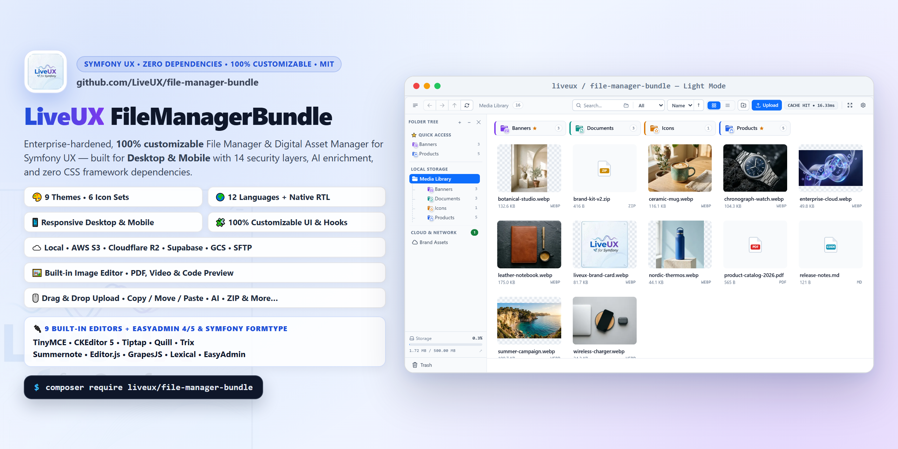
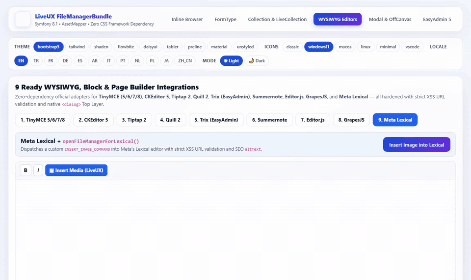

  <picture>
    <source media="(prefers-color-scheme: dark)" srcset="../images/banner-dark.png">
    <source media="(prefers-color-scheme: light)" srcset="../images/banner-light.png">
    
  </picture>

# LiveUX FileManagerBundle — التوثيق العربي

**اللغة:** [English](../en/README.md) · [Türkçe](../tr/README.md) · [Français](../fr/README.md) · [Deutsch](../de/README.md) · [Español](../es/README.md) · **العربية** · [Italiano](../it/README.md) · [Português](../pt/README.md) · [Nederlands](../nl/README.md) · [Polski](../pl/README.md) · [日本語](../ja/README.md) · [简体中文](../zh_CN/README.md) · [الملف الرئيسي](../../README.md)

**LiveUX FileManagerBundle** هي حزمة حديثة وعالية الأداء ومصمّمة للمشاريع المؤسسية، توفّر **مدير ملفات ومدير أصول رقمية (DAM) مبنيّاً على Symfony UX**، متوافقاً مع Symfony 6.4 LTS و7.2+ و8.x (وإصدارات PHP 8.3+). تأتي الحزمة **دون أي اعتمادية على أطر CSS**، مع 14 طبقة أمان مدمجة ودعم عالمي لتعدد اللغات (12 لغة واجهة مدمجة، وتطبيع تلقائي للغات BCP-47 وPOSIX، ودعم أصيل لاتجاه RTL).

---

## المعاينة الحية ولقطات الشاشة

  

  

  

> **فيديو استعراضي بدقة Full HD (1080p، نحو 3 دقائق، 10 فصول)** لمنصة YouTube والإصدارات: [YouTube (1080p)](https://www.youtube.com/watch?v=H2CAf0RiDd8) · [`docs/images/demo-youtube-showcase.mp4`](../images/demo-youtube-showcase.mp4) · معاينة قصيرة: [`docs/images/demo-showcase.mp4`](../images/demo-showcase.mp4)

| الوضع الفاتح (`Light`) | الوضع الداكن (`Dark`) |
| :---: | :---: |
|  |  |

| تخصيص لون المجلد وأيقونته | نافذة حول (`LiveUX`) |
| :---: | :---: |
|  |  |

### عروض محررات النصوص المنسّقة وEasyAdmin والنماذج الديناميكية (GIF)

| TinyMCE 5/6/7/8 | CKEditor 5 |
| :---: | :---: |
|  |  |

| Tiptap 2 (ProseMirror) | Quill 2 |
| :---: | :---: |
|  |  |

| Trix (`TextEditorField` في EasyAdmin) | Summernote |
| :---: | :---: |
|  |  |

| Editor.js (محرر الكتل) | GrapesJS (منشئ الصفحات المرئي) |
| :---: | :---: |
|  |  |

| Meta Lexical | EasyAdmin 4/5 (`FileManagerField`) |
| :---: | :---: |
|  |  |

| `CollectionType` و`LiveCollectionType` في Symfony |
| :---: |
|  |

---

## خارطة البدء السريع في دقيقتين

لست متأكداً من أين تبدأ؟ انتقل مباشرة إلى الدليل الذي يطابق هدفك:

- **التثبيت لأول مرة:** [01 — المتطلبات والتثبيت](01-requirements-and-installation.md) ← [02 — التهيئة وملفات التعريف](02-configuration-and-profiles.md)
- **إضافة منتقي صور أو معرض لـ Symfony Forms:** [05 — تكامل FormType ومحررات النصوص](05-formtype-and-editor-integrations.md)
- **إحكام الأمان والصلاحيات (RBAC) لبيئة الإنتاج:** [06 — الأمان والصلاحيات](06-security-and-authorization.md)
- **الربط مع Supabase أو AWS S3 أو Cloudflare R2:** [07 — التخزين السحابي والتهيئة الديناميكية](07-cloud-storage-and-dynamic-config.md)
- **تخزين البيانات الوصفية عبر Doctrine ORM / DBAL:** [13 — تكامل Doctrine](13-doctrine-integration.md)
- **منع حذف أو نقل الأصول المرتبطة بسجلات قاعدة البيانات:** [10 — حارس استخدام الأصول](10-asset-usage-guard.md)

---

## فهرس التوثيق

| الفصل | الدليل | الملخص |
| :---: | :--- | :--- |
| **01** | [المتطلبات والاعتماديات والتثبيت](01-requirements-and-installation.md) | متطلبات PHP 8.3+ وSymfony 6.4 LTS و7.2+ و8.x، إضافات PHP (بما فيها `ext-exif` و`ext-zip`)، حزم Composer، إعداد AssetMapper وWebpack Encore، أمر `file-manager:doctor`، وبناء أول صفحة عاملة |
| **02** | [التهيئة وملفات التعريف (مرجع YAML)](02-configuration-and-profiles.md) | `defaults` و`volumes` و`profiles`، المسارات الديناميكية الخالية من التعارض (`{user_id}` و`{Y}/{m}`)، حدود الرفع والرفع المجزّأ، التسمية التلقائية، تحسين الصور وشروطها، الصور المصغرة، سلة المهملات، ZIP، 5 وصفات جاهزة للإنتاج، ومرجع مخطط YAML الكامل |
| **03** | [أوضاع الاستخدام وواجهة JavaScript API](03-usage-modes-and-js-api.md) | وضع التضمين المباشر `TwigComponent`، نافذة `<dialog>` المنبثقة ولوحة OffCanvas بأربعة اتجاهات، المرجع الكامل لدالة `window.LiveUXFileManager.open()`، أحداث DOM المخصّصة، دعم RTL/IME وإمكانية الوصول WCAG 2.1 AA، قوائم السياق، محرر الصور المدمج، واختصارات لوحة المفاتيح |
| **04** | [السمات ومجموعات الأيقونات والتخصيص](04-themes-icons-and-customization.md) | 9 سمات مدمجة متوافقة مع WCAG 2.1 AA (Bootstrap 5 وTailwind وShadcn وFlowbite 4 وDaisyUI 5 وTabler وPreline وMaterial وUnstyled)، الوضع الداكن التلقائي/اليدوي، 6 مجموعات أيقونات SVG (49 أيقونة واجهة + 14 أيقونة شارة)، دوال Twig المساعدة، و3 مستويات للتخصيص |
| **05** | [تكامل FormType ومحررات النصوص](05-formtype-and-editor-integrations.md) | حقل `FileManagerPickerType` (منتقي ملف مفرد ومعرض صور متعدد قابل للترتيب بسهولة مع حماية POST)، 5 أنماط مدمجة (`compact` و`card` و`dropzone` و`avatar` و`input`)، دعم `CollectionType` و`LiveCollectionType`، قوالب مخصّصة، TinyMCE وCKEditor 5 وTiptap، وحقل `FileManagerField` بـ 16 دالة في EasyAdmin |
| **06** | [الأمان والصلاحيات (RBAC)](06-security-and-authorization.md) | 17 صلاحية في Voter، كتابة Voters مخصّصة بنمط `unanimous`، قواعد جدار الحماية `security.yaml`، 14 طبقة دفاعية (CSRF، منع اجتياز المسار، 69 امتداداً / 47 نوع MIME، أداة `SvgSanitizer` بـ 55 وسماً، حماية SSRF ضد DNS rebinding، عزل الروابط الرمزية في `ConfinedLocalFilesystemAdapter`، روابط مشاركة موقّعة بـ HMAC، سجل التدقيق)، وتحصين Apache/Nginx |
| **07** | [التخزين السحابي (S3/R2/MinIO/Supabase) والتهيئة الديناميكية](07-cloud-storage-and-dynamic-config.md) | معمارية تعدد وحدات التخزين المحلية والسحابية، أدلة المزوّدين ([Supabase](cloud/supabase-storage.md)، [AWS S3](cloud/aws-s3.md)، [Cloudflare R2](cloud/cloudflare-r2.md)، [Backblaze B2](cloud/backblaze-b2.md)، [MinIO/RustFS](cloud/minio-rustfs.md)، [Google Cloud Storage](cloud/google-cloud-storage.md)، [SFTP وFlysystem المخصّص](cloud/sftp-and-custom-flysystem.md))، ومكوّن `FlysystemServiceLocatorPass`، وواجهة `ConfigProviderInterface`، وتخزين البيانات الوصفية المخصّص |
| **08** | [الأحداث وأوامر CLI والتخزين المؤقت واستكشاف الأخطاء](08-events-commands-cache-and-troubleshooting.md) | 9 أحداث نطاق (Domain Events) في Symfony، و10 أوامر طرفية (`doctor` و`stats` و`duplicates` و`ai:enrich` و`skills:install` وغيرها)، والتخزين المؤقت ثلاثي الطبقات وعزل HTTP 304/CDN المدرك للسياق، ونظام الترجمة العالمي بـ 12 لغة متوافق مع BCP-47/POSIX/RTL (493 مفتاحاً)، والأسئلة الشائعة |
| **09** | [تكامل Symfony AI والإثراء الذكي للبيانات](09-symfony-ai-integration.md) | واجهة `AssetEnricherInterface` بلا اعتماديات إجبارية، وجسر `symfony/ai-bundle` (OpenAI وGemini وClaude وOllama)، وميزة **✨ اقتراح بالذكاء الاصطناعي**، والمعالجة الدفعية عبر أمر `file-manager:ai:enrich`، وأمثلة المعالجة غير المتزامنة بـ Messenger، وفلترة رفض النماذج وحقن الأوامر بـ 11 لغة |
| **10** | [حارس استخدام الأصول (Asset Usage Guard)](10-asset-usage-guard.md) | عقد `AssetUsageCheckerInterface` الاختياري، وسياسات `warn` و`block`، والحماية المزدوجة على جانب الخادم (`enforce_server_side`) لعمليات **`delete` و`rename` و`move` و`overwrite`**، وأمثلة Doctrine لـ MySQL وPostgreSQL وSQLite |
| **11** | [دليل المساهمة وطلبات الدمج (Pull Requests)](11-contributing-and-pr-guide.md) | مسار عمل مبسّط لطلبات الدمج المفتوحة المصدر، وبوابة الجودة `composer qa` (PHPStan Level 8 وأكثر من 360 اختبار PHPUnit وأكثر من 37 اختبار JS)، وخط أنابيب GitHub Actions CI بـ 6 مهام، وإعداد حماية الفروع في GitHub |
| **12** | [دليل مهارات وكلاء الذكاء الاصطناعي (`SKILL.md` و`AGENTS.md`)](12-ai-agent-skills-guide.md) | 6 حزم `SKILL.md` معيارية لكل من Antigravity وClaude Code وCursor وGitHub Copilot وCodex وSymfony AI Mate، والتثبيت بأمر واحد `file-manager:skills:install`، والتحقق عبر CI |
| **13** | [تكامل Doctrine ORM وDBAL](13-doctrine-integration.md) | المحرّك المدمج `metadata.driver: 'doctrine'` (`DoctrineDbalMetadataStorage` — عمليات UPSERT ذرّية، فهرس `text_pattern_ops` لـ PostgreSQL، وحفظ دفعي `saveMany()`)، وتهجير الجداول العابر لقواعد البيانات، وربط الكيانات مع `FileManagerPickerType`، ومخزّن ORM مخصّص متوافق مع `ResetInterface`، ومزامنة قاعدة البيانات عند `ItemRenamedEvent` |
| **14** | [تقرير التدقيق الأمني ومراجعة المنطق وسجل التغييرات](../tr/14-guvenlik-denetim-ve-degisiklik-raporu.md) *(بالتركية فقط)* | تدقيق أمني سطراً بسطر (الجولات 1–18)، وعزل `{user_id}` متعدد المستأجرين بلا تعارض، وتحصين DI وVoter وParser وميزانية خطوات `<use>` في SVG وحماية CDN/انتحال المصدر، وعزل الروابط الرمزية، وفهرس `text_pattern_ops` وUPSERT الذرّي في PostgreSQL، وتدقيق التباين والتركيز لـ WCAG 2.1 AA في 9 سمات، ونوافذ الجوال، وسجل تدقيق الترجمة |

---

## أبرز المزايا المعمارية

- **سرعة هجينة بزمن استجابة 0ms:** تصيير فوري على الخادم عبر `TwigComponent` + ذاكرة تخزين مؤقت داخل المتصفح (`dirCache`) + جلب شجرة المجلدات الكاملة في طلب واحد. تتم التصفية والبحث والترتيب وترقيم الصفحات والتبديل بين الشبكة والقائمة وتوسيع المجلدات لحظياً دون طلبات AJAX إضافية.
- **بلا أي اعتمادية على أطر CSS وتوافق WCAG 2.1 AA:** تستخدم الواجهة بالكامل أصنافاً معزولة النطاق `.liveux-fm-*` ومتغيرات CSS مخصّصة (`--liveux-fm-*`). تعمل بسلاسة إلى جانب **Bootstrap 5 أو Tailwind CSS أو Shadcn/UI أو Flowbite 4 أو DaisyUI 5 أو Tabler أو Preline أو Material** أو **دون أي إطار CSS إطلاقاً** — مع انعدام تضارب الأنماط ودون الحاجة لأي تهيئة إضافية لـ Tailwind purge.
- **الطبقة العليا الأصلية `<dialog>` وتصميم ملائم للجوال أولاً:** تُعرض النوافذ المنبثقة (Modal) والألواح الجانبية (OffCanvas بالاتجاهات `start` و`end` و`top` و`bottom`) داخل الطبقة العليا للمتصفح (Top Layer)، وتتكيّف تلقائياً على شاشات الجوال إلى وضع ملء الشاشة (`100dvh`) أو لوح سفلي (Bottom Sheet) بمقبض سحب أصيل.
- **أمان مؤسسي من 14 طبقة:** صلاحيات RBAC عبر `Voter` في Symfony، وحماية CSRF (`X-LiveUX-FM-CSRF`)، و`PathNormalizer`، و`FileSecurityGuard`، و`SvgSanitizer` بـ 55 وسماً، و`RemoteUrlImporter` المحصّن ضد DNS rebinding، و`ConfinedLocalFilesystemAdapter` لعزل الروابط الرمزية، وحماية ضد قنابل فك الضغط وقنابل البكسل، وترويسات `CSP: sandbox` و`nosniff` مفعّلة افتراضياً.
- **بنية عالمية متعددة اللغات:** **12 لغة واجهة مدمجة** (`en` و`tr` و`fr` و`de` و`es` و`ar` و`it` و`pt` و`nl` و`pl` و`ja` و`zh_CN` بـ 493 مفتاحاً متزامناً لكل لغة)، وتطبيع تلقائي لصيغ BCP-47 وPOSIX `.UTF-8`، ورجوع مضمون للإنجليزية `'en'`، واتجاه RTL تلقائي (`dir="rtl"`) للعربية و14 لغة أخرى تكتب من اليمين إلى اليسار، وسلامة الإدخال المركّب CJK IME.
- **جاهزية تامة لتعدد الخوادم والسحابة:** محرّك مدمج `DoctrineDbalMetadataStorage` (يدعم `text_pattern_ops` في PostgreSQL وUPSERT ذرّي في MySQL/MariaDB/SQLite)، وFlysystem v3 (لـ S3 وR2 وSupabase وB2 وMinIO وGCS وSFTP)، وتوافق كامل مع `ResetInterface` لبيئات FrankenPHP وعمّال Symfony Messenger.

---

## قائمة التحقق للبدء في 5 دقائق

1. **تثبيت الحزمة:** `composer require liveux/file-manager-bundle`
2. **استيراد المسارات:** `config/routes/liveux_file_manager.yaml`
3. **تعريف ملفات التعريف:** `config/packages/liveux_file_manager.yaml`
4. **ملفات CSS وJS (دون تهيئة يدوية):** يتكفّل `autoimport` في Symfony UX بتحميل `core.css` و`file_manager_api.js` ووحدات تحكم Stimulus الثلاث تلقائياً عبر `assets/controllers.json` لكل من AssetMapper وWebpack Encore.
5. **حاوية النوافذ `DialogHost` (تلقائية):** يقوم `AutoInjectDialogHostSubscriber` بحقن `DialogHost` تلقائياً قبل وسم `</body>` في صفحات HTML الكاملة (`defaults.auto_inject_dialog_host: true`) — دون الحاجة لتعديل `base.html.twig`.
6. **فحص التثبيت:** `php bin/console file-manager:doctor`

> هل تستخدم Symfony UX لأول مرة؟ ابدأ خطوة بخطوة مع **[01 — المتطلبات والاعتماديات والتثبيت](01-requirements-and-installation.md)**.

---

**المنظمة:** [LiveUX على GitHub](https://github.com/LiveUX) · [المستودع](https://github.com/LiveUX/file-manager-bundle)  
**الرخصة:** MIT
