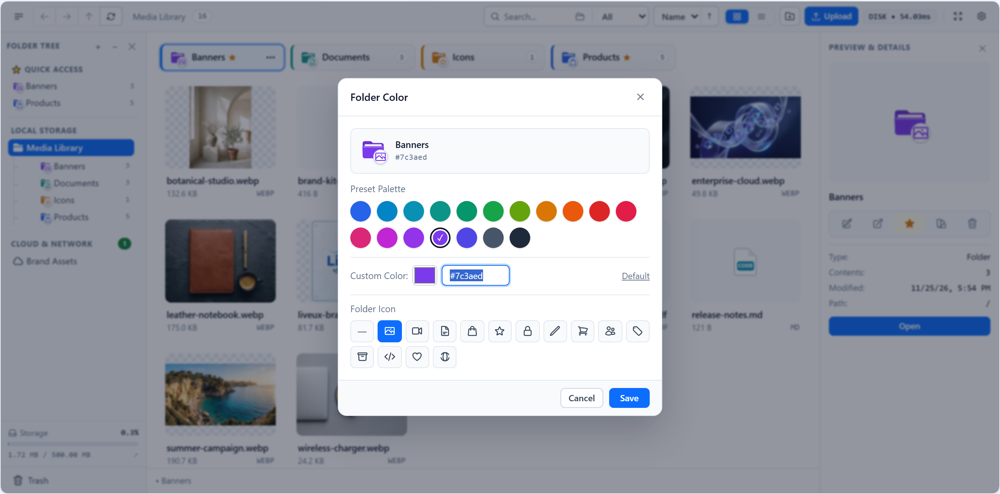

# 04 — Themes, Dark Mode, Ordner-Anpassung, Icon-Sets & Eigenes Design

[← Zurück: 03 — Nutzungsmodi & JS-API](03-usage-modes-and-js-api.md) | [Übersicht](README.md) | [Weiter: 05 — FormType- & Editor-Integrationen →](05-formtype-and-editor-integrations.md)

LiveUX FileManagerBundle wurde **zu 100 % ohne Abhängigkeiten von CSS-Frameworks** entwickelt. Egal ob Ihr Projekt **Bootstrap 5, Tailwind CSS v3/v4, Shadcn/UI, Flowbite 4, DaisyUI 5, Tabler, Preline, Material** oder **gar kein CSS-Framework** verwendet – der Dateimanager funktioniert sofort out-of-the-box und ganz ohne zusätzliche Build-Schritte (kein Tailwind `@source` und keine Purge-Konfiguration erforderlich).

> **Auf einen Blick: Was Sie in diesem Leitfaden lernen**  
> 1. **9 integrierte Themes & Dark Mode:** Passen Sie das Erscheinungsbild und Farbschema mit einer einzigen YAML-Option an Ihre Anwendung an.  
> 2. **Ordnerfarben & Ordner-Icons (Badges):** Personalisieren Sie Ordner direkt über die Benutzeroberfläche oder programmatisch per PHP/Datenbank mit über 18 Farben und 14 integrierten Badges (sowie beliebig vielen eigenen SVG-Badges).  
> 3. **Eigenes Icon-Set erstellen:** Schritt-für-Schritt-Anleitung für ein maßgeschneidertes Icon-Paket mit 9 Datei-Icons, 49 UI-Icons und unbegrenzten eigenen Ordner-Badges.  
> 4. **Eigenes Theme entwickeln (3 Freiheitsgrade):** Marken-Theming mit reinen CSS Custom Properties, gezielte Twig-Überschreibungen über `` oder ein zu 100 % eigenes Headless-Layout von Grund auf.

---

## 1. 9 integrierte Themes (Welches passt zu Ihrem Projekt?)

Themes lassen sich über `defaults.theme`, `profiles.<name>.ui.theme`, die TwigComponent-Prop `theme` oder die Option `theme` von `FileManagerPickerType` konfigurieren. **Alle 9 Themes erfüllen die WCAG-2.1-AA-Kontraststandards sowohl im Hell- als auch im Dunkelmodus.**

| Theme-Schlüssel | Optimal geeignet für | Design-Überblick |
| :--- | :--- | :--- |
| `bootstrap5` *(Standard)* | Bootstrap 5 und klassische Symfony-Admin-Panels | Klassisches Blau (`#0d6efd`), Radien `10px / 8px / 6px`, klare neutrale Rahmen |
| `tailwind` | Moderne Webanwendungen mit Tailwind CSS v3/v4 | Indigo-Akzent (`#6366f1`), weiche Radien `14px / 12px / 8px`, Slate-Farbpalette |
| `shadcn` | Minimalistische, monochrome Schwarz-Weiß-SaaS-Dashboards | Monochrome Zinc-Flächen (`#18181b` / `#fafafa` im Dark Mode), präzise `8px / 6px`-Kanten |
| `flowbite` | Admin-Oberflächen mit Flowbite 4 + Tailwind CSS | Flowbite-Blau (`#1a56db`) & Gray-50/800/900-Flächen, `8px`-Bedienelemente |
| `daisyui` | Projekte auf Basis von DaisyUI 5 | **Übernimmt automatisch** `--color-primary`, `--color-base-100/200/300` und `--radius-box`, sobald DaisyUI auf der Seite geladen ist |
| `tabler` | Tabler.io oder Enterprise-EasyAdmin-Backends | Enterprise-Slate-Hintergrund, blauer Akzent `#066fd1`, markante `4px / 6px`-Ecken |
| `preline` | Preline-UI-Anwendungen | Reine neutrale Flächen (`#fafafa` / `#171717`) mit kräftigem Blau-Akzent (`#2563eb`) |
| `material` | Anwendungen im Google-Material-Design-3-Stil | Tonale Lila-Flächen (`#6750a4` / `#f3edf7`) und vollständig abgerundete Pill-Buttons |
| `unstyled` | Vollständig eigenes CSS-Styling des Dateimanagers | Erbt Schriftart und transparente Flächen der Host-App, behält aber opake `--liveux-fm-elevated-bg`- / `--liveux-fm-elevated-text`-Kontraste für Popover und Lightboxen bei |

| Dark Mode (`bootstrap5` + Dark) | DaisyUI-5-Theme-Bridge (`daisyui`) |
| :---: | :---: |
|  |  |

> [!IMPORTANT]
> **Sicherheitsregel (YAML vs. dynamischer `theme`-Wert zur Laufzeit):**  
> - In `liveux_file_manager.yaml` können Sie jedes der 9 integrierten Themes, einen eigenen CSS-Theme-Namen (z. B. `'corporate'`, passend zu `/^[a-zA-Z0-9_-]{1,40}$/`) oder einen benutzerdefinierten Twig-Template-Pfad (z. B. `'file_manager/custom.html.twig'` oder `'@App/file_manager'`) konfigurieren.  
> - Aus Sicherheitsgründen akzeptieren dynamische `theme`-Werte aus dem Browser, aus URL-Query-Parametern oder über `window.LiveUXFileManager.open({ theme: ... })` **ausschließlich die 9 integrierten Theme-Schlüssel** (`FileManagerThemes::sanitizeDynamic()`).

---

## 2. Dark Mode, RTL & Reduzierte Bewegung

Alle 9 Themes (einschließlich `unstyled`) unterstützen **sowohl den automatischen als auch den manuellen Dark Mode**:

### A) Automatische Host-Erkennung (`color_scheme: 'auto'`)
Sobald auf Ihrer Seite (`<html>` oder `<body>`) eine der folgenden Angaben aktiv ist, wechseln Dateimanager, Modal-`<dialog>` und `FileManagerPickerType`-Felder sofort in den Dunkelmodus:
- `data-bs-theme="dark"` *(Bootstrap 5)*
- Klasse `.dark` *(Tailwind CSS / Shadcn / Flowbite / Preline)*
- `data-theme="dark"` *(DaisyUI / benutzerdefinierte Themes)*

### B) Standard- oder Profil-Farbschema per YAML
```yaml
liveux_file_manager:
    defaults:
        color_scheme: 'auto'          # 'auto' (folgt Host) | 'light' | 'dark'
    profiles:
        default:
            ui:
                color_scheme: 'dark'  # Nur dieses Profil im Dark Mode starten
```

### C) Benutzereinstellung (Einstellungsmenü: `Auto / Hell / Dunkel`)
Benutzer können mit einem Klick im Popover **⚙ Einstellungen** in der oberen Symbolleiste zwischen **Auto / ☀ Hell / 🌙 Dunkel** wechseln. Die Auswahl wird im `localStorage` des Browsers (`liveux_fm_color_scheme`) gespeichert.

### D) Globales RTL & `prefers-reduced-motion`
- `dir="rtl"` wird automatisch für 15 Rechts-nach-Links-Sprachen angewendet, darunter Arabisch (`ar`), Persisch (`fa`), Hebräisch (`he`) und Urdu (`ur`). Alle Abstände in `core.css` nutzen logische CSS-Eigenschaften (`inset-inline`, `padding-inline`, `border-inline-end`).
- Animationen werden automatisch minimiert, wenn im Betriebssystem des Benutzers *„Bewegung reduzieren“* (`prefers-reduced-motion: reduce`) aktiviert ist.

---

## 3. Ordnerfarben & Ordner-Icons (Badges) zuweisen (Schritt für Schritt)



Jedem Ordner lassen sich eine eigene **Farbe**, ein **Badge-Icon** sowie ein **Angepinnt-Status (⭐ Anpinnen)** zuweisen. Diese Funktionen sind aktiv, sobald `defaults.metadata.enabled: true` gesetzt ist und der Benutzer über die Berechtigung `permissions.edit_metadata` verfügt.

### Methode 1: Über die Benutzeroberfläche (für Endbenutzer)
1. Machen Sie einen **Rechtsklick** auf einen beliebigen Ordner und wählen Sie **Anpassen** (oder drücken Sie **`I`** bei ausgewähltem Ordner bzw. klicken Sie im rechten Inspector-Panel auf **Anpassen**).
2. Im Dialog **Anpassen** stehen drei Optionen mit Live-Vorschau zur Verfügung:
   - **Farbpalette mit 18 Voreinstellungen:** Blau (`#2563eb`), Himmelblau (`#0284c7`), Cyan (`#0891b2`), Petrol (`#0d9488`), Smaragd (`#059669`), Grün (`#16a34a`), Limette (`#65a30d`), Bernstein (`#d97706`), Orange (`#ea580c`), Rot (`#dc2626`), Rosé (`#e11d48`), Pink (`#db2777`), Fuchsia (`#c026d3`), Lila (`#9333ea`), Violett (`#7c3aed`), Indigo (`#4f46e5`), Schiefer (`#475569`), Anthrazit (`#1e293b`).
   - **Eigener Farbwähler + HEX-Eingabe:** Wählen Sie eine beliebige Markenfarbe über den nativen Farbwähler oder geben Sie direkt einen `#RRGGBB`-Hex-Code ein. Mit **Auf Standard zurücksetzen** entfernen Sie das benutzerdefinierte Styling.
   - **Ordner-Icon-(Badge-)Raster:** Zeigt alle **14 integrierten Badges** (`archive`, `bag`, `cart`, `code`, `doc`, `globe`, `heart`, `image`, `lock`, `pen`, `star`, `tag`, `users`, `video`) sowie alle eigenen SVG-Dateien aus dem Verzeichnis `badges/` Ihres Icon-Sets an.
3. Klicken Sie auf **Speichern** – der Ordner wird sofort sowohl in der Raster-/Listenansicht als auch im linken Ordnerbaum aktualisiert.

### Methode 2: Programmatisch per PHP (z. B. beim Anlegen eines neuen Kundenordners)
Mit `FolderMetadataStorageInterface` und `PathNormalizer::buildCanonicalKey()` können Sie Farben, Badges und Pins direkt im PHP-Code setzen (derselbe Code funktioniert nahtlos sowohl mit dem Treiber `json_file` als auch mit `doctrine`):

```php
<?php
// src/Service/CustomerFolderInitializer.php

declare(strict_types=1);

namespace App\Service;

use LiveUX\FileManagerBundle\Config\ConfigProviderInterface;
use LiveUX\FileManagerBundle\Metadata\FolderMetadata;
use LiveUX\FileManagerBundle\Metadata\FolderMetadataStorageInterface;
use LiveUX\FileManagerBundle\Security\PathNormalizer;
use LiveUX\FileManagerBundle\Storage\VolumeRegistry;

final readonly class CustomerFolderInitializer
{
    public function __construct(
        private ConfigProviderInterface $configProvider,
        private VolumeRegistry $volumeRegistry,
        private PathNormalizer $pathNormalizer,
        private FolderMetadataStorageInterface $metadataStorage,
    ) {
    }

    public function decorateInvoiceFolder(string $relativeFolderPath): void
    {
        $profile = $this->configProvider->getProfile('default');
        $volume = $this->volumeRegistry->getVolumeForProfile($profile, 'local_uploads');

        // Kanonischen Schlüssel erzeugen (z. B. "local::invoices/2026")
        $canonicalKey = $this->pathNormalizer->buildCanonicalKey($volume, $relativeFolderPath, $profile->basePath);

        $this->metadataStorage->save($canonicalKey, new FolderMetadata(
            color: '#0d9488',   // Petrol (#RRGGBB)
            icon: 'lock',       // Eines der 14 integrierten Badges oder eigenes badges/invoice.svg -> 'invoice'
            pinned: true,       // Zu ⭐ Angepinnte Ordner in der Seitenleiste hinzufügen
        ));
    }
}
```

### Methode 3: Direkt in `metadata.json` (bei Verwendung von `driver: 'json_file'`)
```json
{
    "local::products": { "color": "#2563eb", "icon": "bag",   "pinned": true  },
    "local::images":   { "color": "#0d9488", "icon": "image", "pinned": false },
    "local::invoices": { "color": "#64748b", "icon": "lock",  "pinned": false }
}
```

---

## 4. Icon-Sets & ein eigenes Icon-Set von Grund auf erstellen

**Jedes einzelne Icon** im Bundle – Dateitypen, Ordner, obere Symbolleiste, Kontextmenü, Cloud-Laufwerk-Indikatoren, Inspector-Panel und Ordner-Badges – wird zentral über die `IconSetRegistry` bereitgestellt. Die 6 integrierten Icon-Sets werden für 24 Stunden per PSR-6 gecacht (`liveux_fm_iconset_*`).

### 6 integrierte Icon-Sets (`profiles.<name>.ui.icon_set`)
| Icon-Set | Visueller Stil | Standard-Ordnerfarbe (`meta.json`) |
| :--- | :--- | :--- |
| `classic` *(Standard)* | Flache, gestochen scharfe Vektor-Icons | `#2563eb` |
| `windows11` | Zweifarbige, warmgelbe Ordner im Windows-11-Stil und moderne Dokument-Icons | `#f59e0b` |
| `macos` | Sanft blaue Ordner im Stil des macOS Finders | `#3b82f6` |
| `linux` | Klares Open-Source-Design im GNOME-/Adwaita-Stil | `#3584e4` |
| `minimal` | Minimalistische Icons mit feinen Linien (Outline) | `#475569` |
| `vscode` | Präzise, entwicklerorientierte Icons im VS-Code-Stil | `#dcb67a` |

### Schritt für Schritt: Ein eigenes Icon-Set erstellen

#### Schritt 1: Ein Icon-Verzeichnis im Projekt anlegen
Erstellen Sie beispielsweise `assets/fm-icons/`. **Sie müssen keine Icons kopieren, die Sie nicht verändern möchten** – jedes fehlende Icon fällt automatisch auf die integrierten Sets `classic` / `_ui` / `_folder_badges` zurück!

```text
assets/fm-icons/
├── meta.json               # Standard-Ordnerfarbe: { "defaultFolderColor": "#7c3aed" }
├── folder.svg              # (Optional) Eigenes Haupt-Ordner-Icon
├── pdf.svg                 # (Optional) Nur das PDF-Icon überschreiben
├── ui/                     # (Optional) Icons für Symbolleiste, Kontextmenü & Volumes überschreiben oder ergänzen
│   ├── upload.svg          # Upload-Icon überschreiben
│   ├── new_folder.svg      # „Neuer Ordner“-Icon überschreiben
│   └── company_cloud.svg   # Neues eigenes Volume-Icon hinzufügen -> volumes.<name>.icon: 'company_cloud'
└── badges/                 # (Optional) Bestehende Ordner-Badges überschreiben oder NEUE ergänzen
    ├── lock.svg            # Integriertes Badge „lock“ überschreiben
    └── invoice.svg         # NEUES Badge hinzufügen -> erscheint automatisch im Dialog „Ordner anpassen“!
```

#### Schritt 2: `meta.json` und eine dynamisch einfärbbare `folder.svg` anlegen

> [!TIP]
> **Goldene Regel (`currentColor`):** Damit sich Ihre eigene `folder.svg` automatisch anpasst, sobald Benutzer eine Ordnerfarbe ändern, verwenden Sie **`fill="currentColor"`** (bzw. `stroke="currentColor"` bei Outline-Icons) statt fest codierter Hex-Farbwerte!

```json
// assets/fm-icons/meta.json
{
    "defaultFolderColor": "#7c3aed"
}
```

```xml
<!-- assets/fm-icons/folder.svg -->
<svg xmlns="http://www.w3.org/2000/svg" viewBox="0 0 24 24" fill="none">
    <path d="M3 6.5A2.5 2.5 0 0 1 5.5 4h4.17a2 2 0 0 1 1.42.59l1.32 1.32A2 2 0 0 0 13.83 6.5H18.5A2.5 2.5 0 0 1 21 9v8.5a2.5 2.5 0 0 1-2.5 2.5h-13A2.5 2.5 0 0 1 3 17.5v-11Z"
          fill="currentColor" fill-opacity="0.92"/>
</svg>
```

```xml
<!-- assets/fm-icons/badges/invoice.svg (Neues benutzerdefiniertes Ordner-Badge) -->
<svg xmlns="http://www.w3.org/2000/svg" viewBox="0 0 24 24" fill="none" stroke="currentColor" stroke-width="2" stroke-linecap="round" stroke-linejoin="round">
    <path d="M4 2v20l2-1 2 1 2-1 2 1 2-1 2 1 2-1 2 1V2l-2 1-2-1-2 1-2-1-2 1-2-1-2 1Z"/>
    <path d="M8 8h8M8 12h8M8 16h5"/>
</svg>
```

#### Schritt 3: Das YAML-Profil auf das Verzeichnis verweisen lassen
```yaml
# config/packages/liveux_file_manager.yaml
liveux_file_manager:
    volumes:
        company_disk:
            label: 'Firmenarchiv'
            icon: 'company_cloud' # Verwendet assets/fm-icons/ui/company_cloud.svg!
            driver: 'LocalFileSystem'
            path: '%kernel.project_dir%/public/uploads'
            url_prefix: '/uploads'

    profiles:
        default:
            volumes: ['company_disk']
            ui:
                icon_set: '%kernel.project_dir%/assets/fm-icons'
```

#### Sicherheit & Limits für benutzerdefinierte Icons (`IconSetRegistry`)
- Jede `.svg`-Datei darf maximal **256 KB** (`262.144` Bytes) groß sein und wird beim Laden automatisch durch den **`SvgSanitizer`** bereinigt (entfernt `<script>`, `on*`-Handler usw.).
- Sowohl `ui/` als auch `badges/` erfassen zusätzlich zu den integrierten Schlüsseln bis zu **200 eigene `.svg`**-Dateien.
- Eigene Dateinamen (ohne `.svg`) müssen dem Muster **`/^[a-zA-Z0-9_-]{1,32}$/`** entsprechen (ASCII-Buchstaben, Ziffern, `-` und `_`, maximal 32 Zeichen).

#### Vollständige Referenz überschreibbarer Icon-Schlüssel
- **9 Datei- & Ordner-Icons (Stammverzeichnis `<dir>/<key>.svg`):**  
  `folder`, `file`, `pdf`, `excel`, `word`, `zip`, `video`, `audio`, `code`
- **49 UI-Icons (`<dir>/ui/<key>.svg`):**
  - *Navigation & Layout:* `menu`, `back`, `forward`, `up`, `refresh`, `search`, `search_deep`, `grid`, `list`, `sort`, `fullscreen`, `exit_fullscreen`, `settings`, `close`, `more`, `sun`, `moon`
  - *Datei- & Ordneraktionen:* `new_folder`, `upload`, `cloud_upload`, `download`, `open`, `preview`, `edit_image`, `rename`, `move`, `duplicate`, `cut`, `copy`, `paste`, `trash`, `archive`, `select_all`, `link`, `share`, `color`, `tag`, `star`, `sparkles`, `quota`
  - *Speicher- & Cloud-Anbieter:* `disk`, `cloud`, `aws_s3`, `cloudflare_r2`, `supabase`, `backblaze_b2`, `minio`, `gcs`, `sftp`
- **14 integrierte Ordner-Badges (`<dir>/badges/<key>.svg`):**  
  `archive`, `bag`, `cart`, `code`, `doc`, `globe`, `heart`, `image`, `lock`, `pen`, `star`, `tag`, `users`, `video` *(plus beliebige eigene `*.svg`-Dateien!)*

---

## 5. Ein eigenes Theme erstellen (3 Freiheitsgrade)

`Browser.html.twig` löst den im Profil konfigurierten `theme`-Wert in dieser **exakten Prioritätsreihenfolge** auf:
1. Endet auf `.html.twig` → Rendert Ihr Twig-Template direkt (``).
2. Beginnt mit `@` → Rendert `layout.html.twig` innerhalb dieses Twig-Namespace (``).
3. Entspricht einem der 9 integrierten Themes → Rendert das integrierte Bundle-Theme.
4. Jeder andere kurze Bezeichner (z. B. `'corporate'`, passend zu `/^[a-zA-Z0-9_-]{1,40}$/`) → Umschließt das Standard-Basislayout mit `<div data-liveux-theme="corporate">`.

### Stufe 1: Marken-Theme mit reinen CSS-Variablen (Am schnellsten – ohne Templates!)

#### Vollständige Referenz der CSS Custom Properties (`--liveux-fm-*`)
| Kategorie | CSS-Variablen |
| :--- | :--- |
| **Typografie** | `--liveux-fm-font`, `--liveux-fm-mono` |
| **Flächen & Rahmen** | `--liveux-fm-bg`, `--liveux-fm-surface-muted`, `--liveux-fm-surface-subtle`, `--liveux-fm-hover`, `--liveux-fm-border`, `--liveux-fm-border-strong`, `--liveux-fm-border-hover` |
| **Textfarben** | `--liveux-fm-text`, `--liveux-fm-text-secondary`, `--liveux-fm-text-muted`, `--liveux-fm-elevated-bg`, `--liveux-fm-elevated-text` |
| **Marken-Akzentfarben** | `--liveux-fm-accent`, `--liveux-fm-accent-hover`, `--liveux-fm-accent-fg`, `--liveux-fm-accent-soft`, `--liveux-fm-accent-border`, `--liveux-fm-ring` |
| **Semantische Statusfarben (WCAG AA)** | `--liveux-fm-danger`, `--liveux-fm-danger-hover`, `--liveux-fm-danger-solid`, `--liveux-fm-danger-soft`, `--liveux-fm-danger-border`, `--liveux-fm-success`, `--liveux-fm-success-solid`, `--liveux-fm-success-soft`, `--liveux-fm-warning`, `--liveux-fm-warning-soft` |
| **Radien & Schatten** | `--liveux-fm-radius-shell`, `--liveux-fm-radius-card`, `--liveux-fm-radius-ctrl`, `--liveux-fm-radius-modal`, `--liveux-fm-shadow-sm`, `--liveux-fm-shadow-card`, `--liveux-fm-shadow-float`, `--liveux-fm-shadow-modal`, `--liveux-fm-z-base` |

#### Sofort einsatzbereites Marken-Theme zum Kopieren (`assets/styles/app.css`)
```css
/* 1) Marken-Farbpalette für den Hellmodus (Light Mode) */
[data-liveux-theme="corporate"] {
    --liveux-fm-bg: #ffffff;
    --liveux-fm-surface-muted: #f8f7ff;
    --liveux-fm-surface-subtle: #ede9fe;
    --liveux-fm-hover: #f3f0ff;
    --liveux-fm-border: #ddd6fe;
    --liveux-fm-border-strong: #c4b5fd;
    --liveux-fm-text: #1e1b4b;
    --liveux-fm-text-secondary: #3b2f6e;
    --liveux-fm-text-muted: #6d28d9;
    --liveux-fm-accent: #7c3aed;
    --liveux-fm-accent-hover: #6d28d9;
    --liveux-fm-accent-fg: #ffffff;
    --liveux-fm-accent-soft: #f5f3ff;
    --liveux-fm-accent-border: rgba(124, 58, 237, 0.28);
    --liveux-fm-ring: rgba(124, 58, 237, 0.30);
    --liveux-fm-radius-shell: 16px;
    --liveux-fm-radius-card: 12px;
    --liveux-fm-radius-ctrl: 8px;
}

/* 2) Dark-Mode-Gegenstück (deckt Browser und FormType-Picker im automatischen & manuellen Dark Mode ab) */
[data-bs-theme="dark"] .liveux-fm-root:not([data-fm-color-scheme="light"]) [data-liveux-theme="corporate"],
.dark .liveux-fm-root:not([data-fm-color-scheme="light"]) [data-liveux-theme="corporate"],
[data-theme="dark"] .liveux-fm-root:not([data-fm-color-scheme="light"]) [data-liveux-theme="corporate"],
[data-bs-theme="dark"] [data-liveux-theme="corporate"].liveux-fm-picker:not([data-fm-color-scheme="light"]),
.dark [data-liveux-theme="corporate"].liveux-fm-picker:not([data-fm-color-scheme="light"]),
[data-theme="dark"] [data-liveux-theme="corporate"].liveux-fm-picker:not([data-fm-color-scheme="light"]),
.liveux-fm-picker[data-fm-color-scheme="dark"][data-liveux-theme="corporate"],
[data-fm-color-scheme="dark"] [data-liveux-theme="corporate"] {
    --liveux-fm-bg: #13111c;
    --liveux-fm-surface-muted: #1b1829;
    --liveux-fm-surface-subtle: #242038;
    --liveux-fm-hover: #2d2846;
    --liveux-fm-border: #2e2948;
    --liveux-fm-text: #ede9fe;
    --liveux-fm-text-secondary: #d8d0fc;
    --liveux-fm-text-muted: #a78bfa;
    --liveux-fm-accent: #a78bfa;
    --liveux-fm-accent-hover: #8b5cf6;
    --liveux-fm-accent-fg: #13111c;
    --liveux-fm-accent-soft: rgba(167, 139, 250, 0.16);
}
```

```yaml
# config/packages/liveux_file_manager.yaml
liveux_file_manager:
    defaults:
        theme: 'corporate'
```

---

### Stufe 2: Partielle Überschreibungen mit Twig `` (Empfohlen!)

Das Basislayout ist in **10 ``-Bereiche** und **7 modulare Partials (`parts/`)** gegliedert. So können Sie beispielsweise nur die obere Leiste oder den Footer anpassen, ohne das gesamte Template zu duplizieren:

| Blockname | Bereich | Standard-Partial |
| :--- | :--- | :--- |
| `fm_shell` | Äußerer Shell-Wrapper (`.liveux-fm-shell`) | Umschließt alle verschachtelten Blöcke |
| `fm_topbar` | Obere Befehlsleiste (Navigation, Breadcrumbs, Suche, Sortierung, Aktionen) | `parts/_topbar.html.twig` |
| `fm_settings_popover` | Einstellungs-Popover (Farbmodus, Elementgröße, Ordnerstil, Cache, Tastenkürzel) | `parts/_settings_popover.html.twig` |
| `fm_banners` | Status-Benachrichtigungsbanner + Upload-Warteschlange | Inline-Markup |
| `fm_body` | Hauptbereich in der Mitte (Wrapper für Seitenleiste + Hauptansicht + Inspector) | `.liveux-fm-body` |
| `fm_sidebar` | Linker Ordnerbaum + angepinnte Ordner + Kontingent-Anzeige + Papierkorb | `parts/_sidebar.html.twig` |
| `fm_main` | Datei-Raster/-Liste + schwebende Auswahl-/Zwischenablage-Leiste + Dropzone + Paginierung | `parts/_main.html.twig` |
| `fm_inspector` | Rechtes Vorschau- & Metadaten-Inspector-Panel | `parts/_inspector.html.twig` |
| `fm_footer` | Footer-Leiste für Modal / OffCanvas | `parts/_footer.html.twig` |
| `fm_overlays` | Kontextmenü, Modal, Lightbox sowie Vorlagen für Tastenkürzel & Info-Dialog | `parts/_overlays.html.twig` |

#### Beispiel — Kopfzeile im Unternehmensdesign + eigener Auswahl-Footer
```twig
{# templates/file_manager/corporate_layout.html.twig #}



    <div style="padding: 6px 12px; background: #1e293b; color: #f8fafc; font-size: 0.75rem; display: flex; justify-content: space-between; align-items: center;">
        <span>📁 Zentrales Unternehmens-Medienarchiv</span>
        <span>Profil: <strong>{{ this.profile }}</strong></span>
    </div>
    {{ parent() }}



    
        <div class="liveux-fm-footer">
            <span class="liveux-fm-muted" data-{{ ctrl }}-target="footerStatus"></span>
            <div class="liveux-fm-row-sm">
                <button type="button" class="liveux-fm-btn" data-action="{{ ctrl }}#closeDialog">Abbrechen</button>
                <button type="button" class="liveux-fm-btn liveux-fm-btn-primary"
                        data-{{ ctrl }}-target="confirmSelectionBtn"
                        data-action="{{ ctrl }}#confirmSelection">Auswahl bestätigen</button>
            </div>
        </div>
    

```

```yaml
# config/packages/liveux_file_manager.yaml
liveux_file_manager:
    profiles:
        default:
            ui:
                # 1) Direkter .html.twig-Template-Pfad:
                theme: 'file_manager/corporate_layout.html.twig'
                # 2) Oder ein Twig-Namespace-Verzeichnis (lädt automatisch layout.html.twig darin):
                # theme: '@App/file_manager'
```

---

### Stufe 3: Zu 100 % eigenes Headless-Layout von Grund auf (Erforderliche Stimulus-Targets)

Wenn Sie Ihre eigene HTML-Struktur komplett ohne `` aufbauen möchten, binden Sie einfach diese `data-{{ ctrl }}-target`-Attribute mit dem Präfix `ctrl = 'liveux--file-manager-bundle--browser'` ein:

| Target (`data-...-target`) | Erforderlich? | Zweck |
| :--- | :---: | :--- |
| `shell` | Empfohlen | Elementgrößen-Skalierung (`--liveux-fm-card-min`), `data-size-tier`, `data-folder-style`, `data-sidebar-open` |
| `contentArea` | **Erforderlich** | Hauptfläche, in der Datei-/Ordnerkarten und Listenzeilen gerendert werden |
| `modalBackdrop`, `modalTitle`, `modalBody` | **Erforderlich** | Dialog-Container für die Modale „Neuer Ordner“, „Hochladen“, „Löschen“, „Anpassen“, „Kontingent“ und „Metadaten“ |
| `breadcrumbs` | Empfohlen | Klickbare Pfad-Breadcrumb-Navigation |
| `confirmSelectionBtn`, `footerStatus` | Empfohlen (Modal/OffCanvas) | Schaltfläche zum Bestätigen der Auswahl (automatisch `disabled`, wenn nichts ausgewählt ist) sowie Statusanzeige |
| `statusBanner`, `uploadQueue` | Empfohlen | Fehler-/Erfolgsmeldungen und Fortschrittsanzeige für Chunked-Uploads |
| `tree` + `sidebar` + `pinnedFolders` | Optional | Linker Ordnerbaum und angepinnte Ordner |
| `contextMenu` | Optional | Container für das Rechtsklick-Kontextmenü |
| `inspector` | Optional | Rechtes Vorschau- & Metadaten-Panel |
| `lightbox`, `lightboxStage`, `lightboxCaption`, `lightboxCounter`, `lightboxControls` | Optional | Universelle Medienvorschau-Lightbox |

---

## 6. 7 Twig-Hilfsfunktionen für eigene Templates

| Twig-Funktion | Zweck | Anwendungsbeispiel |
| :--- | :--- | :--- |
| `liveux_fm_icon(key, iconSet, size, class, group, fallbackKey)` | Rendert ein XSS-sicheres Inline-SVG (kein `\|raw` nötig). `group`: `'ui'`, `'icons'`, `'badges'`. | `{{ liveux_fm_icon('upload', this.resolvedIconSet, 14, '', 'ui', 'file') }}` |
| `liveux_fm_thumb_url(profile, volume, path, w, h)` | Erzeugt eine sichere Thumbnail-URL für eine Datei. | `` |
| `liveux_fm_download_url(profile, volume, path, inline)` | Erzeugt eine sichere Download- oder Inline-Vorschau-URL. | `<a href="{{ liveux_fm_download_url('default', 'customer_vault', 'invoice.pdf', false) }}">Herunterladen</a>` |
| `liveux_fm_trans(key, params, locale)` | Übersetzt einen Bundle-Übersetzungsschlüssel mit garantiertem `'en'`-Fallback. | `{{ liveux_fm_trans('ui.upload', {}, 'de') }}` |
| `liveux_fm_bcp47_locale(locale)` | Wandelt PHP-/ICU-Locale-Codes wie `de_DE.UTF-8` in gültige HTML-`lang="..."`-BCP-47-Tags (`de-DE`) um. | `<div lang="{{ liveux_fm_bcp47_locale(fmLocale) }}">` |
| `liveux_fm_is_rtl(locale)` | Gibt `true` zurück, wenn die angegebene Sprache rechtsläufig ist (Arabisch, Persisch, Hebräisch usw.). | `dir="{{ liveux_fm_is_rtl(fmLocale) ? 'rtl' : 'ltr' }}"` |
| `liveux_fm_normalize_field_items(value)` / `liveux_fm_describe_field_item(item)` | Normalisiert Formular-/EasyAdmin-Werte sicher in renderbare Bild-/Dateideskriptoren (blockiert `javascript:`-/`data:`-URLs). | EasyAdmin-Index-/Detail-Ansichten und eigene Templates |

---

[← Zurück: 03 — Nutzungsmodi & JS-API](03-usage-modes-and-js-api.md) | [Übersicht](README.md) | [Weiter: 05 — FormType- & Editor-Integrationen →](05-formtype-and-editor-integrations.md)
