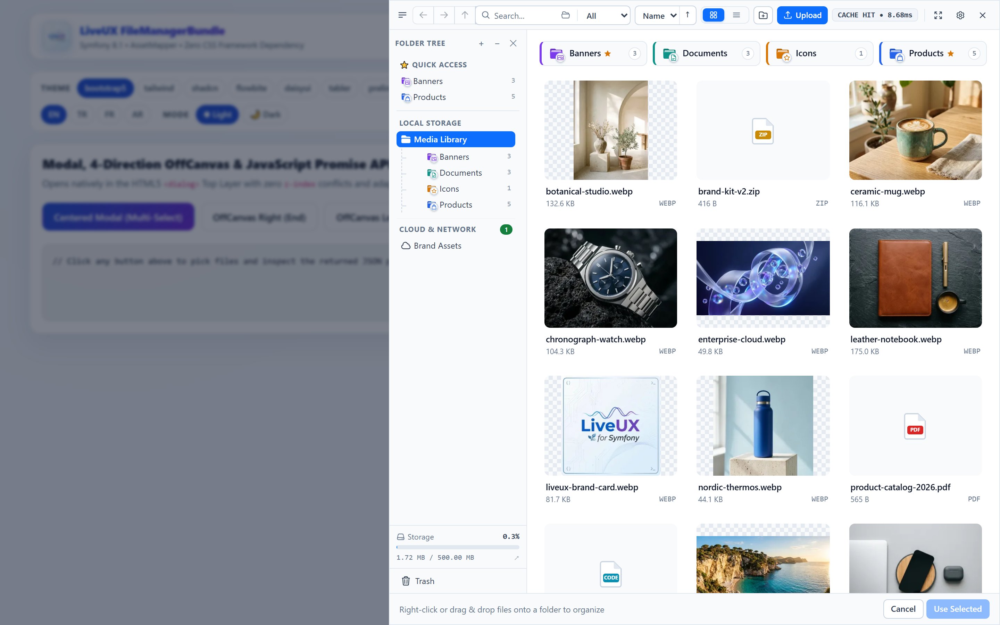

# 03 — Usage Modes & JavaScript API

[← Previous: 02 — Configuration & Profiles](02-configuration-and-profiles.md) | [Documentation Index](README.md) | [Next: 04 — Themes, Icon Sets & Customization →](04-themes-icons-and-customization.md)

You can embed LiveUX FileManagerBundle **inline** inside any page, open it in a centered **Modal**, slide it out as a 4-way **OffCanvas** drawer, or invoke it programmatically from anywhere using the **JavaScript Promise API**.

> [!TIP]
> **Which mode should I choose?**  
> - **Inline:** Dedicated *"Media Library"* pages where the file manager fills the main content area.  
> - **Modal:** Centered dialog triggered by a *"Choose Image"* button while editing a product or article—closes as soon as the user selects an asset.  
> - **OffCanvas:** Modern slide-over panel from any edge (`start`, `end`, `top`, `bottom`) that keeps your form visible in the background.  
> - **JavaScript API (`window.LiveUXFileManager.open()`):** Trigger the picker from any custom HTML button, React/Vue/Alpine component, or vanilla JS workflow without Symfony Forms.

---

## 1. Inline Mode — TwigComponent


Embedding a full inline file manager takes a single Twig call. Wrap it in a container with an explicit height (such as `680px` or `calc(100vh - 140px)`):

```twig
<div style="height: 680px;">
    {{ component('LiveUX:FileManager:Browser', {
        profile: 'default',
        mode: 'inline'
    }) }}
</div>
```

Or using Symfony UX's `<twig:...>` component tag syntax:

```twig
<div style="height: 680px;">
    <twig:LiveUX:FileManager:Browser
        profile="products"
        mode="inline"
        theme="flowbite"
        iconSet="macos"
        typeFilter="image"
        locale="en"
    />
</div>
```

### All `Browser` Component Props

| Prop | Type | Default | Description |
| :--- | :--- | :--- | :--- |
| `profile` | `string` | `'default'` | Profile key defined in `liveux_file_manager.yaml`. |
| `volume` | `?string` | `null` | Initial volume key (`null` opens the profile's first volume). |
| `path` | `string` | `''` | Initial subdirectory (e.g., `'products/2026'`). |
| `multiple` | `bool` | `false` | Enables multi-file selection mode. |
| `mode` | `string` | `'inline'` | `'inline'`, `'modal'`, or `'offcanvas'`. |
| `typeFilter` | `string` | `'all'` | Initial type filter: `'all'`, `'folder'`, `'image'`, `'doc'`, or `'video'`. |
| `theme` | `?string` | `null` | Runtime theme override (accepts the 9 built-in themes: `bootstrap5`, `tailwind`, `shadcn`, `flowbite`, `daisyui`, `tabler`, `preline`, `material`, `unstyled`). Custom CSS/Twig themes are configured in YAML. |
| `iconSet` | `?string` | `null` | Runtime icon set override (`classic`, `windows11`, `macos`, `linux`, `minimal`, `vscode`). Custom SVG directories are configured in YAML. |
| `locale` | `?string` | `null` | Runtime locale override across all **12 built-in UI languages** (`en`, `tr`, `fr`, `de`, `es`, `ar`, `it`, `pt`, `nl`, `pl`, `ja`, `zh_CN`) or any BCP-47 / POSIX locale (e.g., `'ar'`, `'zh_Hans_CN'`). |

---

## 2. Modal & OffCanvas — Programmatic JavaScript Promise API

`DialogHost` is automatically injected into every full HTML response (`defaults.auto_inject_dialog_host: true`). You can call `window.LiveUXFileManager.open()` with `async/await` from any page.

### All `open(options)` Options

| Option | Type | Default | Description |
| :--- | :--- | :--- | :--- |
| `profile` | `string` | `'default'` | Profile name to open. |
| `volume` | `?string` | `null` | Initial storage volume key. |
| `path` | `string` | `''` | Initial folder path (e.g., `'banners'`). |
| `mode` | `'modal'\|'offcanvas'` | `'modal'` | Centered modal dialog or slide-over OffCanvas drawer. |
| `position` | `'start'\|'end'\|'top'\|'bottom'` | `'end'` | Edge to slide from when `mode: 'offcanvas'` (`start` = left, `end` = right; automatically mirrored in RTL locales). |
| `mobileMode` | `'auto'\|'fullscreen'\|'sheet'` | `null` *(profile)* | Overrides mobile viewport layout (`<= 767.98px`). |
| `multiple` | `bool` | `false` | `false` = single file, `true` = multiple files. |
| `type` / `filetype` | `'all'\|'folder'\|'image'\|'doc'\|'video'\|'media'` | `'all'` | Opens pre-filtered to a specific file category (`filetype` is a TinyMCE compatibility alias; `'media'` automatically maps to `'video'`). |
| `theme` | `?string` | `null` | Runtime override for any of the 9 built-in themes (custom Twig template paths are restricted to server-side YAML for security). |
| `iconSet` | `?string` | `null` | Runtime override for any of the 6 built-in icon sets. |
| `locale` | `?string` | `null` | Runtime locale override (`'en'`, `'tr'`, `'fr'`, `'de'`, `'ar'`, `'ja'`, `'zh_CN'`, etc.). |

### Real-World Example: Hidden `<input>` + Live Image Preview (No Symfony Form)

Drop this snippet into any HTML or Twig page and it works immediately:

```html
<!-- 1. Hidden field + live preview + trigger button -->
<div>
    <input type="hidden" id="cover-url" name="cover_url" value="">
    
    <br>
    <button type="button" id="cover-pick-btn">Choose Cover Image</button>
</div>

<script>
document.getElementById('cover-pick-btn').addEventListener('click', async () => {
    const selected = await window.LiveUXFileManager.open({
        profile: 'default',
        mode: 'offcanvas',
        position: 'end',
        mobileMode: 'auto',
        multiple: false,
        type: 'image',       // Open pre-filtered to images
        theme: 'shadcn',
        iconSet: 'windows11',
    });

    // User pressed ESC or closed the dialog without selecting anything
    if (selected.length === 0) {
        return;
    }

    const file = selected[0];
    document.getElementById('cover-url').value = file.url;

    const img = document.getElementById('cover-preview');
    if (file.isImage) {
        img.src = file.url;
        img.alt = file.meta?.alt || file.name;
        img.style.display = 'block';
    }
});
</script>
```

### Quick Mode Snippets

```html
<!-- Centered Modal -->
<button type="button" onclick="window.LiveUXFileManager.open({ mode: 'modal' })">Open Modal</button>

<!-- Right Slide-Over Drawer (OffCanvas) -->
<button type="button" onclick="window.LiveUXFileManager.open({ mode: 'offcanvas', position: 'end' })">Right Drawer</button>

<!-- Bottom Sheet Drawer (OffCanvas) -->
<button type="button" onclick="window.LiveUXFileManager.open({ mode: 'offcanvas', position: 'bottom' })">Bottom Drawer</button>
```

> [!NOTE]
> **Cancellation Behavior:** If the user dismisses the dialog without picking a file (`ESC`, close button, or backdrop click), the Promise **does not reject**—it cleanly resolves to an empty array (`[]`).
>
> **Mobile Responsiveness (`mobileMode` / `ui.mobile_dialog_mode`):** On viewports `<= 767.98px`, the dialog automatically adapts: in `'auto'` mode, modals and side drawers (`start`/`end`) open edge-to-edge full-screen (`100dvh`), while `bottom`/`top` drawers open as rounded native sheets with a drag handle. The left folder tree starts collapsed on mobile and slides out on tap.

| Desktop OffCanvas Panel (`position: 'end'`) | Mobile Bottom Sheet (`mobileMode: 'sheet'`) |
| :---: | :---: |
|  |  |

### Returned File Object Shape

`window.LiveUXFileManager.open()` resolves to an array of objects with the following shape:

```json
[
    {
        "kind": "file",
        "path": "products/matte-black-tumbler.webp",
        "url": "/uploads/products/matte-black-tumbler.webp",
        "name": "matte-black-tumbler.webp",
        "extension": "webp",
        "isImage": true,
        "meta": {
            "alt": "Matte black insulated stainless steel tumbler",
            "title": "Tumbler Pro",
            "caption": "500 ml vacuum-insulated bottle",
            "tags": ["tumbler", "drinkware"],
            "focalPoint": { "x": 0.5, "y": 0.4 }
        }
    }
]
```

*(Note: On `private: true` volumes, `url` points to the RBAC-protected `/_liveux-file-manager/download?...&inline=1` endpoint.)*

### Custom DOM Events

In addition to awaiting `window.LiveUXFileManager.open()`, you can subscribe to dialog lifecycle events directly on `window`:

| DOM Event (`window.addEventListener`) | When It Fires | `event.detail` Payload |
| :--- | :--- | :--- |
| `liveux:file-manager:open` | When a dialog open request is dispatched (bridge between `file_manager_api.js` and `dialog_controller.js`). | `open()` options + `requestId` |
| `liveux:file-manager:dialog-opened` | Once the dialog has opened and its content is mounted. | `{ mode, position, profile }` |
| `liveux:file-manager:selected` | When the user confirms a selection (or cancels the dialog). | `{ items: [...], requestId }` |

```javascript
window.addEventListener('liveux:file-manager:selected', (event) => {
    console.log('Selected items count:', event.detail.items.length);
});
```

---

## 3. Built-In End-User Features

- **Compact Context Menus:**
  - *On a file or folder:* Windows 11-style single-row SVG Quick Action Bar (`Cut`, `Copy`, `Rename`, `Download`/`Pin`, `Delete`) followed by grouped one-click actions (Preview, Edit Image, File Metadata & Focal Point, Extract ZIP, Copy URL, Create Share Link, Move/Copy, Clone, Folder Color & Icon).
  - *On empty space:* Top quick navigation strip (`← → ↑ ↻`), New Folder, Upload Here, Paste Here, Select All, Sort, and Items Per Page. *(Fullscreen, Keyboard Shortcuts, and About live inside the **⚙ Settings** menu in the toolbar.)*
  - *Mobile / Touch:* Opens as a touch-friendly bottom sheet via the `⋯` button on each card.
- **Universal Previewer (Lightbox v2) & Right Inspector:**
  - **Images:** Gallery navigation (`←`/`→`), zoom controls (`-` / `100%` / `+`), and focal point indicator.
  - **Video (`.mp4`, `.webm`, `.ogv`, `.mov`, `.m4v`):** Live `<video controls>` player in the Inspector + fullscreen Lightbox + `HTTP 206 Partial Content` seeking on private volumes (toggleable per profile via `ui.allow_video_preview`).
  - **PDF (`.pdf`):** Sandboxed `<iframe>` PDF viewer inside the Lightbox (toggleable via `ui.allow_pdf_preview`).
  - **Audio (`.mp3`, `.wav`, `.ogg`, `.m4a`, `.flac`, `.aac`) & Text/Code (`.txt`, `.md`, `.json`, `.yaml`, `.csv`, `.css`, `.sql`, etc. — 64 KB cap).**
  - In `inline` mode, **double-clicking** any previewable file (or pressing `Space`) opens the Lightbox immediately.
- **Smart Upload Queue (Pause / Resume / Confirmed Cancel):**
  - Upload files **or entire folder hierarchies** (`webkitGetAsEntry`) via drag-and-drop, or paste images straight from the clipboard with `Ctrl+V`.
  - Chunked uploads display live chunk counters (`2/5 • 40%`), one-click **Pause (`⏸`) / Resume (`▶`)**, confirmation-guarded **Cancel (`✕`)**, batch **Pause All / Cancel All**, and automatic server-side cleanup of partial temp chunks on cancellation.
- **Multi-Selection (Including Marquee Lasso), Clipboard & Deep Search:**
  - Click and drag on empty space to draw a **Marquee / Lasso selection rectangle** around multiple files and folders (hold `Ctrl`/`Cmd` to add to the current selection).
  - `Shift+Click` range selection, `Ctrl+Click` toggle selection, `Ctrl+A` select all, and `Ctrl+C`/`Ctrl+X`/`Ctrl+V` across folders and even across volumes.
  - **Sortable List Column Headers:** Click **Name**, **Type**, **Size**, or **Date** headers in List view to toggle ascending/descending sort.
  - **Live Card Size Slider & Folder Cards:** Adjust card sizing live (`96 px – 320 px`) and toggle between compact folder tiles (`tile`) and full-size folder cards (`card`) from the Settings (`⚙`) menu.
  - Toggle the Deep Search button in the search bar to search recursively across all subfolders, including `#tags` and `alt` metadata.
  - **⭐ Pinned Quick Access** folders in the sidebar, clickable **Storage Quota & Detailed Disk Usage** breakdown modal, and **Auto / Light / Dark** theme switcher.
- **0ms Image Resolution & Aspect Ratio Validation (`image_constraints`):** When dimension or aspect ratio rules (`1:1`, `16:9`, etc.) are configured, non-compliant images are rejected immediately in the browser before uploading (and re-verified server-side).
- **Editorial Metadata, Focal Point & Signed Share Links:**
  - Edit `alt`, `title`, `caption`, `#tags`, clickable `[x, y]` **Focal Point** picker, and optional **✨ Suggest with AI**.
  - Generate time-limited HMAC-signed share links (`15 min`, `1 hour`, `24 hours`, `7 days`, `30 days`).
- **Built-In Canvas Image Editor:** Freeform or aspect-locked (`1:1`, `4:3`, `16:9`) cropping, pixel resizing (`Max W`/`Max H`), output format (`JPEG`/`PNG`/`WebP`) & quality control, 90° rotation, horizontal/vertical flip, and Save as Copy / Overwrite.

| File Metadata & Focal Point (`I`) | Built-In Canvas Image Editor (`E`) |
| :---: | :---: |
|  |  |

- **Global i18n, RTL & Accessibility (WCAG 2.1 AA):**
  - **12 Built-In UI Languages & Automatic RTL (`dir="rtl"`):** Supports `en`, `tr`, `fr`, `de`, `es`, `ar`, `it`, `pt`, `nl`, `pl`, `ja`, and `zh_CN`. Arabic (`ar`), Persian (`fa`), Hebrew (`he`), Urdu (`ur`), and other RTL locales automatically flip layouts, breadcrumbs, sidebars, and OffCanvas edges using logical CSS (`inset-inline`, `margin-inline`).
  - **CJK / IME Safety:** Prevents `Enter` or shortcuts from firing prematurely while composing Chinese, Japanese, or Korean text (`event.isComposing`).
  - **Full Keyboard & Screen-Reader Accessibility:** Focus trapping (`Tab`/`Shift+Tab`) in modals and Lightbox, arrow-key navigation in context menus, `role="tree"` / `aria-expanded` / `aria-current` semantics, and automatic focus restoration on close.
- **Keyboard Shortcuts (Complete Reference):**
  - All shortcuts activate only when the file manager is focused, outside text inputs (`<input>`, `<textarea>`, `<select>`), and strictly respect the user's **Voter permissions** (`ui.keyboard_shortcuts: true`).
  - On macOS, **`Cmd (⌘)`** works seamlessly alongside `Ctrl`.
  - **International Keyboard & IME Protection:** Uses physical key codes (`event.code` `Key*`) with fallback character mapping so shortcuts work across non-QWERTY and non-Latin keyboard layouts, while staying silent during CJK IME composition (`isComposing`).

#### A. File & Folder Operations
| Shortcut | Action | Condition / Note |
| :--- | :--- | :--- |
| `N` | Create new folder | Outside Trash (`create_folder` permission) |
| `U` | Open upload dialog | Outside Trash (`upload` permission) |
| `F2` | Rename item | Single file or folder selected (`rename` permission) |
| `M` | Open Move / Copy dialog | 1 or more items selected (`move` or `copy` permission) |
| `D` | Clone (duplicate) file | **Single file** selected (`clone` permission) |
| `I` | **Folder:** Color & Icon / **File:** Metadata & Focal Point | Single item selected (`edit_metadata` permission) |
| `E` | Open built-in Canvas Image Editor | Single raster image (`.jpg`, `.jpeg`, `.png`, `.webp`) selected (`upload` permission) |
| `L` | Copy file URL to clipboard | Single file selected (`download` permission) |
| `S` | Open time-limited HMAC Share Link modal | Single file selected (`share` permission + `share.enabled: true`) |
| `Delete` | Delete selected items (trash or permanent) | 1 or more items selected (`delete` permission) |

#### B. Navigation & Preview
| Shortcut | Action | Condition / Note |
| :--- | :--- | :--- |
| `/` or `Ctrl + F` | Focus search input | When `show_search: true` (`Ctrl + F` also works inside inputs) |
| `←` `→` `↑` `↓` | Move between grid cards or list rows | — |
| `Enter` | **Folder:** open • **Single file:** open Lightbox in Inline mode, or confirm selection in Modal/OffCanvas mode | — |
| `Space` | Preview selected file in Lightbox | Single file selected |
| `Backspace` or `Alt + ↑` | Go up to parent directory | Inside a subfolder |
| `Alt + ←` / `Alt + →` | Navigate Back / Forward in history | Automatically mirrored in **RTL** locales (Arabic, Persian, Hebrew) |
| `R` | Refresh current directory from server (`?refresh=1`) | When `show_refresh_button: true` |

#### C. Selection, Clipboard & Layer Dismissal
| Shortcut | Action | Condition / Note |
| :--- | :--- | :--- |
| `Ctrl + A` | Select all visible items | Outside Trash |
| `Ctrl + C` / `Ctrl + X` | Copy / Cut selected items to clipboard | When no text is highlighted (`copy` / `move` permission) |
| `Ctrl + V` | Paste clipboard files/folders into current directory **or** upload an image/file directly from your OS clipboard | Also works while the Upload modal is open |
| `Shift + Click` / `Ctrl + Click` | Range selection / toggle individual items | You can also drag on empty space for Marquee (lasso) selection |
| `Esc` | **4-stage smart dismiss:** 1) Close open menu/modal/lightbox/settings/mobile drawer → 2) Clear selection → 3) Clear clipboard → 4) Exit inline fullscreen | Dismisses only the topmost layer per press |
| `Tab` / `Shift + Tab` | Cycle through interactive controls inside an open modal or Lightbox (focus trap) | — |

#### D. View & Help
| Shortcut | Action |
| :--- | :--- |
| `V` | Toggle between Grid and List view |
| `B` | Toggle left folder tree sidebar |
| `F` | Toggle fullscreen mode |
| `T` | Toggle Trash Bin view (when `trash.enabled: true`) |
| `?` or Arabic `؟` | Open keyboard shortcuts help modal |

#### E. Inside the Lightbox Preview
| Shortcut | Action |
| :--- | :--- |
| `←` / `→` | Previous / Next image *(automatically mirrored in RTL locales)* |
| `+`, `=`, or `Numpad +` | Zoom in |
| `-` or `Numpad -` | Zoom out |
| `0` or `Numpad 0` | Reset zoom to `100%` |
| `Esc` | Close Lightbox |

#### F. Inside an Open Context Menu
| Shortcut | Action |
| :--- | :--- |
| `↑` / `↓` | Move up / down through menu items |
| `Home` / `End` | Jump to first / last menu item |
| `Enter` / `Space` | Execute the focused menu action |
| `Tab` / `Esc` | Close the context menu |

---

[← Previous: 02 — Configuration & Profiles](02-configuration-and-profiles.md) | [Documentation Index](README.md) | [Next: 04 — Themes, Icon Sets & Customization →](04-themes-icons-and-customization.md)
