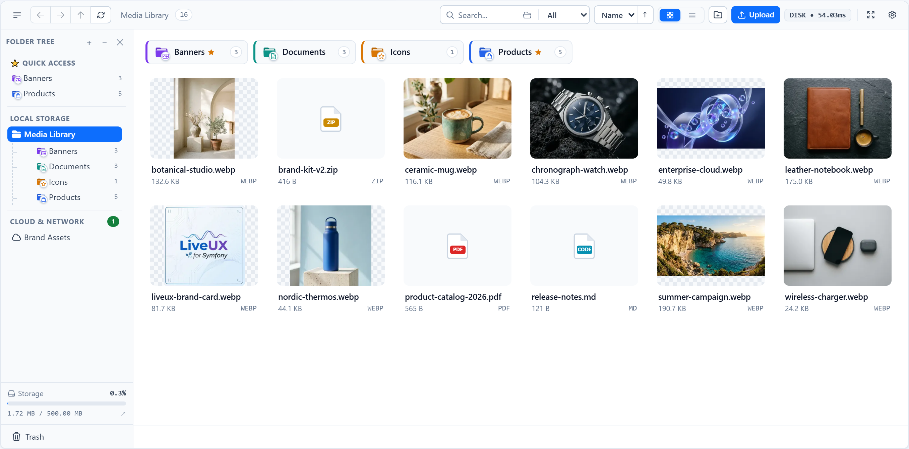

  <picture>
    <source media="(prefers-color-scheme: dark)" srcset="../images/banner-dark.png">
    <source media="(prefers-color-scheme: light)" srcset="../images/banner-light.png">
    
  </picture>

# LiveUX FileManagerBundle — Documentazione in italiano

**Lingua:** [English](../en/README.md) · [Türkçe](../tr/README.md) · [Français](../fr/README.md) · [Deutsch](../de/README.md) · [Español](../es/README.md) · [العربية](../ar/README.md) · **Italiano** · [Português](../pt/README.md) · [Nederlands](../nl/README.md) · [Polski](../pl/README.md) · [日本語](../ja/README.md) · [简体中文](../zh_CN/README.md) · [README principale](../../README.md)

**LiveUX FileManagerBundle** è un **Gestore file e Digital Asset Manager (DAM) per Symfony UX** moderno, ad alte prestazioni e di livello enterprise, progettato per Symfony 6.4 LTS, 7.2+ e 8.x (PHP 8.3+). Non richiede **alcun framework CSS**, integra 14 livelli di sicurezza nativi e offre supporto multilingua globale (12 lingue UI integrate, rilevamento locale BCP-47 / POSIX e RTL nativo).

---

## Anteprima interattiva e schermate

  

> **Video dimostrativo Full HD (1080p, ~3 min) in 10 capitoli** per YouTube e release: [`docs/images/demo-youtube-showcase.mp4`](../images/demo-youtube-showcase.mp4) · Anteprima breve: [`docs/images/demo-showcase.mp4`](../images/demo-showcase.mp4)

| Modalità chiara (`Light`) | Modalità scura (`Dark`) |
| :---: | :---: |
|  |  |

| Personalizzazione colore e icona cartella | Finestra Informazioni (`LiveUX`) |
| :---: | :---: |
|  |  |

### Demo editor Rich-Text, EasyAdmin e form dinamici (GIF)

| TinyMCE 5/6/7/8 | CKEditor 5 |
| :---: | :---: |
|  |  |

| Tiptap 2 (ProseMirror) | Quill 2 |
| :---: | :---: |
|  |  |

| Trix (`TextEditorField` di EasyAdmin) | Summernote |
| :---: | :---: |
|  |  |

| Editor.js (Editor a blocchi) | GrapesJS (Page Builder visuale) |
| :---: | :---: |
|  |  |

| Meta Lexical | EasyAdmin 4/5 (`FileManagerField`) |
| :---: | :---: |
|  |  |

| Symfony `CollectionType` e `LiveCollectionType` |
| :---: |
|  |

---

## Percorso rapido in 2 minuti

Non sai da dove iniziare? Vai subito alla guida che corrisponde al tuo obiettivo:

- **Prima installazione:** [01 — Requisiti e installazione](01-requirements-and-installation.md) → [02 — Configurazione e profili](02-configuration-and-profiles.md)
- **Aggiungere un selettore di immagini o gallerie a un Symfony Form:** [05 — FormType e integrazioni editor](05-formtype-and-editor-integrations.md)
- **Blindare sicurezza e RBAC per la produzione:** [06 — Sicurezza e autorizzazioni](06-security-and-authorization.md)
- **Collegare Supabase, AWS S3 o Cloudflare R2:** [07 — Archiviazione cloud e configurazione dinamica](07-cloud-storage-and-dynamic-config.md)
- **Salvare i metadati con Doctrine ORM / DBAL:** [13 — Integrazione con Doctrine](13-doctrine-integration.md)
- **Impedire eliminazione o spostamento di asset referenziati nel database:** [10 — Asset Usage Guard](10-asset-usage-guard.md)

---

## Indice della documentazione

| Capitolo | Guida | Panoramica |
| :---: | :--- | :--- |
| **01** | [Requisiti, dipendenze e installazione](01-requirements-and-installation.md) | Requisiti PHP 8.3+ / Symfony 6.4 LTS, 7.2+ e 8.x, estensioni PHP (incluse `ext-exif`, `ext-zip`), dipendenze Composer, configurazione AssetMapper e Webpack Encore, `file-manager:doctor` e prima pagina funzionante |
| **02** | [Configurazione e profili (Riferimento YAML)](02-configuration-and-profiles.md) | `defaults`, `volumes`, `profiles`, percorsi dinamici privi di collisioni (`{user_id}`, `{Y}/{m}`), limiti di caricamento e blocchi, normalizzazione nomi, ottimizzazione e vincoli immagini, miniature, Cestino, ZIP, 5 ricette pronte per la produzione e riferimento completo dello schema YAML |
| **03** | [Modalità d'uso e API JavaScript](03-usage-modes-and-js-api.md) | `TwigComponent` inline, Modale `<dialog>` e OffCanvas in 4 direzioni, riferimento completo di `window.LiveUXFileManager.open()`, eventi DOM personalizzati, accessibilità RTL/IME/WCAG 2.1 AA, menu contestuali, editor immagini integrato e scorciatoie da tastiera |
| **04** | [Temi, set di icone e personalizzazione](04-themes-icons-and-customization.md) | 9 temi WCAG 2.1 AA integrati (Bootstrap 5, Tailwind, Shadcn, Flowbite 4, DaisyUI 5, Tabler, Preline, Material, Unstyled), modalità scura automatica/manuale, 6 set di icone SVG (49 icone UI + 14 badge), helper Twig e 3 livelli di personalizzazione grafica |
| **05** | [FormType e integrazioni editor](05-formtype-and-editor-integrations.md) | `FileManagerPickerType` (selezione singola e galleria multi-immagine ordinabile e accessibile + protezione POST), 5 varianti integrate (`compact`, `card`, `dropzone`, `avatar`, `input`), `CollectionType` / `LiveCollectionType`, template personalizzati, TinyMCE, CKEditor 5, Tiptap e `FileManagerField` per EasyAdmin con 16 metodi |
| **06** | [Sicurezza e autorizzazioni (RBAC)](06-security-and-authorization.md) | 17 permessi Voter, Voter personalizzati in strategia `unanimous`, regole firewall di `security.yaml`, 14 livelli di difesa (CSRF, path traversal, 69 estensioni / 47 tipi MIME, `SvgSanitizer` a 55 tag, protezione SSRF contro DNS rebinding, confinamento symlink `ConfinedLocalFilesystemAdapter`, link di condivisione HMAC, audit log) e hardening Apache/Nginx |
| **07** | [Archiviazione cloud (S3/R2/MinIO/Supabase) e configurazione dinamica](07-cloud-storage-and-dynamic-config.md) | Architettura multi-volume locale/cloud, guide per provider ([Supabase](cloud/supabase-storage.md), [AWS S3](cloud/aws-s3.md), [Cloudflare R2](cloud/cloudflare-r2.md), [Backblaze B2](cloud/backblaze-b2.md), [MinIO/RustFS](cloud/minio-rustfs.md), [Google Cloud Storage](cloud/google-cloud-storage.md), [SFTP e Flysystem personalizzato](cloud/sftp-and-custom-flysystem.md)), `FlysystemServiceLocatorPass`, `ConfigProviderInterface` e archiviazione metadati personalizzata |
| **08** | [Eventi, comandi CLI, cache e risoluzione dei problemi](08-events-commands-cache-and-troubleshooting.md) | 9 eventi di dominio Symfony, 10 comandi console (`doctor`, `stats`, `duplicates`, `ai:enrich`, `skills:install`, ecc.), cache a 3 livelli e isolamento HTTP 304/CDN sensibile al contesto, sistema di traduzione globale in 12 lingue con BCP-47/POSIX/RTL (493 chiavi) e FAQ |
| **09** | [Integrazione Symfony AI e arricchimento intelligente](09-symfony-ai-integration.md) | `AssetEnricherInterface` senza dipendenze obbligatorie, bridge `symfony/ai-bundle` (OpenAI, Gemini, Claude, Ollama), **✨ Suggerisci con AI**, comando batch `file-manager:ai:enrich`, esempi asincroni con Messenger e filtraggio in 11 lingue contro rifiuti LLM e prompt injection |
| **10** | [Asset Usage Guard](10-asset-usage-guard.md) | Contratto opt-in `AssetUsageCheckerInterface`, policy `warn` / `block`, protezione server-side a doppio livello (`enforce_server_side`) per **`delete`, `rename`, `move` e `overwrite`**, ed esempi Doctrine per MySQL, PostgreSQL e SQLite |
| **11** | [Guida ai contributi e Pull Request](11-contributing-and-pr-guide.md) | Workflow open source per PR adatto anche ai principianti, quality gate `composer qa` (PHPStan Level 8, 360+ test PHPUnit, 37+ test JS), CI GitHub Actions a 6 job e configurazione GitHub Branch Protection |
| **12** | [Guida alle Skill per agenti AI (`SKILL.md` e `AGENTS.md`)](12-ai-agent-skills-guide.md) | 6 pacchetti modulari `SKILL.md` per Antigravity, Claude Code, Cursor, GitHub Copilot, Codex e Symfony AI Mate, installazione in un comando con `file-manager:skills:install` e validazione CI |
| **13** | [Integrazione Doctrine ORM e DBAL](13-doctrine-integration.md) | Driver integrato `metadata.driver: 'doctrine'` (`DoctrineDbalMetadataStorage` — UPSERT atomico, indice PostgreSQL `text_pattern_ops`, batch `saveMany()`), migrazioni multipiattaforma, Entity + `FileManagerPickerType`, storage ORM personalizzato compatibile con `ResetInterface` e sincronizzazione DB tramite `ItemRenamedEvent` |
| **14** | [Audit di sicurezza, revisione logica e changelog](../tr/14-guvenlik-denetim-ve-degisiklik-raporu.md) *(solo in turco)* | Audit di sicurezza riga per riga (cicli 1–18), isolamento multi-tenant disgiunto `{user_id}`, hardening DI/Voter/Parser/budget di passaggi SVG `<use>` e anti-spoofing CDN/origine, confinamento symlink, PostgreSQL `text_pattern_ops` e UPSERT atomico, verifica contrasto/focus WCAG 2.1 AA su 9 temi, finestre mobile e registro audit i18n |

---

## Punti di forza architetturali

- **Velocità ibrida 0ms:** `TwigComponent` SSR rapido + cache in memoria nel browser (`dirCache`) + albero completo delle cartelle in una sola richiesta. Filtri, ricerca, ordinamento, paginazione, cambio vista Griglia/Elenco ed espansione/compressione delle cartelle avvengono all'istante senza ulteriori chiamate AJAX.
- **Zero dipendenze da framework CSS e WCAG 2.1 AA:** L'intera interfaccia usa classi con prefisso isolato `.liveux-fm-*` e variabili CSS (`--liveux-fm-*`). Convive senza problemi con **Bootstrap 5, Tailwind CSS, Shadcn/UI, Flowbite 4, DaisyUI 5, Tabler, Preline, Material** o **senza alcun framework CSS**—senza collisioni di stile e senza configurazioni extra di purge per Tailwind.
- **Top Layer nativo HTML5 `<dialog>` ed ergonomia mobile-first:** Modali e OffCanvas (`start`, `end`, `top`, `bottom`) vengono renderizzati nel Top Layer del browser e si adattano automaticamente su mobile a schermo intero (`100dvh`) o come bottom sheet nativo con maniglia di trascinamento.
- **Sicurezza enterprise a 14 livelli:** RBAC tramite `Voter` Symfony, protezione CSRF (`X-LiveUX-FM-CSRF`), `PathNormalizer`, `FileSecurityGuard`, `SvgSanitizer` a 55 tag, `RemoteUrlImporter` protetto contro DNS rebinding, confinamento symlink `ConfinedLocalFilesystemAdapter`, protezione contro zip/pixel bomb e header `CSP: sandbox` + `nosniff` attivi di default.
- **Architettura multilingua globale:** **12 lingue UI integrate** (`en`, `tr`, `fr`, `de`, `es`, `ar`, `it`, `pt`, `nl`, `pl`, `ja`, `zh_CN` con 493 chiavi sincronizzate ciascuna), normalizzazione dei locale BCP-47 e POSIX `.UTF-8`, fallback garantito su `'en'`, RTL automatico (`dir="rtl"`) per l'arabo e altre 14 lingue RTL e gestione sicura della composizione IME CJK.
- **Pronto per multi-server e cloud:** `DoctrineDbalMetadataStorage` integrato (PostgreSQL `text_pattern_ops`, UPSERT atomico su MySQL/MariaDB/SQLite), Flysystem v3 (S3, R2, Supabase, B2, MinIO, GCS, SFTP) e compatibilità `ResetInterface` per worker FrankenPHP e Symfony Messenger.

---

## Checklist rapida in 5 minuti

1. **Installa il bundle:** `composer require liveux/file-manager-bundle`
2. **Importa le rotte:** `config/routes/liveux_file_manager.yaml`
3. **Definisci i profili:** `config/packages/liveux_file_manager.yaml`
4. **CSS e JS (Zero configurazione):** L'`autoimport` di Symfony UX carica automaticamente `core.css`, `file_manager_api.js` e tutti e 3 i controller Stimulus tramite `assets/controllers.json`, sia con AssetMapper sia con Webpack Encore.
5. **Dialog host (Automatico):** `AutoInjectDialogHostSubscriber` inserisce automaticamente `DialogHost` subito prima di `</body>` nelle pagine HTML complete (`defaults.auto_inject_dialog_host: true`), senza dover modificare `base.html.twig`.
6. **Verifica la configurazione:** `php bin/console file-manager:doctor`

> È la tua prima volta con Symfony UX? Inizia passo dopo passo da **[01 — Requisiti, dipendenze e installazione](01-requirements-and-installation.md)**.

---

**Organizzazione:** [LiveUX su GitHub](https://github.com/LiveUX) · [Repository](https://github.com/LiveUX/file-manager-bundle)  
**Licenza:** MIT
