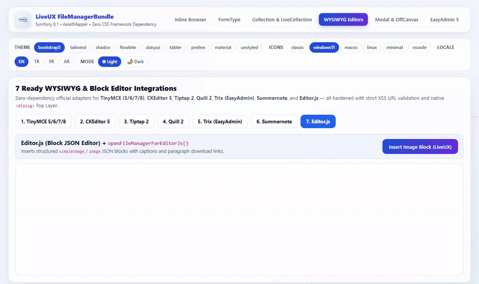

# 05 — FormType（`FileManagerPickerType`）とエディタ連携

[← 前へ: 04 — テーマ・アイコン・カスタマイズ](04-themes-icons-and-customization.md) | [目次](README.md) | [次へ: 06 — セキュリティと認可 →](06-security-and-authorization.md)

`FileManagerPickerType` は Symfony Form コンポーネントとネイティブに統合されます。**単一ファイル（`?string`）**と**複数ファイルギャラリー（`list<string>` / JSON）**の両方に対応し、**9 種類のテーマ**、**5 種類の組み込みレイアウトバリアント**、**ドラッグ＆ドロップ / キーボード / タッチ対応のアクセシブルなギャラリー並び替え**、そして完全な **カスタム Twig テンプレート（`template`）** サポートを備えています。

> **このガイドの概要**  
> 商品登録・ブログ記事・ユーザープロフィールなどのフォームを作成する際、素の `<input type="file">` の代わりに `FileManagerPickerType` を使えば、**ファイルマネージャーを開いて既存アセットを選択したり、新規アップロードしたりできる Symfony フォームフィールド**をすぐに導入できます。  
> さらに本ガイドでは、**`CollectionType` / `LiveCollectionType`**、**7 種類の人気 WYSIWYG・ブロックエディタ**（TinyMCE、CKEditor 5、Tiptap、Quill 2、Trix、Summernote、Editor.js）、および **EasyAdmin 4/5** との連携方法も数行のコード例とともに解説します。

> [!NOTE]
> フォームテーマ（`@LiveUXFileManager/form/picker.html.twig`）と `DialogHost` コンテナはバンドルによって**自動登録・自動注入**されるため、`twig.yaml` や `base.html.twig` を編集する必要はありません。

---

## 1. `FileManagerPickerType` の全オプション一覧

| オプション | 型 | デフォルト | 説明 |
| :--- | :--- | :--- | :--- |
| `profile` | `string` | `'default'` | 開くファイルマネージャーのプロファイル名。 |
| `locale` | `?string` | `null` | `null` の場合はプロファイルのロケールを継承します。12 種類の組み込み UI 言語（`'en'`, `'tr'`, `'fr'`, `'de'`, `'es'`, `'ar'`, `'it'`, `'pt'`, `'nl'`, `'pl'`, `'ja'`, `'zh_CN'`）のいずれかを指定してフィールド単位で上書きできます。 |
| `volume` | `?string` | `null` | 初期表示ボリューム名（`null` の場合はプロファイルの先頭ボリュームを使用）。 |
| `multiple` | `bool` | `false` | `false` = 単一ファイル（`?string`）、`true` = 複数ファイルギャラリー（`list<string>`）。 |
| `max_files` | `?int` | `null` | `multiple: true` 時の最大ファイル数（`null` = 無制限。サーバー側でも厳格に検証されます）。 |
| `mode` | `'modal'\|'offcanvas'` | `'modal'` | ダイアログの表示スタイル。 |
| `position` | `'start'\|'end'\|'top'\|'bottom'` | `'end'` | `mode: 'offcanvas'` 時のドロワー表示位置。 |
| `mobile_mode` | `null\|'auto'\|'fullscreen'\|'sheet'` | `null` | `null` の場合はプロファイルの `ui.mobile_dialog_mode` を継承します。モバイル（`<= 767px`）時のダイアログレイアウトをフィールド単位で上書きします。 |
| `return_type` | `'url'\|'path'` | `'url'` | データベースに完全な URL（`/uploads/a.jpg`）を保存するか、相対パス（`a.jpg`）を保存するかを選択します *(下の選択ガイドを参照)*。 |
| `preview` | `bool` | `true` | **全バリアント**（単一・複数）における画像 / ファイルのサムネイルプレビュー表示を制御します。`false` の場合はファイル名 / パスのみ表示されます。 |
| `button_label` | `?string` | `null` | ピッカーボタンのカスタムラベル（例: `'画像を選択'`、`'ロゴを変更'`）。 |
| `placeholder` | `?string` | `null` | ファイル未選択時に表示するプレースホルダーテキスト。 |
| `theme` | `?string` | `null` | `null` の場合はプロファイルのテーマを継承します。9 種類の組み込みテーマまたは独自 CSS テーマ名（例: `'corporate'`）を指定できます。 |
| `color_scheme` | `?string` | `null` | `null` の場合はプロファイル / デフォルトのカラースキーム（`'auto'`, `'light'`, `'dark'`）を継承します。 |
| `variant` | `string` | `'compact'` | 組み込みレイアウトバリアント: `'compact'`, `'card'`, `'dropzone'`, `'avatar'`, `'input'`。 |
| `template` | `?string` | `null` | 組み込みバリアントを置き換える **100% カスタム Twig テンプレート**のパス（例: `'forms/custom_picker.html.twig'`）。 |
| `disabled` | `bool` | `false` | Symfony Form 標準オプション: `true` にするとフィールド全体が読み取り専用になり、選択・クリア・並び替え操作がロックされます。 |

### `return_type: 'url'` と `'path'` のどちらを選ぶべきか？
- **`'url'`（デフォルト・最もシンプル）:** データベースに `/uploads/products/thermos.webp` や `https://cdn.example.com/thermos.webp` を保存します。Twig 側では追加ロジックなしでそのまま `` と描画できます。
- **`'path'`（柔軟・CDN 移行に強い）:** 相対パス `products/thermos.webp` のみを保存します。将来ストレージディスクや CDN ドメインを変更してもデータベースレコードを移行する必要がなく、`{{ liveux_fm_thumb_url('products', 'local_uploads', product.coverImage) }}` を使うか CDN のベース URL を前置して描画できます。

### 組み込みセキュリティとアクセシブルなギャラリー並び替え
- **サーバー側 POST ハードニング:** ブラウザの DevTools で hidden `<input>` を改ざんし、`javascript:alert(1)`、`../../etc/passwd`、`.trash/...`、256 KB 超の不正 JSON、500 件超のアイテム、不正 UTF-8、`max_files` 超過、HTTP パラメータ汚染（HPP）配列などを送信しようとしても、`FileManagerPickerType` が**サーバー側で自動的に検知・拒否**します。
- **アクセシブルなギャラリー並び替え（`multiple: true`）:** ユーザーは以下の **3 通りの方法** でギャラリーアイテムの順番を変更できます。
  1. デスクトップでの **ドラッグ＆ドロップ**
  2. カードにフォーカスした状態での **`←` / `→` 矢印キー**（アラビア語などの RTL ロケールでは方向が自動反転）
  3. モバイル・タッチデバイス向けに各カードへ配置された **`◀` / `▶` ボタン**

---

## 2. 5 種類の組み込みレイアウトバリアント（`variant`）

`variant` と `theme` は完全に独立しています。すべてのバリアントは全テーマ上で**単一モード**と**複数モード**の両方に対応します。

| バリアント | 単一モード（`multiple: false`） | 複数モード（`multiple: true`） | 最適な用途 |
| :--- | :--- | :--- | :--- |
| `compact` *(デフォルト)* | 60×60 正方形サムネイル + 入力欄 + 選択 / クリア行 | 横並びギャラリーカード + 点線の `+` 追加タイル | 一般的なフォーム項目、商品ギャラリー |
| `card` | 16:10 カバープレビューカード + ファイル名 + 下部アクション | カードグリッド | ブログ / 記事カバー、ヒーローバナー、アイキャッチ画像 |
| `dropzone` | クリック可能な大型点線ボックス + ライブプレビュー | 上部に大型追加ボックス + 下部にギャラリーカード | 目立たせたいメディア / ファイルアップロード領域 |
| `avatar` | 円形 `82×82` プロフィール / ロゴプレビュー + 横並びボタン | 円形 `72×72` アバターチップ + 円形 `+` タイル | ユーザープロフィール写真、ブランドロゴ |
| `input` | サムネイルなしのミニマルな 1 行入力グループ | 削除可能なチップ / タグリスト + `+ 追加` | コンパクトなフォーム、PDF、書類、契約書 |


---

## 3. エンティティ + FormType の完全な実装例

### Doctrine エンティティ（`src/Entity/Product.php`）
```php
<?php
// src/Entity/Product.php

declare(strict_types=1);

namespace App\Entity;

use Doctrine\DBAL\Types\Types;
use Doctrine\ORM\Mapping as ORM;

#[ORM\Entity]
class Product
{
    #[ORM\Column(length: 255, nullable: true)]
    private ?string $coverImage = null;

    /** @var list<string> */
    #[ORM\Column(type: Types::JSON)]
    private array $galleryImages = [];

    public function getCoverImage(): ?string
    {
        return $this->coverImage;
    }

    public function setCoverImage(?string $coverImage): self
    {
        $this->coverImage = $coverImage;

        return $this;
    }

    /** @return list<string> */
    public function getGalleryImages(): array
    {
        return $this->galleryImages;
    }

    /** @param list<string> $galleryImages */
    public function setGalleryImages(array $galleryImages): self
    {
        $this->galleryImages = $galleryImages;

        return $this;
    }
}
```

### Symfony フォームクラス（`src/Form/ProductType.php`）
```php
<?php
// src/Form/ProductType.php

declare(strict_types=1);

namespace App\Form;

use App\Entity\Product;
use LiveUX\FileManagerBundle\Form\FileManagerPickerType;
use Symfony\Component\Form\AbstractType;
use Symfony\Component\Form\FormBuilderInterface;
use Symfony\Component\OptionsResolver\OptionsResolver;

final class ProductType extends AbstractType
{
    public function buildForm(FormBuilderInterface $builder, array $options): void
    {
        $builder
            ->add('coverImage', FileManagerPickerType::class, [
                'label' => '商品カバー画像',
                'profile' => 'products',
                'theme' => 'flowbite',
                'variant' => 'card',
                'mode' => 'offcanvas',
                'position' => 'end',
                'button_label' => 'カバーを選択',
                'placeholder' => 'カバー画像が選択されていません…',
            ])
            ->add('galleryImages', FileManagerPickerType::class, [
                'label' => '商品ギャラリー',
                'profile' => 'products',
                'theme' => 'flowbite',
                'variant' => 'dropzone',
                'multiple' => true,
                'max_files' => 8,
                'mode' => 'modal',
                'button_label' => '画像を追加',
            ]);
    }

    public function configureOptions(OptionsResolver $resolver): void
    {
        $resolver->setDefaults(['data_class' => Product::class]);
    }
}
```

---

## 4. 独自のカスタム FormType UI の構築（3 つのアプローチ）

5 種類の組み込みバリアントや 9 種類のテーマに縛られる必要はありません。Stimulus 連携をそのまま活かした **100% カスタムな HTML / Bootstrap / Tailwind / Alpine デザイン**を構築できます。

### アプローチ 1: フィールドごとの `template` オプション（最速かつ最も柔軟）

フォーム定義で `'template'` パスを指定します。バンドル側がラッパーの Stimulus コントローラー（`liveux--file-manager-bundle--picker`）を自動付与し、内部のマークアップすべてをあなたの Twig ファイルへ委譲します。

```php
$builder
    ->add('heroBanner', FileManagerPickerType::class, [
        'profile' => 'default',
        'theme' => 'unstyled',
        'template' => 'forms/custom_single_picker.html.twig',
        'button_label' => 'バナーを選択',
        'placeholder' => 'カバー画像がまだ選択されていません',
    ])
    ->add('productGallery', FileManagerPickerType::class, [
        'profile' => 'default',
        'multiple' => true,
        'max_files' => 8,
        'theme' => 'unstyled',
        'template' => 'forms/custom_gallery_picker.html.twig',
        'button_label' => 'ギャラリーに追加',
    ]);
```

#### 例 A — カスタム単一ピッカーテンプレート（`templates/forms/custom_single_picker.html.twig`）
```twig
{# templates/forms/custom_single_picker.html.twig #}
<input type="hidden"
       id="{{ id }}"
       name="{{ full_name }}"
       value="{{ value }}"
       data-{{ ctrl }}-target="input"
       {{ isDisabled ? 'disabled' : '' }}
       {{ k|e('html_attr') }}="{{ v }}"  />

<div class="my-custom-banner-card">
    <div class="my-banner-preview"
         data-{{ ctrl }}-target="singlePreview"
         data-action="click->{{ ctrl }}#open"
         style="height: 180px; cursor: pointer;">
    </div>

    <div class="my-banner-bar">
        <span data-{{ ctrl }}-target="fileLabel">{{ value ?: emptyPlaceholder }}</span>
        <div>
            <button type="button" {{ isDisabled ? 'disabled' : '' }} data-action="click->{{ ctrl }}#open">{{ btnLabel }}</button>
            <button type="button" {{ isDisabled ? 'disabled' : '' }} data-{{ ctrl }}-target="clearBtn" data-action="click->{{ ctrl }}#clearSingle">{{ clearLabel }}</button>
        </div>
    </div>
</div>
```

#### 例 B — カスタム複数ファイルギャラリーテンプレート（`templates/forms/custom_gallery_picker.html.twig`）
```twig
{# templates/forms/custom_gallery_picker.html.twig #}
<input type="hidden"
       id="{{ id }}"
       name="{{ full_name }}"
       value="{{ value|default('[]') }}"
       data-{{ ctrl }}-target="input"
       {{ isDisabled ? 'disabled' : '' }}
       {{ k|e('html_attr') }}="{{ v }}"  />

<div class="my-gallery-header">
    <span>選択中の画像: <strong data-{{ ctrl }}-target="countLabel">0</strong> / {{ max_files }}</span>
    <button type="button" {{ isDisabled ? 'disabled' : '' }} data-action="click->{{ ctrl }}#open">+ {{ btnLabel }}</button>
</div>

{# picker_controller.js が選択アイテムを並び替え可能なカードとしてこのコンテナ内に描画します #}
<div class="my-gallery-grid" data-{{ ctrl }}-target="galleryGrid"></div>
```

#### カスタム FormType テンプレートリファレンス

| 属性 / イベント | 説明 |
| :--- | :--- |
| `data-{{ ctrl }}-target="input"` | **必須** — フォーム送信時にサーバーへ送られる `<input>` 要素。 |
| `data-{{ ctrl }}-target="singlePreview"` | 単一モードで選択された画像 / ファイルのプレビューが自動描画されるコンテナ。 |
| `data-{{ ctrl }}-target="fileLabel"` | 選択されたファイル名 / パスで自動更新されるテキスト要素。 |
| `data-{{ ctrl }}-target="clearBtn"` | クリアボタン。未選択時または `isDisabled` が `true` のときに自動的に `disabled` になります。 |
| `data-{{ ctrl }}-target="galleryGrid"` | 複数モードで選択ファイルカードと並び替えを管理するコンテナ。 |
| `data-{{ ctrl }}-target="countLabel"` | 複数モードで現在の選択ファイル数を表示するカウンター要素。 |
| `data-action="click->{{ ctrl }}#open"` | ファイルマネージャーの Modal / OffCanvas ダイアログを開きます。 |
| `data-action="click->{{ ctrl }}#clearSingle"` | 現在の単一選択をクリアします。 |
| **JS イベント:** `liveux:file-manager:picker-changed` | アイテムの選択・クリア・削除・並び替えのたびに発火します。`event.detail` には `{ values, value, multiple }` が含まれます。 |

**カスタムテンプレートへ自動的に渡される Twig 変数:**  
`id`, `full_name`, `value`, `attr`, `ctrl`, `isDisabled`, `btnLabel`, `emptyPlaceholder`, `clearLabel`, `removeLabel`, `profile`, `volume`, `multiple`, `max_files`, `mode`, `position`, `mobile_mode`, `return_type`, `preview`, `button_label`, `placeholder`, `theme`, `resolvedTheme`, `color_scheme`, `variant`, `resolvedVariant`, `locale`, `fmLocale`, `bcp47_locale`, `is_rtl`, `thumb_url`, `preview_url_prefix`。

---

### アプローチ 2: アプリケーション全体の Symfony `form_themes` オーバーライド

プロジェクト全体にある**すべて**の `FileManagerPickerType` フィールドの見た目を一括カスタマイズしたい場合は、独自のフォームテーマで `liveux_file_manager_picker_widget` ブロックを上書きします。

```yaml
# config/packages/twig.yaml
twig:
    form_themes:
        - 'form/my_custom_file_manager_theme.html.twig'
```

```twig
{# templates/form/my_custom_file_manager_theme.html.twig #}

    {# アプリ共通のカスタム HTML & CSS マークアップ #}

```

---

### アプローチ 3: 再利用可能なカスタム子 FormType クラス

複数のフォームで同じ `profile`、`theme`、`template`、`mode` オプションを繰り返し書かずに済むよう、専用のサブクラス FormType を作成できます。

```php
<?php

declare(strict_types=1);

namespace App\Form\Type;

use LiveUX\FileManagerBundle\Form\FileManagerPickerType;
use Symfony\Component\Form\AbstractType;
use Symfony\Component\OptionsResolver\OptionsResolver;

final class ProductCoverImageType extends AbstractType
{
    public function configureOptions(OptionsResolver $resolver): void
    {
        $resolver->setDefaults([
            'profile' => 'product_catalog',
            'theme' => 'corporate',
            'variant' => 'card',
            'mode' => 'offcanvas',
            'position' => 'end',
            'template' => 'forms/custom_single_picker.html.twig',
            'button_label' => '商品カバーを選択',
            'placeholder' => 'カバー画像が選択されていません…',
        ]);
    }

    public function getParent(): string
    {
        return FileManagerPickerType::class;
    }
}
```

あとはどのフォームでも 1 行で呼び出せます。
```php
$builder->add('coverImage', ProductCoverImageType::class);
```

---

## 5. Symfony `CollectionType` と Symfony UX `LiveCollectionType`


`FileManagerPickerType` は、クラシックな Symfony の **`CollectionType`**（`data-prototype` による動的な行の追加・削除）と **`symfony/ux-live-component`（`LiveCollectionType`）** の両方でシームレスに動作します。

- **`CollectionType`:** 新しい行が DOM に挿入された瞬間に Stimulus の `picker` コントローラーが自動接続されるため、手動での JavaScript 初期化は不要です。
- **`LiveCollectionType`:** 行の追加・削除時に Idiomorph が DOM をモーフィングしても、`picker_controller.js`（`render:finished` + `MutationObserver`）が最新の `<input>` 値からすべての単一プレビューと複数ファイルギャラリーカードを自動再描画します。
- **複合サブフォーム vs 直接スカラーのエントリ型:**
  - `entry_type: SlideItemType::class` のような**複合サブフォーム**を使う場合、`LiveCollectionTrait::addCollectionItem()` が新しい行に対して `[]` を送信してもサブフォーム側でそのまま処理されるため、追加コードは不要です。
  - 単一ファイル（`multiple: false`）の `entry_type: FileManagerPickerType::class` を直接使う場合、ピッカー組み込みの `PRE_SUBMIT` リスナーが HPP 保護として配列ペイロードを拒否します。下記のようにコレクション側へ 4 行の `PRE_SUBMIT` リスナーを追加すると、新しく追加された空行の `[]` が `''` に正規化されます。

### A. 標準 Symfony `CollectionType` の例

```php
// src/Form/SlideItemType.php
use LiveUX\FileManagerBundle\Form\FileManagerPickerType;
use Symfony\Component\Form\AbstractType;
use Symfony\Component\Form\Extension\Core\Type\TextType;
use Symfony\Component\Form\FormBuilderInterface;

final class SlideItemType extends AbstractType
{
    public function buildForm(FormBuilderInterface $builder, array $options): void
    {
        $builder
            ->add('title', TextType::class, ['label' => 'タイトル'])
            ->add('image', FileManagerPickerType::class, [
                'label' => 'カバー画像',
                'profile' => 'default',
                'variant' => 'compact',
            ])
            ->add('gallery', FileManagerPickerType::class, [
                'label' => '添付ファイル',
                'profile' => 'default',
                'multiple' => true,
                'variant' => 'input',
            ]);
    }
}
```

```php
// 親 FormType 内:
use Symfony\Component\Form\Extension\Core\Type\CollectionType;

$builder->add('slides', CollectionType::class, [
    'entry_type' => SlideItemType::class,
    'allow_add' => true,
    'allow_delete' => true,
    'prototype' => true,
    'by_reference' => false,
]);
```

```twig
<div id="slides-holder"
     data-index="{{ form.slides|length }}"
     data-prototype="{{ form_widget(form.slides.vars.prototype)|e('html_attr') }}">
    
        <div class="slide-row">{{ form_widget(slide) }}</div>
    
</div>
<button type="button" onclick="
    const h = document.getElementById('slides-holder');
    const i = Number(h.dataset.index || 0);
    h.insertAdjacentHTML('beforeend', '<div class=slide-row>' + h.dataset.prototype.replace(/__name__/g, i) + '</div>');
    h.dataset.index = i + 1;
">+ 行を追加</button>
```

### B. Symfony UX `LiveCollectionType` の例（`LiveCollectionTrait`）

```php
// src/Form/SliderLiveFormType.php
use LiveUX\FileManagerBundle\Form\FileManagerPickerType;
use Symfony\Component\Form\AbstractType;
use Symfony\Component\Form\FormBuilderInterface;
use Symfony\Component\Form\FormEvent;
use Symfony\Component\Form\FormEvents;
use Symfony\UX\LiveComponent\Form\Type\LiveCollectionType;

final class SliderLiveFormType extends AbstractType
{
    public function buildForm(FormBuilderInterface $builder, array $options): void
    {
        $builder
            // 1) 複合サブフォーム — 追加の PRE_SUBMIT リスナー不要:
            ->add('slides', LiveCollectionType::class, [
                'entry_type' => SlideItemType::class,
                'entry_options' => ['label' => false],
                'allow_add' => true,
                'allow_delete' => true,
            ])
            // 2) 直接の単一ファイル FileManagerPickerType（スカラーリスト）:
            ->add('logos', LiveCollectionType::class, [
                'entry_type' => FileManagerPickerType::class,
                'entry_options' => ['label' => false, 'variant' => 'input'],
                'allow_add' => true,
                'allow_delete' => true,
            ]);

        // 直接のスカラー（multiple: false）entry_type の場合のみ必要:
        // LiveCollectionTrait::addCollectionItem() が新規行に [] を追加するため '' に正規化します。
        $builder->get('logos')->addEventListener(FormEvents::PRE_SUBMIT, static function (FormEvent $e): void {
            $rows = $e->getData();
            if (is_array($rows)) {
                $e->setData(array_map(static fn (mixed $v): mixed => $v === [] ? '' : $v, $rows));
            }
        });
    }
}
```

```php
// src/Twig/Components/SliderFormComponent.php
use Symfony\Bundle\FrameworkBundle\Controller\AbstractController;
use Symfony\Component\Form\FormInterface;
use Symfony\UX\LiveComponent\Attribute\AsLiveComponent;
use Symfony\UX\LiveComponent\Attribute\LiveAction;
use Symfony\UX\LiveComponent\DefaultActionTrait;
use Symfony\UX\LiveComponent\LiveCollectionTrait;

#[AsLiveComponent]
final class SliderFormComponent extends AbstractController
{
    use DefaultActionTrait;
    use LiveCollectionTrait;

    protected function instantiateForm(): FormInterface
    {
        return $this->createForm(SliderLiveFormType::class);
    }

    #[LiveAction]
    public function save(): void
    {
        $this->submitForm();
        $data = $this->getForm()->getData();
        // データを永続化...
    }
}
```

> [!NOTE]
> CSRF トークンが確実に送信されるよう、`LiveCollectionType` のテンプレートでは必ず `{{ form_end(form) }}` を呼び出してください（`render_rest: false` を渡す場合は `{{ form_row(form._token) }}` を明示的に出力します）。

#### LiveComponent の Twig テンプレート（`templates/components/SliderFormComponent.html.twig`）
```twig
<div {{ attributes }}>
    {{ form_start(form, { attr: { 'data-action': 'live#action:prevent', 'data-live-action-param': 'save' } }) }}
        
            <div class="slide-card">
                {{ form_row(slideForm.title) }}
                {{ form_row(slideForm.image) }}
                {{ form_row(slideForm.gallery) }}
                {{ form_widget(slideForm.vars.button_delete) }}
            </div>
        

        {{ form_widget(form.slides.vars.button_add) }}
        <button type="submit">保存（AJAX）</button>
        {{ form_rest(form) }}
    {{ form_end(form) }}
</div>
```

あとは Twig の好きな場所で 1 タグ書くだけでレンダリングできます。
```twig
<twig:SliderFormComponent />
```

---

## 6. リッチテキスト & ブロックエディタ連携 — 7 種類の組み込みアダプター（ステップバイステップ）

> **初めての方への概要**  
> ブログ記事や商品説明を執筆する際、編集者はコンテンツ内に画像や PDF をスムーズに挿入できる必要があります。LiveUX FileManagerBundle には、定番のオープンソースエディタ向け **7 種類の専用 JavaScript アダプター** が標準同梱されています：**TinyMCE (5/6/7/8)**、**CKEditor 5**、**Tiptap 2**、**Quill 2**、**Trix（EasyAdmin `TextEditorField`）**、**Summernote**、**Editor.js**。すべてのアダプターには次の特長があります。
> - ブラウザネイティブの `<dialog>` Top Layer 上にファイルマネージャーを開くため、**エディタのポップアップ裏での `z-index` 競合やフォーカストラップの不具合が一切発生しません**。
> - 選択された画像の SEO メタデータ（`alt` / `title` / `caption`）を自動的に引き継ぎます。
> - 返却されるすべての URL について、`javascript:` やパストラバーサル（`../`）による XSS ベクターを検証します。

7 つのアダプターはすべて共通のオプションを受け取ります。  
`profile`, `volume`, `path`, `mode` (`'modal'`|`'offcanvas'`), `position` (`'start'`|`'end'`|`'top'`|`'bottom'`), `mobileMode` (`'auto'`|`'fullscreen'`|`'sheet'`), `locale`, `theme`, `iconSet`, `multiple`, `type`。

> [!IMPORTANT]
> **AssetMapper 利用者向けの 1 行 `importmap.php` 登録:**  
> **Webpack Encore** プロジェクトでは `import ... from '@liveux/file-manager-bundle/js/integrations/...'` がそのまま動作します。  
> **Symfony AssetMapper** をお使いの場合は、ブラウザの `<script type="importmap">` がモジュール指定子を認識できるよう、**実際に使用するアダプターのみ** `importmap.php` に登録してください（ファイルはすでにバンドル内に存在するため、インターネットからのダウンロードは発生しません）。
> ```php
> // importmap.php（実際に使用するエディタアダプターのみ追加）
> '@liveux/file-manager-bundle/js/integrations/tinymce_adapter.js'    => ['path' => '@liveux/file-manager-bundle/js/integrations/tinymce_adapter.js'],
> '@liveux/file-manager-bundle/js/integrations/ckeditor5_adapter.js'  => ['path' => '@liveux/file-manager-bundle/js/integrations/ckeditor5_adapter.js'],
> '@liveux/file-manager-bundle/js/integrations/tiptap_adapter.js'     => ['path' => '@liveux/file-manager-bundle/js/integrations/tiptap_adapter.js'],
> '@liveux/file-manager-bundle/js/integrations/quill_adapter.js'      => ['path' => '@liveux/file-manager-bundle/js/integrations/quill_adapter.js'],
> '@liveux/file-manager-bundle/js/integrations/trix_adapter.js'       => ['path' => '@liveux/file-manager-bundle/js/integrations/trix_adapter.js'],
> '@liveux/file-manager-bundle/js/integrations/summernote_adapter.js' => ['path' => '@liveux/file-manager-bundle/js/integrations/summernote_adapter.js'],
> '@liveux/file-manager-bundle/js/integrations/editorjs_adapter.js'   => ['path' => '@liveux/file-manager-bundle/js/integrations/editorjs_adapter.js'],
> ```

---

### A. TinyMCE 5 / 6 / 7 / 8 連携（`createTinyMceFilePicker`）


TinyMCE 5、6、7、8 はすべて同じ `file_picker_callback` シグネチャを採用しており、**実ブラウザテストで動作確認済み**です。このアダプターは、TinyMCE の **画像（`image`）**、**メディア（`media`）**、**リンク（`link`）** 各ダイアログ内の参照ボタンを LiveUX FileManagerBundle に直接接続します。

> **バージョンに関する補足:** TinyMCE **7 または 8** を使う場合は `license_key: 'gpl'` を残してください。TinyMCE **5 または 6** の場合はその 1 行を省くだけで、その他はまったく同じです。

#### ステップ 1: ページに TinyMCE を読み込む（オープンソース・API キー不要）
```twig
{# templates/article/edit.html.twig #}



    {# TinyMCE 7（CDN または自前の public/ ディレクトリから読み込み） #}
    <script src="https://cdn.jsdelivr.net/npm/tinymce@7.6.0/tinymce.min.js" referrerpolicy="origin"></script>

    <div data-controller="tinymce-editor">
        <textarea name="article[content]" data-tinymce-editor-target="textarea">
            {{ article.content|default('') }}
        </textarea>
    </div>

```

#### ステップ 2: Stimulus コントローラーで `createTinyMceFilePicker` を接続する
`assets/controllers/tinymce_editor_controller.js` を作成します（**AssetMapper** と **Webpack Encore** の両方でそのまま動作します）。

```javascript
// assets/controllers/tinymce_editor_controller.js
import { Controller } from '@hotwired/stimulus';
import { createTinyMceFilePicker } from '@liveux/file-manager-bundle/js/integrations/tinymce_adapter.js';

export default class extends Controller {
    static targets = ['textarea'];

    connect() {
        if (!window.tinymce) {
            return;
        }

        window.tinymce.init({
            target: this.textareaTarget,
            license_key: 'gpl', // 無料のオープンソース GPL ライセンスモード
            height: 420,
            plugins: 'image link media lists table code',
            toolbar: 'undo redo | blocks | bold italic | bullist numlist | image media link | code',
            file_picker_types: 'file image media',
            file_picker_callback: createTinyMceFilePicker({
                profile: 'default',     // liveux_file_manager.yaml のプロファイル名
                mode: 'modal',          // 'modal' | 'offcanvas'
                position: 'end',
                mobileMode: 'auto',
                locale: 'ja',
            }),
        });
    }

    disconnect() {
        if (window.tinymce) {
            const inst = window.tinymce.get(this.textareaTarget.id);
            inst?.remove();
        }
    }
}
```

#### 動作の流れ
ユーザーが TinyMCE ツールバーの **画像** ボタンを押し、**ソース（Source）** 欄の横にある参照アイコンをクリックすると、次の動作が行われます。
1. LiveUX FileManagerBundle が TinyMCE のモーダルより前面に開き、画像のみに事前フィルタリングされた状態（`filetype: 'image'`）で表示されます。
2. ユーザーが画像を選択すると、**ソース URL** と **代替テキスト（`alt`）** の両方が自動的に入力されます。

---

### B. CKEditor 5 連携（`openFileManagerForCKEditor5`）


CKEditor 5 の Classic、Inline、Balloon、Decoupled 各ビルドに対応しており、ボタン 1 つで**単一または複数**の画像（`insertImage`）やドキュメント / PDF リンクを挿入できます。

#### ステップ 1: CKEditor 5 とメディア挿入ボタンを配置する
```twig
{# templates/article/ckeditor.html.twig #}



    <script src="https://cdn.jsdelivr.net/npm/@ckeditor/ckeditor5-build-classic@41.4.2/build/ckeditor.js"></script>

    <div data-controller="ckeditor-editor">
        <div style="margin-bottom: 10px;">
            <button type="button" data-action="ckeditor-editor#insertMedia">
                ファイルマネージャーからメディアを挿入
            </button>
        </div>

        <textarea name="article[content]" data-ckeditor-editor-target="textarea">
            {{ article.content|default('') }}
        </textarea>
    </div>

```

#### ステップ 2: `openFileManagerForCKEditor5` を接続する
```javascript
// assets/controllers/ckeditor_editor_controller.js
import { Controller } from '@hotwired/stimulus';
import { openFileManagerForCKEditor5 } from '@liveux/file-manager-bundle/js/integrations/ckeditor5_adapter.js';

export default class extends Controller {
    static targets = ['textarea'];

    async connect() {
        if (!window.ClassicEditor) {
            return;
        }
        this.editor = await window.ClassicEditor.create(this.textareaTarget);
    }

    async insertMedia() {
        if (!this.editor) {
            return;
        }

        await openFileManagerForCKEditor5(this.editor, {
            profile: 'default',
            mode: 'offcanvas', // エディタを隠さずに参照できるスライドインドロワー
            position: 'end',
            multiple: true,    // 複数の写真をまとめて挿入
            locale: 'ja',
        });
    }

    disconnect() {
        this.editor?.destroy().catch(() => {});
    }
}
```

#### 動作の流れ
- **画像**は CKEditor 5 ネイティブの `insertImage` コマンドを通じて `<figure class="image">` ブロックとして挿入されます。
- **ドキュメント（PDF、ZIP など）**はファイル名付きのクリック可能な `<a href="...">` リンクとして挿入されます。

---

### C. Tiptap / ProseMirror 連携（`insertFromFileManager`）


モダンなヘッドレスエディタ **Tiptap 2** をお使いの場合、`@tiptap/extension-image` および `@tiptap/extension-link` と関数呼び出し 1 回で連携できます。

#### ステップ 1: パッケージをインストールする
- **Webpack Encore / npm の場合:**
  ```bash
  npm install @tiptap/core @tiptap/starter-kit @tiptap/extension-image @tiptap/extension-link
  ```
- **AssetMapper の場合:**
  ```bash
  php bin/console importmap:require @tiptap/core @tiptap/starter-kit @tiptap/extension-image @tiptap/extension-link
  ```

#### ステップ 2: Twig テンプレート（ツールバー + エディタキャンバス + Hidden Input）
```twig
{# templates/article/tiptap.html.twig #}
<div data-controller="tiptap-editor">
    <div class="tiptap-toolbar">
        <button type="button" data-action="tiptap-editor#toggleBold"><strong>B</strong></button>
        <button type="button" data-action="tiptap-editor#toggleItalic"><em>I</em></button>
        <button type="button" data-action="tiptap-editor#insertMedia">🖼 メディアを挿入 (LiveUX)</button>
    </div>

    <div data-tiptap-editor-target="canvas"></div>
    <input type="hidden" name="article[content]" data-tiptap-editor-target="hiddenInput" value="{{ article.content|default('') }}">
</div>
```

#### ステップ 3: `insertFromFileManager` の Stimulus コントローラーを作成する
```javascript
// assets/controllers/tiptap_editor_controller.js
import { Controller } from '@hotwired/stimulus';
import { Editor } from '@tiptap/core';
import StarterKit from '@tiptap/starter-kit';
import Image from '@tiptap/extension-image';
import Link from '@tiptap/extension-link';
import { insertFromFileManager } from '@liveux/file-manager-bundle/js/integrations/tiptap_adapter.js';

export default class extends Controller {
    static targets = ['canvas', 'hiddenInput'];

    connect() {
        this.editor = new Editor({
            element: this.canvasTarget,
            extensions: [
                StarterKit,
                Image.configure({ inline: false }),
                Link.configure({ openOnClick: false }),
            ],
            content: this.hiddenInputTarget.value || '<p>本文を入力してください...</p>',
            onUpdate: ({ editor }) => {
                // フォーム送信に備えて最新の HTML を hidden input に同期
                this.hiddenInputTarget.value = editor.getHTML();
            },
        });
    }

    async insertMedia() {
        await insertFromFileManager(this.editor, {
            profile: 'default',
            mode: 'modal',
            multiple: true,
            locale: 'ja',
        });
    }

    toggleBold() { this.editor?.chain().focus().toggleBold().run(); }
    toggleItalic() { this.editor?.chain().focus().toggleItalic().run(); }

    disconnect() {
        this.editor?.destroy();
    }
}
```

#### 動作の流れ
- 画像は SEO の `alt` および `title` 属性を保持したまま `setImage({ src, alt, title })` で挿入されます。
- ドキュメント（PDF、ZIP など）は自動的にクリック可能なリンク（`marks: [{ type: 'link', attrs: { href } }]`）として挿入されます。

---

### D. Quill 1.x / 2.x 連携（`createQuillImageHandler` & `openFileManagerForQuill`）


Quill ツールバー標準の **画像** ボタンを 1 行で LiveUX FileManagerBundle へ接続し、画像には SEO `alt` 属性を付与、ドキュメントにはクリック可能なリンクを挿入します。

#### ステップ 1: Quill の CSS/JS とエディタコンテナを配置する
```twig
{# templates/article/quill.html.twig #}
<link rel="stylesheet" href="https://cdn.jsdelivr.net/npm/quill@2.0.3/dist/quill.snow.css">
<script src="https://cdn.jsdelivr.net/npm/quill@2.0.3/dist/quill.js"></script>

<div data-controller="quill-editor">
    <div data-quill-editor-target="canvas"></div>
    <input type="hidden" name="article[content]" data-quill-editor-target="hiddenInput" value="{{ article.content|default('') }}">
</div>
```

#### ステップ 2: `createQuillImageHandler` の Stimulus コントローラーを作成する
```javascript
// assets/controllers/quill_editor_controller.js
import { Controller } from '@hotwired/stimulus';
import { createQuillImageHandler } from '@liveux/file-manager-bundle/js/integrations/quill_adapter.js';

export default class extends Controller {
    static targets = ['canvas', 'hiddenInput'];

    connect() {
        this.quill = new window.Quill(this.canvasTarget, {
            theme: 'snow',
            modules: {
                toolbar: {
                    container: [[{ header: [1, 2, false] }], ['bold', 'italic'], ['link', 'image']],
                    handlers: {
                        // Quill 標準の画像ボタンをクリックすると LiveUX FileManagerBundle が開きます！
                        image: createQuillImageHandler(() => this.quill, {
                            profile: 'default',
                            mode: 'offcanvas',
                            position: 'end',
                            locale: 'ja',
                        }),
                    },
                },
            },
        });
        this.quill.on('text-change', () => {
            this.hiddenInputTarget.value = this.quill.root.innerHTML;
        });
    }
}
```

---

### E. Trix エディタ連携 — EasyAdmin `TextEditorField` & Turbo（`openFileManagerForTrix`）


**EasyAdmin 組み込みの `TextEditorField`** や Symfony Turbo / Hotwire アプリケーションで標準利用される `<trix-editor>` に対し、安全な画像添付（`Trix.Attachment`）とドキュメントリンクを挿入します。

```twig
{# templates/article/trix.html.twig #}
<link rel="stylesheet" href="https://cdn.jsdelivr.net/npm/trix@2.1.12/dist/trix.css">
<script src="https://cdn.jsdelivr.net/npm/trix@2.1.12/dist/trix.umd.min.js"></script>

<div data-controller="trix-editor">
    <button type="button" data-action="trix-editor#insertMedia">ファイルマネージャーから挿入</button>
    <input id="article_body" type="hidden" name="article[content]" value="{{ article.content|default('') }}">
    <trix-editor input="article_body" data-trix-editor-target="editor"></trix-editor>
</div>
```

```javascript
// assets/controllers/trix_editor_controller.js
import { Controller } from '@hotwired/stimulus';
import { openFileManagerForTrix } from '@liveux/file-manager-bundle/js/integrations/trix_adapter.js';

export default class extends Controller {
    static targets = ['editor'];

    async insertMedia() {
        await openFileManagerForTrix(this.editorTarget, {
            profile: 'default',
            mode: 'modal',
            multiple: true,
            locale: 'ja',
        });
    }
}
```

---

### F. Summernote 連携（`openFileManagerForSummernote`）


Bootstrap ベースの管理画面で広く使われている Summernote に対し、サニタイズ済みの DOM `` ノード（SEO 用の `alt` & `title` 付き）および `<a>` リンクを挿入します。

```javascript
// assets/controllers/summernote_editor_controller.js
import { Controller } from '@hotwired/stimulus';
import { openFileManagerForSummernote } from '@liveux/file-manager-bundle/js/integrations/summernote_adapter.js';

export default class extends Controller {
    static targets = ['textarea'];

    connect() {
        this.$el = window.jQuery(this.textareaTarget);
        this.$el.summernote({ height: 320 });
    }

    async insertMedia() {
        await openFileManagerForSummernote(this.$el, {
            profile: 'default',
            mode: 'offcanvas',
            position: 'end',
            multiple: true,
            locale: 'ja',
        });
    }
}
```

---

### G. Editor.js（ブロックベース JSON エディタ）連携（`openFileManagerForEditorJs`）



ヘッドレス CMS や Notion 風ブロックエディタに最適な **Editor.js** に対し、構造化された `image`（`@editorjs/image`）または `simpleImage`（`@editorjs/simple-image`）ブロックとドキュメントリンクを挿入します。

```javascript
// assets/controllers/editorjs_controller.js
import { Controller } from '@hotwired/stimulus';
import { openFileManagerForEditorJs } from '@liveux/file-manager-bundle/js/integrations/editorjs_adapter.js';

export default class extends Controller {
    static targets = ['holder'];

    connect() {
        this.editor = new window.EditorJS({
            holder: this.holderTarget,
            tools: {
                header: window.Header,
                simpleImage: window.SimpleImage,
            },
        });
    }

    async insertMedia() {
        await openFileManagerForEditorJs(this.editor, {
            profile: 'default',
            mode: 'modal',
            multiple: true,
            imageBlockType: 'simpleImage', // @editorjs/image を使用する場合は 'image' のままにします
            locale: 'ja',
        });
    }
}
```

---

### H. GrapesJS（ビジュアルページ＆メールビルダー）連携（`createGrapesJsAssetManagerConfig` / `openFileManagerForGrapesJs`）


**GrapesJS（0.20+ / 0.21+ / 0.22+）** と 2 通りの方法でシームレスに連携できます。
1. **`createGrapesJsAssetManagerConfig()`:** GrapesJS 標準の Asset Manager モーダルを LiveUX FileManagerBundle に置き換えます（キャンバス上の画像をダブルクリックすると自動で開きます）。
2. **`openFileManagerForGrapesJs()`:** カスタムボタンから単一または複数の画像・リンクコンポーネントをキャンバスへ直接挿入します。

```javascript
// assets/controllers/grapesjs_controller.js
import { Controller } from '@hotwired/stimulus';
import {
    createGrapesJsAssetManagerConfig,
    openFileManagerForGrapesJs,
} from '@liveux/file-manager-bundle/js/integrations/grapesjs_adapter.js';

export default class extends Controller {
    static targets = ['canvas'];

    connect() {
        this.editor = window.grapesjs.init({
            container: this.canvasTarget,
            height: '520px',
            storageManager: false,
            // 1) 標準の Asset Manager を LiveUX FileManager に置き換えます:
            assetManager: createGrapesJsAssetManagerConfig({
                profile: 'default',
                mode: 'modal',
                locale: 'ja',
            }),
        });
    }

    // 2) またはカスタムボタンから画像・リンクをキャンバスへ直接挿入します:
    async insertMedia() {
        await openFileManagerForGrapesJs(this.editor, {
            profile: 'default',
            mode: 'offcanvas',
            position: 'end',
            multiple: true,
            locale: 'ja',
        });
    }
}
```

---

### I. Meta Lexical 連携（`openFileManagerForLexical`）


Meta の拡張可能なリッチテキストエンジン **Lexical**（`lexical` 0.15+ / 0.20+ / 0.30+）と、コマンドディスパッチ（`INSERT_IMAGE_COMMAND` / `TOGGLE_LINK_COMMAND`）またはカスタム `onInsert` コールバック経由で連携できます。厳格な XSS URL バリデーションと SEO 用 `altText` メタデータにも対応しています。

```javascript
// assets/controllers/lexical_controller.js
import { Controller } from '@hotwired/stimulus';
import { createEditor, createCommand, COMMAND_PRIORITY_EDITOR } from 'lexical';
import { openFileManagerForLexical } from '@liveux/file-manager-bundle/js/integrations/lexical_adapter.js';

export const INSERT_IMAGE_COMMAND = createCommand('INSERT_IMAGE_COMMAND');

export default class extends Controller {
    static targets = ['editable'];

    connect() {
        this.editor = createEditor({
            namespace: 'AppLexicalEditor',
            nodes: [/* カスタム ImageNode */],
            onError: (err) => console.error(err),
        });
        this.editor.setRootElement(this.editableTarget);

        this.editor.registerCommand(
            INSERT_IMAGE_COMMAND,
            ({ src, altText }) => {
                // カスタムの ImageNode / DecoratorNode を Lexical のステートへ挿入します
                this.editor.update(() => {
                    // $insertNodes([$createImageNode({ src, altText })]);
                });
                return true;
            },
            COMMAND_PRIORITY_EDITOR,
        );
    }

    async insertMedia() {
        await openFileManagerForLexical(this.editor, {
            profile: 'default',
            mode: 'modal',
            multiple: true,
            locale: 'ja',
            insertImageCommand: INSERT_IMAGE_COMMAND,
        });
    }
}
```

---

## 7. EasyAdmin 4 / 5 連携 — ステップバイステップ（`FileManagerField`）


組み込みの `FileManagerField` は追加の依存パッケージなしでそのまま利用できます。
- **一覧（Index）**および**詳細（Detail）**画面では、選択されたファイルのサムネイルやバッジを自動描画します（`liveux_fm_describe_field_item()` による URL 安全性チェック付き）。
- **新規作成（New）**および**編集（Edit）**画面では、そのまま `FileManagerPickerType` として描画されます。

### ステップ 1: EasyAdmin の `DashboardController` でアプリのアセットを読み込む（重要！）

EasyAdmin は独自のベースレイアウトを使用しており、アプリの `base.html.twig` を継承しないため、`DashboardController::configureAssets()` で `app` エントリポイントを登録してください。

```php
<?php
// src/Controller/Admin/DashboardController.php

declare(strict_types=1);

namespace App\Controller\Admin;

use EasyCorp\Bundle\EasyAdminBundle\Attribute\AdminDashboard;
use EasyCorp\Bundle\EasyAdminBundle\Config\Assets;
use EasyCorp\Bundle\EasyAdminBundle\Controller\AbstractDashboardController;

#[AdminDashboard(routePath: '/admin', routeName: 'admin')]
final class DashboardController extends AbstractDashboardController
{
    public function configureAssets(): Assets
    {
        // AssetMapper を使用している場合:
        return Assets::new()->addAssetMapperEntry('app');

        // Webpack Encore を使用している場合は上の行を以下へ置き換えてください:
        // return Assets::new()->addWebpackEncoreEntry('app');
    }
}
```

### ステップ 2: `CrudController` で `FileManagerField` を使用する

```php
<?php
// src/Controller/Admin/ProductCrudController.php

declare(strict_types=1);

namespace App\Controller\Admin;

use App\Entity\Product;
use EasyCorp\Bundle\EasyAdminBundle\Controller\AbstractCrudController;
use EasyCorp\Bundle\EasyAdminBundle\Field\TextField;
use LiveUX\FileManagerBundle\Bridge\EasyAdmin\FileManagerField;

final class ProductCrudController extends AbstractCrudController
{
    public static function getEntityFqcn(): string
    {
        return Product::class;
    }

    public function configureFields(string $pageName): iterable
    {
        yield TextField::new('title', '商品名');

        yield FileManagerField::new('coverImage', 'カバー画像')
            ->setProfile('products')
            ->setVolume('local_uploads')
            ->setColorScheme('auto')
            ->setVariant('dropzone')
            ->setMode('offcanvas')
            ->setPosition('end')
            ->setMobileMode('sheet')
            ->setButtonLabel('カバーを選択');

        yield FileManagerField::new('galleryImages', '商品ギャラリー')
            ->setProfile('products')
            ->setMultiple(true)
            ->setMaxFiles(10)
            ->setReturnType('url')
            ->setVariant('card');
    }
}
```

### `FileManagerField` の全フルエントメソッド一覧（16 メソッド）

| メソッド | 対応するオプション | 使用例 |
| :--- | :--- | :--- |
| `setProfile(string $profile)` | `profile` | `->setProfile('products')` |
| `setLocale(?string $locale)` | `locale` | `->setLocale('ja')` |
| `setVolume(?string $volume)` | `volume` | `->setVolume('supabase_s3')` |
| `setMultiple(bool $multiple = true)` | `multiple` | `->setMultiple(true)` |
| `setMaxFiles(?int $maxFiles)` | `max_files` | `->setMaxFiles(8)` |
| `setMode(string $mode)` | `mode` | `->setMode('offcanvas')` |
| `setPosition(string $position)` | `position` | `->setPosition('end')` |
| `setMobileMode(?string $mobileMode)` | `mobile_mode` | `->setMobileMode('fullscreen')` |
| `setReturnType(string $returnType)` | `return_type` | `->setReturnType('path')` |
| `setPreview(bool $preview = true)` | `preview` | `->setPreview(false)` |
| `setTheme(?string $theme)` | `theme` | `->setTheme('tabler')` |
| `setColorScheme(?string $colorScheme)` | `color_scheme` | `->setColorScheme('dark')` |
| `setVariant(string $variant)` | `variant` | `->setVariant('avatar')` |
| `setCustomTemplate(?string $template)` | `template` | `->setCustomTemplate('forms/custom.html.twig')` |
| `setButtonLabel(?string $label)` | `button_label` | `->setButtonLabel('ロゴを変更')` |
| `setPlaceholder(?string $placeholder)` | `placeholder` | `->setPlaceholder('まだ選択されていません')` |

---

[← 前へ: 04 — テーマ・アイコン・カスタマイズ](04-themes-icons-and-customization.md) | [目次](README.md) | [次へ: 06 — セキュリティと認可 →](06-security-and-authorization.md)
