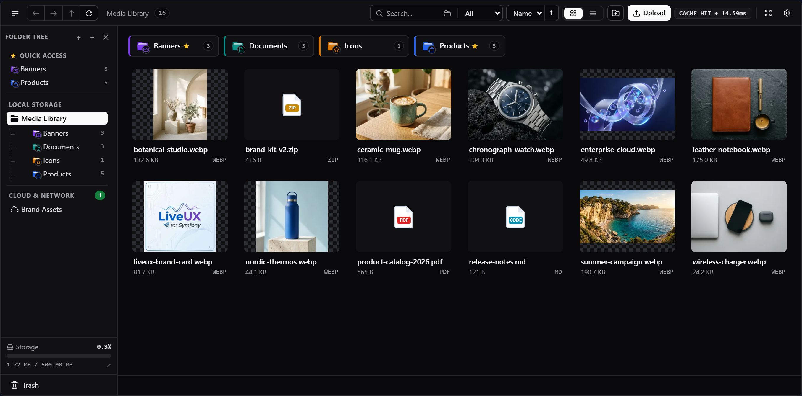

  <picture>
    <source media="(prefers-color-scheme: dark)" srcset="../images/banner-dark.png">
    <source media="(prefers-color-scheme: light)" srcset="../images/banner-light.png">
    
  </picture>

# LiveUX FileManagerBundle — Nederlandse documentatie

**Taal:** [English](../en/README.md) · [Türkçe](../tr/README.md) · [Français](../fr/README.md) · [Deutsch](../de/README.md) · [Español](../es/README.md) · [العربية](../ar/README.md) · [Italiano](../it/README.md) · [Português](../pt/README.md) · **Nederlands** · [Polski](../pl/README.md) · [日本語](../ja/README.md) · [简体中文](../zh_CN/README.md) · [Hoofd-README](../../README.md)

**LiveUX FileManagerBundle** is een modern, razendsnel **Symfony UX bestandsbeheer- en Digital Asset Manager (DAM)-pakket** op enterprise-niveau, gebouwd voor Symfony 6.4 LTS, 7.2+ en 8.x (PHP 8.3+). De bundle heeft **nul CSS-frameworkafhankelijkheden**, 14 ingebouwde beveiligingslagen en uitgebreide meertalige ondersteuning (12 ingebouwde UI-talen, BCP-47-/POSIX-localedetectie en native RTL).

---

## Live voorbeeld & screenshots

  

  

  

> **Full HD (1080p, ~3 min) showcasevideo in 10 hoofdstukken** voor YouTube en releases: [YouTube (1080p)](https://www.youtube.com/watch?v=H2CAf0RiDd8) · [`docs/images/demo-youtube-showcase.mp4`](../images/demo-youtube-showcase.mp4) · Korte preview: [`docs/images/demo-showcase.mp4`](../images/demo-showcase.mp4)

| Lichte modus (`Light`) | Donkere modus (`Dark`) |
| :---: | :---: |
|  |  |

| Mapkleur & mappictogram aanpassen | Over-dialoogvenster (`LiveUX`) |
| :---: | :---: |
|  |  |

### Rich-texteditors, EasyAdmin & dynamische formulierdemo's (GIF)

| TinyMCE 5/6/7/8 | CKEditor 5 |
| :---: | :---: |
|  |  |

| Tiptap 2 (ProseMirror) | Quill 2 |
| :---: | :---: |
|  |  |

| Trix (EasyAdmin `TextEditorField`) | Summernote |
| :---: | :---: |
|  |  |

| Editor.js (Blokeditor) | GrapesJS (Visuele Paginabouwer) |
| :---: | :---: |
|  |  |

| Meta Lexical | EasyAdmin 4/5 (`FileManagerField`) |
| :---: | :---: |
|  |  |

| Symfony `CollectionType` & `LiveCollectionType` |
| :---: |
|  |

---

## Snelstart-routekaart (2 minuten)

Weet je nog niet waar je moet beginnen? Spring direct naar de gids die bij jouw doel past:

- **Voor het eerst installeren:** [01 — Vereisten & installatie](01-requirements-and-installation.md) → [02 — Configuratie & profielen](02-configuration-and-profiles.md)
- **Een afbeeldings- of galerijkiezer toevoegen aan een Symfony Form:** [05 — FormType & editor-integraties](05-formtype-and-editor-integrations.md)
- **Beveiliging & RBAC dichttimmeren voor productie:** [06 — Beveiliging & autorisatie](06-security-and-authorization.md)
- **Supabase, AWS S3 of Cloudflare R2 koppelen:** [07 — Cloudopslag & dynamische configuratie](07-cloud-storage-and-dynamic-config.md)
- **Metadata opslaan via Doctrine ORM / DBAL:** [13 — Doctrine-integratie](13-doctrine-integration.md)
- **Voorkomen dat bestanden in gebruik worden verwijderd of verplaatst:** [10 — Asset Usage Guard](10-asset-usage-guard.md)

---

## Inhoudsopgave (Documentatie-overzicht)

| Hoofdstuk | Gids | Samenvatting |
| :---: | :--- | :--- |
| **01** | [Vereisten, afhankelijkheden & installatie](01-requirements-and-installation.md) | PHP 8.3+- / Symfony 6.4 LTS-, 7.2+- & 8.x-vereisten, PHP-extensies (incl. `ext-exif`, `ext-zip`), Composer-pakketten, AssetMapper- & Webpack Encore-configuratie, `file-manager:doctor` en je eerste werkende pagina |
| **02** | [Configuratie & profielen (YAML-referentie)](02-configuration-and-profiles.md) | `defaults`, `volumes`, `profiles`, botsingsvrije dynamische paden (`{user_id}`, `{Y}/{m}`), upload-/chunklimieten, automatische naamgeving, afbeeldingsoptimalisatie & -regels, miniaturen, prullenbak, ZIP, 5 productierecepten en de volledige YAML-schemareferentie |
| **03** | [Gebruiksmodi & JavaScript API](03-usage-modes-and-js-api.md) | Inline `TwigComponent`, `<dialog>` Modal & 4-richtingen OffCanvas, volledige `window.LiveUXFileManager.open()`-referentie, custom DOM-events, RTL/IME/WCAG 2.1 AA-toegankelijkheid, contextmenu's, ingebouwde afbeeldingseditor en sneltoetsen |
| **04** | [Thema's, pictogramsets & maatwerk](04-themes-icons-and-customization.md) | 9 ingebouwde WCAG 2.1 AA-thema's (Bootstrap 5, Tailwind, Shadcn, Flowbite 4, DaisyUI 5, Tabler, Preline, Material, Unstyled), automatische/handmatige donkere modus, 6 SVG-pictogramsets (49 UI- + 14 badgepictogrammen), Twig-helpers en 3 niveaus van eigen styling |
| **05** | [FormType & editor-integraties](05-formtype-and-editor-integrations.md) | `FileManagerPickerType` (enkelvoudig & toegankelijke meervoudige galerij met sortering + POST-beveiliging), 5 ingebouwde varianten (`compact`, `card`, `dropzone`, `avatar`, `input`), `CollectionType` / `LiveCollectionType`, eigen templates, TinyMCE, CKEditor 5, Tiptap en de 16-methoden EasyAdmin `FileManagerField` |
| **06** | [Beveiliging & autorisatie (RBAC)](06-security-and-authorization.md) | 17 Voter-rechten, eigen `unanimous` Voters, `security.yaml`-firewallregels, 14 beveiligingslagen (CSRF, pad-traversal, 69 extensies / 47 MIME-typen, 55-tags `SvgSanitizer`, SSRF DNS-rebindingbeveiliging, `ConfinedLocalFilesystemAdapter` symlink-afscherming, HMAC-deellinks, auditlogging) en Apache/Nginx-hardening |
| **07** | [Cloudopslag (S3/R2/MinIO/Supabase) & dynamische configuratie](07-cloud-storage-and-dynamic-config.md) | Multi-volume lokaal/cloud-architectuur, providergidsen ([Supabase](cloud/supabase-storage.md), [AWS S3](cloud/aws-s3.md), [Cloudflare R2](cloud/cloudflare-r2.md), [Backblaze B2](cloud/backblaze-b2.md), [MinIO/RustFS](cloud/minio-rustfs.md), [Google Cloud Storage](cloud/google-cloud-storage.md), [SFTP & Custom Flysystem](cloud/sftp-and-custom-flysystem.md)), `FlysystemServiceLocatorPass`, `ConfigProviderInterface` en eigen metadata-opslag |
| **08** | [Events, CLI-commando's, caching & probleemoplossing](08-events-commands-cache-and-troubleshooting.md) | 9 Symfony-domeinevents, 10 consolecommando's (`doctor`, `stats`, `duplicates`, `ai:enrich`, `skills:install`, enz.), 3-laags caching & contextbewuste HTTP 304/CDN-isolatie, meertalig BCP-47/POSIX/RTL-vertaalsysteem voor 12 talen (493 sleutels) en FAQ |
| **09** | [Symfony AI-integratie & slimme verrijking](09-symfony-ai-integration.md) | `AssetEnricherInterface` zonder verplichte afhankelijkheden, `symfony/ai-bundle`-koppeling (OpenAI, Gemini, Claude, Ollama), **✨ Voorstellen met AI**, batch-CLI `file-manager:ai:enrich`, asynchrone Messenger-voorbeelden en LLM-weigerings- & prompt-injectionfiltering in 11 talen |
| **10** | [Asset Usage Guard](10-asset-usage-guard.md) | Opt-in `AssetUsageCheckerInterface`-contract, `warn`-/ `block`-beleid, tweelaagse server-side beveiliging (`enforce_server_side`) voor **`delete`, `rename`, `move` en `overwrite`**, en Doctrine-voorbeelden voor MySQL, PostgreSQL en SQLite |
| **11** | [Bijdragen & Pull Request-gids](11-contributing-and-pr-guide.md) | Laagdrempelige open-source PR-workflow, `composer qa`-kwaliteitscontrole (PHPStan Level 8, 360+ PHPUnit-tests, 37+ JS-tests), 6-job GitHub Actions CI en GitHub Branch Protection-instelling |
| **12** | [AI Agent Skills-gids (`SKILL.md` & `AGENTS.md`)](12-ai-agent-skills-guide.md) | 6 modulaire `SKILL.md`-pakketten voor Antigravity, Claude Code, Cursor, GitHub Copilot, Codex en Symfony AI Mate, één-commando `file-manager:skills:install` en CI-validatie |
| **13** | [Doctrine ORM- & DBAL-integratie](13-doctrine-integration.md) | Ingebouwde `metadata.driver: 'doctrine'` (`DoctrineDbalMetadataStorage` — atomaire UPSERT, PostgreSQL `text_pattern_ops`-index, batch `saveMany()`), platformonafhankelijke migraties, Entity + `FileManagerPickerType`, eigen `ResetInterface`-bewuste ORM-opslag en DB-synchronisatie via `ItemRenamedEvent` |
| **14** | [Beveiligingsaudit, logicabeoordeling & wijzigingsrapport](../tr/14-guvenlik-denetim-ve-degisiklik-raporu.md) *(alleen in het Turks)* | Regel-voor-regel beveiligingsaudit (rondes 1–18), disjuncte multi-tenant `{user_id}`-isolatie, DI/Voter/Parser/SVG `<use>`-stapbudget- & CDN/origin-spoofing-hardening, symlink-afscherming, PostgreSQL `text_pattern_ops` & atomaire UPSERT, WCAG 2.1 AA contrast-/focusaudit voor 9 thema's, mobiele dialogen en i18n-auditlog |

---

## Architectuurhoogtepunten

- **0 ms hybride snelheid:** Snelle SSR `TwigComponent` + geheugencache in de browser (`dirCache`) + volledige mappenstructuur in één verzoek. Filteren, zoeken, sorteren, pagineren, wisselen tussen Raster/Lijst en het uit- of inklappen van mappen gebeuren direct zonder extra AJAX-roundtrips.
- **Nul CSS-frameworkafhankelijkheden & WCAG 2.1 AA:** De volledige UI gebruikt gescopede `.liveux-fm-*`-klassen en CSS custom properties (`--liveux-fm-*`). Werkt probleemloos naast **Bootstrap 5, Tailwind CSS, Shadcn/UI, Flowbite 4, DaisyUI 5, Tabler, Preline, Material** of **helemaal zonder CSS-framework** — zonder stijlbotsingen en zonder extra Tailwind-purgeconfiguratie.
- **Native HTML5 `<dialog>` Top Layer & mobile-first ergonomie:** Modal- en OffCanvas-vensters (`start`, `end`, `top`, `bottom`) worden gerenderd in de Top Layer van de browser en schakelen op mobiel automatisch over naar volledig scherm (`100dvh`) of een native bottom sheet met sleepgreep.
- **14-laags enterprise-beveiliging:** Symfony `Voter` RBAC, CSRF-bescherming (`X-LiveUX-FM-CSRF`), `PathNormalizer`, `FileSecurityGuard`, 55-tags `SvgSanitizer`, DNS-rebindingbestendige `RemoteUrlImporter`, `ConfinedLocalFilesystemAdapter` symlink-afscherming, decompressie-/pixelbombeveiliging en `CSP: sandbox` + `nosniff`-headers standaard ingeschakeld.
- **Wereldwijde meertalige architectuur:** **12 ingebouwde UI-talen** (`en`, `tr`, `fr`, `de`, `es`, `ar`, `it`, `pt`, `nl`, `pl`, `ja`, `zh_CN` met elk 493 gesynchroniseerde sleutels), BCP-47- en POSIX `.UTF-8`-localenormalisatie, gegarandeerde `'en'`-fallback, automatische RTL (`dir="rtl"`) voor Arabisch en 14 andere RTL-talen en CJK IME-compositieveiligheid.
- **Klaar voor multi-server & cloud:** Ingebouwde `DoctrineDbalMetadataStorage` (PostgreSQL `text_pattern_ops`, atomaire UPSERT op MySQL/MariaDB/SQLite), Flysystem v3 (S3, R2, Supabase, B2, MinIO, GCS, SFTP) en `ResetInterface`-ondersteuning voor FrankenPHP- en Symfony Messenger-workers.

---

## Snelstart-checklist (5 minuten)

1. **Installeer de bundle:** `composer require liveux/file-manager-bundle`
2. **Importeer de routes:** `config/routes/liveux_file_manager.yaml`
3. **Definieer profielen:** `config/packages/liveux_file_manager.yaml`
4. **CSS & JS (zero-config):** Symfony UX `autoimport` laadt `core.css`, `file_manager_api.js` en alle 3 Stimulus-controllers automatisch via `assets/controllers.json` voor zowel AssetMapper als Webpack Encore.
5. **Dialog host (automatisch):** `AutoInjectDialogHostSubscriber` injecteert `DialogHost` automatisch vlak voor `</body>` op volledige HTML-pagina's (`defaults.auto_inject_dialog_host: true`) — je hoeft `base.html.twig` niet aan te passen.
6. **Controleer je installatie:** `php bin/console file-manager:doctor`

> Nieuw met Symfony UX? Begin stap voor stap met **[01 — Vereisten, afhankelijkheden & installatie](01-requirements-and-installation.md)**.

---

**Organisatie:** [LiveUX op GitHub](https://github.com/LiveUX) · [Repository](https://github.com/LiveUX/file-manager-bundle)  
**Licentie:** MIT
