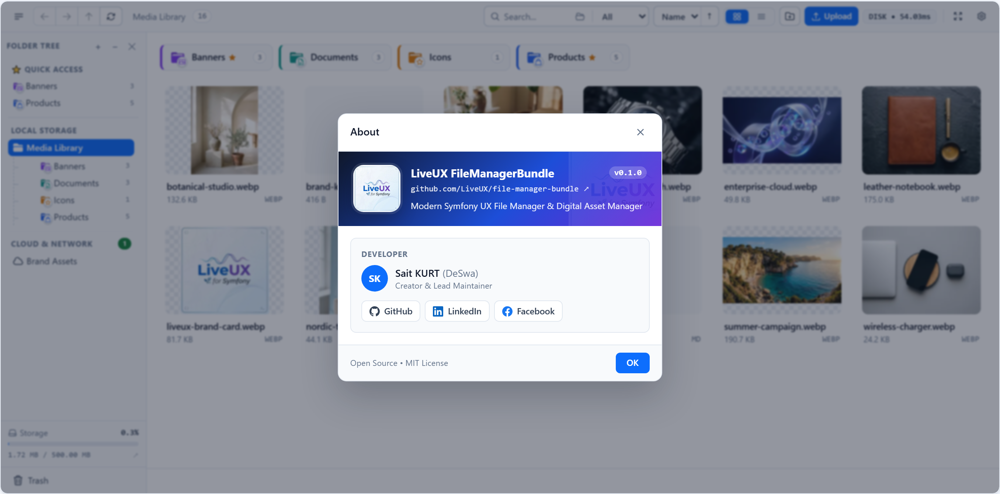

  <picture>
    <source media="(prefers-color-scheme: dark)" srcset="../images/banner-dark.png">
    <source media="(prefers-color-scheme: light)" srcset="../images/banner-light.png">
    
  </picture>

# LiveUX FileManagerBundle — Documentação em Português

**Idioma:** [English](../en/README.md) · [Türkçe](../tr/README.md) · [Français](../fr/README.md) · [Deutsch](../de/README.md) · [Español](../es/README.md) · [العربية](../ar/README.md) · [Italiano](../it/README.md) · **Português** · [Nederlands](../nl/README.md) · [Polski](../pl/README.md) · [日本語](../ja/README.md) · [简体中文](../zh_CN/README.md) · [README principal](../../README.md)

O **LiveUX FileManagerBundle** é um **Gerenciador de Arquivos e Gerenciador de Ativos Digitais (DAM) para Symfony UX** moderno, de alto desempenho e pronto para ambientes corporativos, desenvolvido para Symfony 6.4 LTS, 7.2+ e 8.x (PHP 8.3+). Ele vem com **zero dependências de frameworks CSS**, 14 camadas de segurança integradas e suporte multilíngue global (12 idiomas de interface integrados, detecção de locale BCP-47 / POSIX e RTL nativo).

---

## Prévia ao Vivo e Capturas de Tela

  

> **Vídeo de apresentação em Full HD (1080p, ~3 min) em 10 capítulos** para YouTube e releases: [`docs/images/demo-youtube-showcase.mp4`](../images/demo-youtube-showcase.mp4) · Prévia curta: [`docs/images/demo-showcase.mp4`](../images/demo-showcase.mp4)

| Modo Claro (`Light`) | Modo Escuro (`Dark`) |
| :---: | :---: |
|  |  |

| Personalização de Cor e Ícone da Pasta | Caixa de Diálogo Sobre (`LiveUX`) |
| :---: | :---: |
|  |  |

### Demonstrações de Editores Rich-Text, EasyAdmin e Formulários Dinâmicos (GIF)

| TinyMCE 5/6/7/8 | CKEditor 5 |
| :---: | :---: |
|  |  |

| Tiptap 2 (ProseMirror) | Quill 2 |
| :---: | :---: |
|  |  |

| Trix (EasyAdmin `TextEditorField`) | Summernote |
| :---: | :---: |
|  |  |

| Editor.js (Editor em Blocos) | GrapesJS (Construtor Visual de Páginas) |
| :---: | :---: |
|  |  |

| Meta Lexical | EasyAdmin 4/5 (`FileManagerField`) |
| :---: | :---: |
|  |  |

| Symfony `CollectionType` e `LiveCollectionType` |
| :---: |
|  |

---

## Roteiro de Início Rápido em 2 Minutos

Não sabe por onde começar? Vá direto ao guia correspondente ao seu objetivo:

- **Instalando pela primeira vez:** [01 — Requisitos e Instalação](01-requirements-and-installation.md) → [02 — Configuração e Perfis](02-configuration-and-profiles.md)
- **Adicionando um seletor de imagem ou galeria a um Symfony Form:** [05 — FormType e Integrações com Editores](05-formtype-and-editor-integrations.md)
- **Blindando segurança e RBAC para produção:** [06 — Segurança e Autorização](06-security-and-authorization.md)
- **Conectando Supabase, AWS S3 ou Cloudflare R2:** [07 — Armazenamento em Nuvem e Configuração Dinâmica](07-cloud-storage-and-dynamic-config.md)
- **Usando armazenamento de metadados com Doctrine ORM / DBAL:** [13 — Integração com Doctrine](13-doctrine-integration.md)
- **Impedindo a exclusão ou movimentação de ativos referenciados no banco de dados:** [10 — Proteção de Uso de Ativos](10-asset-usage-guard.md)

---

## Sumário (Índice da Documentação)

| Capítulo | Guia | Resumo |
| :---: | :--- | :--- |
| **01** | [Requisitos, Dependências e Instalação](01-requirements-and-installation.md) | Requisitos de PHP 8.3+ / Symfony 6.4 LTS, 7.2+ e 8.x, extensões PHP (incluindo `ext-exif`, `ext-zip`), dependências Composer, configuração de AssetMapper e Webpack Encore, `file-manager:doctor` e sua primeira página funcional |
| **02** | [Configuração e Perfis (Referência YAML)](02-configuration-and-profiles.md) | `defaults`, `volumes`, `profiles`, caminhos dinâmicos sem colisões (`{user_id}`, `{Y}/{m}`), limites de envio/partes, nomenclatura automática, otimização e regras de imagem, miniaturas, lixeira, ZIP, 5 receitas prontas para produção e referência completa do esquema YAML |
| **03** | [Modos de Uso e API JavaScript](03-usage-modes-and-js-api.md) | `TwigComponent` inline, Modal `<dialog>` e OffCanvas em 4 direções, referência completa de `window.LiveUXFileManager.open()`, eventos DOM personalizados, acessibilidade RTL/IME/WCAG 2.1 AA, menus de contexto, editor de imagens integrado e atalhos de teclado |
| **04** | [Temas, Conjuntos de Ícones e Personalização](04-themes-icons-and-customization.md) | 9 temas integrados com WCAG 2.1 AA (Bootstrap 5, Tailwind, Shadcn, Flowbite 4, DaisyUI 5, Tabler, Preline, Material, Unstyled), modo escuro automático/manual, 6 conjuntos de ícones SVG (49 ícones de interface + 14 ícones de pasta), helpers Twig e 3 níveis de estilização personalizada |
| **05** | [FormType e Integrações com Editores](05-formtype-and-editor-integrations.md) | `FileManagerPickerType` (seleção única e galeria multi-imagem com ordenação acessível + guarda de segurança POST), 5 variantes integradas (`compact`, `card`, `dropzone`, `avatar`, `input`), `CollectionType` / `LiveCollectionType`, templates personalizados, TinyMCE, CKEditor 5, Tiptap e o `FileManagerField` de 16 métodos para EasyAdmin |
| **06** | [Segurança e Autorização (RBAC)](06-security-and-authorization.md) | 17 permissões de Voter, Voters personalizados `unanimous`, regras de firewall em `security.yaml`, 14 camadas de defesa (CSRF, travessia de diretórios, 69 extensões / 47 tipos MIME, `SvgSanitizer` de 55 tags, proteção contra SSRF/DNS rebinding, confinamento de links simbólicos `ConfinedLocalFilesystemAdapter`, links de compartilhamento HMAC, log de auditoria) e endurecimento de Apache/Nginx |
| **07** | [Armazenamento em Nuvem (S3/R2/MinIO/Supabase) e Configuração Dinâmica](07-cloud-storage-and-dynamic-config.md) | Arquitetura multi-volume local/nuvem, guias de provedores ([Supabase](cloud/supabase-storage.md), [AWS S3](cloud/aws-s3.md), [Cloudflare R2](cloud/cloudflare-r2.md), [Backblaze B2](cloud/backblaze-b2.md), [MinIO/RustFS](cloud/minio-rustfs.md), [Google Cloud Storage](cloud/google-cloud-storage.md), [SFTP e Flysystem Personalizado](cloud/sftp-and-custom-flysystem.md)), `FlysystemServiceLocatorPass`, `ConfigProviderInterface` e armazenamento de metadados personalizado |
| **08** | [Eventos, Comandos CLI, Cache e Solução de Problemas](08-events-commands-cache-and-troubleshooting.md) | 9 eventos de domínio do Symfony, 10 comandos de console (`doctor`, `stats`, `duplicates`, `ai:enrich`, `skills:install`, etc.), cache em 3 camadas e isolamento HTTP 304/CDN sensível ao contexto, sistema global de tradução em 12 idiomas BCP-47/POSIX/RTL (493 chaves) e perguntas frequentes |
| **09** | [Integração com Symfony AI e Enriquecimento Inteligente](09-symfony-ai-integration.md) | `AssetEnricherInterface` sem dependências obrigatórias, ponte `symfony/ai-bundle` (OpenAI, Gemini, Claude, Ollama), **✨ Sugerir com IA**, CLI em lote `file-manager:ai:enrich`, exemplos assíncronos com Messenger e filtragem de recusas de LLM e prompt injection em 11 idiomas |
| **10** | [Proteção de Uso de Ativos (Asset Usage Guard)](10-asset-usage-guard.md) | Contrato opt-in `AssetUsageCheckerInterface`, políticas `warn` / `block`, proteção em duas camadas no servidor (`enforce_server_side`) para **`delete`, `rename`, `move` e `overwrite`**, além de exemplos Doctrine para MySQL, PostgreSQL e SQLite |
| **11** | [Guia de Contribuição e Pull Requests](11-contributing-and-pr-guide.md) | Fluxo de PR open-source amigável para iniciantes, portão de qualidade `composer qa` (PHPStan Nível 8, 360+ testes PHPUnit, 37+ testes JS), CI do GitHub Actions com 6 jobs e configuração de Branch Protection no GitHub |
| **12** | [Guia de Skills para Agentes de IA (`SKILL.md` e `AGENTS.md`)](12-ai-agent-skills-guide.md) | 6 pacotes modulares `SKILL.md` para Antigravity, Claude Code, Cursor, GitHub Copilot, Codex e Symfony AI Mate, instalação em um comando com `file-manager:skills:install` e validação em CI |
| **13** | [Integração com Doctrine ORM e DBAL](13-doctrine-integration.md) | `metadata.driver: 'doctrine'` integrado (`DoctrineDbalMetadataStorage` — UPSERT atômico, índice `text_pattern_ops` no PostgreSQL, `saveMany()` em lote), migrações multiplataforma, Entity + `FileManagerPickerType`, armazenamento ORM personalizado compatível com `ResetInterface` e sincronização de banco via `ItemRenamedEvent` |
| **14** | [Auditoria de Segurança, Revisão Lógica e Relatório de Alterações](../tr/14-guvenlik-denetim-ve-degisiklik-raporu.md) *(somente em turco)* | Auditoria de segurança linha a linha (rodadas 1–18), isolamento multi-tenant disjunto por `{user_id}`, endurecimento de DI/Voter/Parser/orçamento de passos de `<use>` em SVG e CDN/falsificação de origem, confinamento de links simbólicos, `text_pattern_ops` e UPSERT atômico no PostgreSQL, auditoria de contraste/foco WCAG 2.1 AA nos 9 temas, diálogos móveis e registro de auditoria i18n |

---

## Destaques da Arquitetura

- **Velocidade Híbrida de 0 ms:** `TwigComponent` SSR rápido + cache em memória no navegador (`dirCache`) + árvore completa de pastas em uma única solicitação. Filtragem, pesquisa, ordenação, paginação, alternância Grade/Lista e expansão/recolhimento de pastas acontecem instantaneamente, sem idas e vindas AJAX extras.
- **Zero Dependências de Frameworks CSS e WCAG 2.1 AA:** Toda a interface usa classes com escopo `.liveux-fm-*` e propriedades customizadas CSS (`--liveux-fm-*`). Funciona em harmonia com **Bootstrap 5, Tailwind CSS, Shadcn/UI, Flowbite 4, DaisyUI 5, Tabler, Preline, Material** ou **sem nenhum framework CSS** — sem colisões de estilo e sem configuração adicional de purge do Tailwind.
- **Top Layer HTML5 `<dialog>` Nativo e Ergonomia Mobile-First:** Os diálogos Modal e OffCanvas (`start`, `end`, `top`, `bottom`) são renderizados na Top Layer do navegador e se adaptam automaticamente em dispositivos móveis para tela cheia (`100dvh`) ou folha inferior nativa com alça de arraste.
- **Segurança Corporativa em 14 Camadas:** RBAC com `Voter` do Symfony, proteção CSRF (`X-LiveUX-FM-CSRF`), `PathNormalizer`, `FileSecurityGuard`, `SvgSanitizer` com 55 tags, `RemoteUrlImporter` protegido contra DNS rebinding, confinamento de links simbólicos `ConfinedLocalFilesystemAdapter`, proteções contra bombas de descompressão/pixels e cabeçalhos `CSP: sandbox` + `nosniff` habilitados de fábrica.
- **Arquitetura Multilíngue Global:** **12 idiomas de interface integrados** (`en`, `tr`, `fr`, `de`, `es`, `ar`, `it`, `pt`, `nl`, `pl`, `ja`, `zh_CN` com 493 chaves sincronizadas em cada), normalização de locale BCP-47 e POSIX `.UTF-8`, fallback garantido para `'en'`, RTL automático (`dir="rtl"`) para árabe e outros 14 idiomas RTL, e segurança para composição IME de idiomas CJK.
- **Pronto para Multi-Servidor e Nuvem:** `DoctrineDbalMetadataStorage` integrado (`text_pattern_ops` no PostgreSQL, UPSERT atômico no MySQL/MariaDB/SQLite), Flysystem v3 (S3, R2, Supabase, B2, MinIO, GCS, SFTP) e compatibilidade com `ResetInterface` para FrankenPHP e workers do Symfony Messenger.

---

## Checklist de Início Rápido em 5 Minutos

1. **Instale o bundle:** `composer require liveux/file-manager-bundle`
2. **Importe as rotas:** `config/routes/liveux_file_manager.yaml`
3. **Defina os perfis:** `config/packages/liveux_file_manager.yaml`
4. **CSS e JS (Zero Config):** O `autoimport` do Symfony UX carrega automaticamente `core.css`, `file_manager_api.js` e todos os 3 controladores Stimulus via `assets/controllers.json`, tanto no AssetMapper quanto no Webpack Encore.
5. **Host de diálogo (Automático):** O `AutoInjectDialogHostSubscriber` injeta automaticamente o `DialogHost` logo antes de `</body>` em páginas HTML completas (`defaults.auto_inject_dialog_host: true`) — sem precisar editar `base.html.twig`.
6. **Verifique sua instalação:** `php bin/console file-manager:doctor`

> Novo no Symfony UX? Comece passo a passo em **[01 — Requisitos, Dependências e Instalação](01-requirements-and-installation.md)**.

---

**Organização:** [LiveUX no GitHub](https://github.com/LiveUX) · [Repositório](https://github.com/LiveUX/file-manager-bundle)  
**Licença:** MIT
