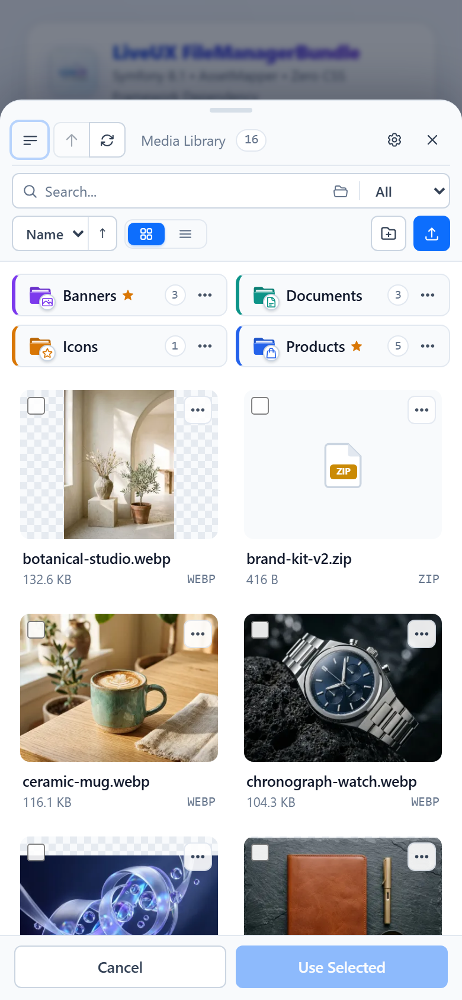
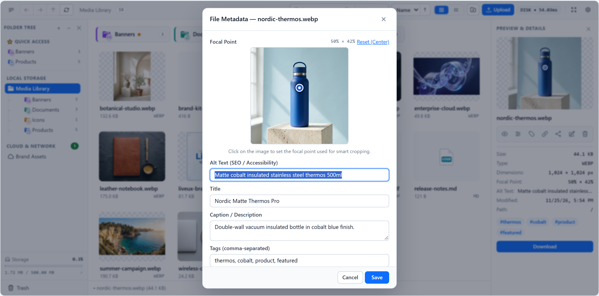
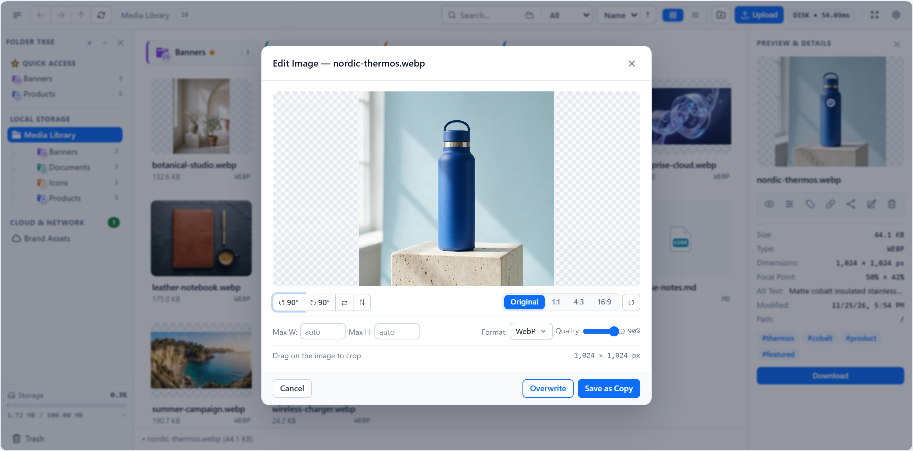

# 03 — 使用模式与 JavaScript API

[← 上一章：02 — 配置与 Profile 方案](02-configuration-and-profiles.md) | [文档目录索引](README.md) | [下一章：04 — 主题、图标集与自定义样式 →](04-themes-icons-and-customization.md)

你可以将 LiveUX FileManagerBundle 以**内联（Inline）**方式直接嵌入任意页面，以居中**模态框（Modal）**或四向滑出 **OffCanvas 抽屉**的形式打开，也可以在任何地方通过 **JavaScript Promise API** 以编程方式唤起。

> [!TIP]
> **应该选择哪种模式？**  
> - **内联（Inline）：** 独立的*“媒体库”*管理页面，文件管理器铺满主内容区域。  
> - **模态框（Modal）：** 在编辑商品或文章时，点击*“选择图片”*按钮弹出的居中对话框——用户选中资源后立即关闭并返回结果。  
> - **OffCanvas 抽屉：** 从屏幕任意一侧（`start`、`end`、`top`、`bottom`）滑出的现代侧边面板，在挑选文件时保留背景表单可见。  
> - **JavaScript API（`window.LiveUXFileManager.open()`）：** 无需依赖 Symfony Form，可从任意自定义 HTML 按钮、React/Vue/Alpine 组件或原生 JS 业务流中随时唤起文件选择器。

---

## 1. 内联模式 — TwigComponent


只需一行 Twig 调用即可嵌入完整的内联文件管理器。请将其包裹在具有明确高度的容器中（例如 `680px` 或 `calc(100vh - 140px)`）：

```twig
<div style="height: 680px;">
    {{ component('LiveUX:FileManager:Browser', {
        profile: 'default',
        mode: 'inline'
    }) }}
</div>
```

也可以使用 Symfony UX 的 `<twig:...>` 组件标签语法：

```twig
<div style="height: 680px;">
    <twig:LiveUX:FileManager:Browser
        profile="products"
        mode="inline"
        theme="flowbite"
        iconSet="macos"
        typeFilter="image"
        locale="zh_CN"
    />
</div>
```

### `Browser` 组件全部属性（Props）

| 属性 | 类型 | 默认值 | 说明 |
| :--- | :--- | :--- | :--- |
| `profile` | `string` | `'default'` | 在 `liveux_file_manager.yaml` 中定义的 Profile 键名。 |
| `volume` | `?string` | `null` | 初始打开的存储卷键名（`null` 表示打开该 Profile 的第一个存储卷）。 |
| `path` | `string` | `''` | 初始进入的子目录路径（例如 `'products/2026'`）。 |
| `multiple` | `bool` | `false` | 是否开启多文件选择模式。 |
| `mode` | `string` | `'inline'` | `'inline'`、`'modal'` 或 `'offcanvas'`。 |
| `typeFilter` | `string` | `'all'` | 初始文件类型筛选：`'all'`、`'folder'`、`'image'`、`'doc'` 或 `'video'`。 |
| `theme` | `?string` | `null` | 运行时主题覆写（支持全部 9 套内置主题：`bootstrap5`、`tailwind`、`shadcn`、`flowbite`、`daisyui`、`tabler`、`preline`、`material`、`unstyled`）。自定义 CSS/Twig 主题需在 YAML 中配置。 |
| `iconSet` | `?string` | `null` | 运行时图标集覆写（`classic`、`windows11`、`macos`、`linux`、`minimal`、`vscode`）。自定义 SVG 图标目录需在 YAML 中配置。 |
| `locale` | `?string` | `null` | 运行时区域语言覆写，支持全部 **12 种内置界面语言**（`en`、`tr`、`fr`、`de`、`es`、`ar`、`it`、`pt`、`nl`、`pl`、`ja`、`zh_CN`）以及任意 BCP-47 / POSIX 区域代码（如 `'ar'`、`'zh_Hans_CN'`）。 |

---

## 2. 模态框与 OffCanvas — 编程式 JavaScript Promise API

`DialogHost` 会自动注入到每一个完整 HTML 响应中（`defaults.auto_inject_dialog_host: true`），因此你可以在任意页面直接使用 `async/await` 调用 `window.LiveUXFileManager.open()`。

### `open(options)` 全部选项

| 选项 | 类型 | 默认值 | 说明 |
| :--- | :--- | :--- | :--- |
| `profile` | `string` | `'default'` | 要打开的 Profile 名称。 |
| `volume` | `?string` | `null` | 初始存储卷键名。 |
| `path` | `string` | `''` | 初始目录路径（例如 `'banners'`）。 |
| `mode` | `'modal'\|'offcanvas'` | `'modal'` | 居中模态框或侧滑 OffCanvas 抽屉。 |
| `position` | `'start'\|'end'\|'top'\|'bottom'` | `'end'` | 当 `mode: 'offcanvas'` 时的滑出方向（`start` = 左侧，`end` = 右侧；在 RTL 语言中会自动镜像反转）。 |
| `mobileMode` | `'auto'\|'fullscreen'\|'sheet'` | `null` *（继承 Profile）* | 覆写移动端视口（`<= 767.98px`）下的弹窗呈现方式。 |
| `multiple` | `bool` | `false` | `false` = 单选文件，`true` = 多选文件。 |
| `type` / `filetype` | `'all'\|'folder'\|'image'\|'doc'\|'video'\|'media'` | `'all'` | 打开时预先按指定分类筛选（`filetype` 为 TinyMCE 兼容别名；`'media'` 会自动映射为 `'video'`）。 |
| `theme` | `?string` | `null` | 运行时覆写 9 套内置主题中的任意一套（出于安全原因，自定义 Twig 模板路径仅限在服务端 YAML 中配置）。 |
| `iconSet` | `?string` | `null` | 运行时覆写 6 套内置图标集中的任意一套。 |
| `locale` | `?string` | `null` | 运行时语言覆写（`'zh_CN'`、`'en'`、`'tr'`、`'fr'`、`'de'`、`'ar'`、`'ja'` 等）。 |

### 实战示例：隐藏 `<input>` + 实时图片预览（不依赖 Symfony Form）

将以下代码片段粘贴到任意 HTML 或 Twig 页面即可直接运行：

```html
<!-- 1. 隐藏输入框 + 实时预览图 + 触发按钮 -->
<div>
    <input type="hidden" id="cover-url" name="cover_url" value="">
    
    <br>
    <button type="button" id="cover-pick-btn">选择封面图片</button>
</div>

<script>
document.getElementById('cover-pick-btn').addEventListener('click', async () => {
    const selected = await window.LiveUXFileManager.open({
        profile: 'default',
        mode: 'offcanvas',
        position: 'end',
        mobileMode: 'auto',
        multiple: false,
        type: 'image',       // 打开时默认筛选为图片
        theme: 'shadcn',
        iconSet: 'windows11',
    });

    // 用户按 ESC 或未选择文件直接关闭了弹窗
    if (selected.length === 0) {
        return;
    }

    const file = selected[0];
    document.getElementById('cover-url').value = file.url;

    const img = document.getElementById('cover-preview');
    if (file.isImage) {
        img.src = file.url;
        img.alt = file.meta?.alt || file.name;
        img.style.display = 'block';
    }
});
</script>
```

### 常用模式快捷片段

```html
<!-- 居中模态框 -->
<button type="button" onclick="window.LiveUXFileManager.open({ mode: 'modal' })">打开模态框</button>

<!-- 右侧滑出抽屉（OffCanvas） -->
<button type="button" onclick="window.LiveUXFileManager.open({ mode: 'offcanvas', position: 'end' })">右侧抽屉</button>

<!-- 底部滑出面板（OffCanvas） -->
<button type="button" onclick="window.LiveUXFileManager.open({ mode: 'offcanvas', position: 'bottom' })">底部抽屉</button>
```

> [!NOTE]
> **取消操作行为：** 当用户未选择任何文件就关闭弹窗（按 `ESC`、点击关闭按钮或点击遮罩层）时，Promise **不会 reject（抛出拒绝异常）**，而是平稳 resolve 为一个空数组（`[]`）。
>
> **移动端响应式适配（`mobileMode` / `ui.mobile_dialog_mode`）：** 在宽度 `<= 767.98px` 的移动设备上，弹窗会自动自适应：在 `'auto'` 模式下，模态框与左右抽屉（`start`/`end`）会以铺满视口的全屏模式（`100dvh`）打开，而 `bottom`/`top` 抽屉会呈现为带拖动手柄的圆角原生抽屉面板。左侧文件夹树在移动端默认折叠，轻触即可滑出。

| 桌面端 OffCanvas 面板（`position: 'end'`） | 移动端底部抽屉（`mobileMode: 'sheet'`） |
| :---: | :---: |
|  |  |

### 返回的文件对象结构

`window.LiveUXFileManager.open()` resolve 后的数组元素结构如下：

```json
[
    {
        "kind": "file",
        "path": "products/matte-black-tumbler.webp",
        "url": "/uploads/products/matte-black-tumbler.webp",
        "name": "matte-black-tumbler.webp",
        "extension": "webp",
        "isImage": true,
        "meta": {
            "alt": "磨砂黑不锈钢真空保温杯",
            "title": "保温杯 Pro",
            "caption": "500 ml 真空隔热保温杯",
            "tags": ["保温杯", "饮水器具"],
            "focalPoint": { "x": 0.5, "y": 0.4 }
        }
    }
]
```

*（注：在 `private: true` 的私有存储卷上，`url` 会指向受 RBAC 权限保护的 `/_liveux-file-manager/download?...&inline=1` 接口。）*

### 自定义 DOM 事件

除了 `await window.LiveUXFileManager.open()` 之外，你还可以直接在 `window` 上监听弹窗生命周期事件：

| DOM 事件（`window.addEventListener`） | 触发时机 | `event.detail` 载荷 |
| :--- | :--- | :--- |
| `liveux:file-manager:open` | 派发打开弹窗请求时（`file_manager_api.js` 与 `dialog_controller.js` 之间的通信桥接）。 | `open()` 选项 + `requestId` |
| `liveux:file-manager:dialog-opened` | 弹窗成功打开且内部内容挂载完成时。 | `{ mode, position, profile }` |
| `liveux:file-manager:selected` | 用户确认所选项目（或取消关闭弹窗）时。 | `{ items: [...], requestId }` |

```javascript
window.addEventListener('liveux:file-manager:selected', (event) => {
    console.log('已选项目数量：', event.detail.items.length);
});
```

---

## 3. 内置终端用户功能

- **紧凑右键上下文菜单：**
  - *右键点击文件或文件夹：* 顶部呈现 Windows 11 风格单行 SVG 快捷操作栏（`剪切`、`复制`、`重命名`、`下载`/`固定到快速访问`、`删除`），下方为分组一键操作（预览、编辑图片、SEO 与焦点 / 信息与标签、解压压缩包、复制链接、创建分享链接、移动到文件夹…、创建副本、文件夹颜色）。
  - *右键点击空白区域：* 顶部显示快捷导航栏（`← → ↑ ↻`），以及新建文件夹、上传到此处、粘贴到此处、全选、排序方式与每页显示数量。*（全屏、键盘快捷键与关于入口统一收纳在工具栏的 **⚙ 设置** 菜单中。）*
  - *移动端 / 触控设备：* 点击每个卡片上的 `⋯` 按钮即可以触控友好的底部面板弹出菜单。
- **全能预览器（Lightbox v2）与右侧预览详情面板（Inspector）：**
  - **图片：** 支持图库前后切换（`←`/`→`）、缩放控制（`-` / `100%` / `+`）与焦点位置标记。
  - **视频（`.mp4`、`.webm`、`.ogv`、`.mov`、`.m4v`）：右侧详情面板内置 `<video controls>` 实时播放 + 全屏灯箱播放 + 私有存储卷原生支持 `HTTP 206 Partial Content` 进度条拖动（可通过 `ui.allow_video_preview` 按 Profile 开关）。
  - **PDF（`.pdf`）：** 灯箱内置沙箱隔离的 `<iframe>` PDF 阅览器（可通过 `ui.allow_pdf_preview` 控制开关）。
  - **音频（`.mp3`、`.wav`、`.ogg`、`.m4a`、`.flac`、`.aac`）与文本/代码（`.txt`、`.md`、`.json`、`.yaml`、`.csv`、`.css`、`.sql` 等，上限 64 KB）。**
  - 在 `inline` 模式下，**双击**任意可预览文件（或按 `Space`）即可立刻打开灯箱预览。
- **智能上传队列（暂停 / 继续 / 二次确认取消）：**
  - 支持直接拖放单个文件**或整个嵌套文件夹层级**（`webkitGetAsEntry`），也支持按 `Ctrl+V` 直接粘贴剪贴板中的图片。
  - 分片上传实时展示分片进度（`2/5 • 40%`）、一键**暂停（`⏸`）/ 继续（`▶`）**、带二次确认防误触的**取消（`✕`）**、批量**全部暂停 / 全部取消**，并在取消时自动通知服务端清理残余临时分片。
- **多选（含框选套索）、剪贴板与深度搜索：**
  - 在空白处按住鼠标拖动可拉出**框选 / 套索选择框**批量选中多个文件与文件夹（按住 `Ctrl`/`Cmd` 可追加选中）。
  - 支持 `Shift+点击` 连续区间选择、`Ctrl+点击` 切换多选、`Ctrl+A` 全选以及跨文件夹甚至跨存储卷的 `Ctrl+C`/`Ctrl+X`/`Ctrl+V`。
  - **可排序列表表头：** 在列表视图中点击**名称**、**类型**、**大小**或**日期**列头即可快速切换升序/降序。
  - **实时卡片大小滑块与文件夹样式切换：** 在设置（`⚙`）菜单中实时拖动调整项目大小（`96 px – 320 px`），并在紧凑磁贴（`tile`）与全尺寸卡片（`card`）间即时切换。
  - 点击搜索栏中的**包含子文件夹（深度搜索）**按钮，即可递归检索所有子目录，检索范围同时涵盖 `#标签` 与 `alt` 替代文本元数据。
  - 侧边栏支持 **⭐ 快速访问**固定文件夹、可点击展开的**存储用量与配额详情**分析弹窗，以及**自动 / 浅色 / 深色**外观切换器。
- **0ms 图片分辨率与宽高比校验（`image_constraints`）：** 配置尺寸或宽高比规则（如 `1:1`、`16:9`）后，不符合要求的图片会在上传前于浏览器端瞬时拦截，并在服务端再次强校验。
- **编辑元数据、焦点位置与签名分享链接：**
  - 编辑文件的 `alt`、标题、说明、`#标签`、可点击定位的 `[x, y]` **焦点位置**，并支持可选的 **✨ AI 智能建议**。
  - 生成带有效期的 HMAC 签名分享链接（`15 分钟`、`1 小时`、`24 小时`、`7 天`、`30 天`）。
- **内置 Canvas 图片编辑器：** 支持自由或固定比例（`1:1`、`4:3`、`16:9`）裁剪、像素缩放（`最大宽度`/`最大高度`）、输出格式（`JPEG`/`PNG`/`WebP`）与压缩质量控制、90° 旋转、水平/垂直翻转，以及**另存为副本 / 覆盖原图**。

| 文件元数据与焦点位置（`I`） | 内置 Canvas 图片编辑器（`E`） |
| :---: | :---: |
|  |  |

- **全球化 i18n、RTL 与无障碍访问（WCAG 2.1 AA）：**
  - **内置 12 种界面语言与自动 RTL（`dir="rtl"`）：** 完整支持 `en`、`tr`、`fr`、`de`、`es`、`ar`、`it`、`pt`、`nl`、`pl`、`ja` 与 `zh_CN`。阿拉伯语（`ar`）、波斯语（`fa`）、希伯来语（`he`）、乌尔都语（`ur`）等从右到左语言会借助 CSS 逻辑属性（`inset-inline`、`margin-inline`）自动镜像翻转布局、面包屑、侧边栏与 OffCanvas 滑出方向。
  - **中日韩（CJK）输入法 IME 安全防护：** 严格检测 `event.isComposing`，避免在拼音/假名/韩文选词输入过程中按 `Enter` 或字母键误触发快捷键。
  - **完整的键盘与屏幕阅读器无障碍体验：** 模态框与灯箱内置焦点陷阱（`Tab`/`Shift+Tab`）、右键菜单方向键导航、完整的 `role="tree"` / `aria-expanded` / `aria-current` 语义属性，并在关闭弹窗时自动恢复原始焦点。
- **键盘快捷键（完整速查表）：**
  - 所有快捷键仅在文件管理器获得焦点且不在文本输入控件（`<input>`、`<textarea>`、`<select>`）内时生效，并严格遵循当前用户的 **Voter 权限**（受 `ui.keyboard_shortcuts: true` 控制）。
  - 在 macOS 上，**`Cmd (⌘)`** 与 `Ctrl` 均可无缝使用。
  - **国际键盘与输入法保护：** 采用物理键码（`event.code` `Key*`）并辅以字符回退映射，确保在非 QWERTY 及非拉丁键盘布局下照常工作，同时在 CJK 输入法组合态（`isComposing`）下保持静默。

#### A. 文件与文件夹操作
| 快捷键 | 操作 | 触发条件 / 说明 |
| :--- | :--- | :--- |
| `N` | 新建文件夹 | 非回收站视图（需 `create_folder` 权限） |
| `U` | 打开上传文件弹窗 | 非回收站视图（需 `upload` 权限） |
| `F2` | 重命名所选项 | 选中单个文件或文件夹（需 `rename` 权限） |
| `M` | 打开移动 / 复制到文件夹弹窗 | 选中 1 个或多个项目（需 `move` 或 `copy` 权限） |
| `D` | 创建所选文件副本 | 选中**单个文件**（需 `clone` 权限） |
| `I` | **文件夹：** 文件夹颜色与图标 / **文件：** 元数据（SEO 与焦点） | 选中单个项目（需 `edit_metadata` 权限） |
| `E` | 打开内置 Canvas 图片编辑器 | 选中单个位图图像（`.jpg`、`.jpeg`、`.png`、`.webp`）（需 `upload` 权限） |
| `L` | 复制文件链接到剪贴板 | 选中单个文件（需 `download` 权限） |
| `S` | 打开带有效期的 HMAC 签名分享链接弹窗 | 选中单个文件（需 `share` 权限且 `share.enabled: true`） |
| `Delete` | 删除所选项（移至回收站或永久删除） | 选中 1 个或多个项目（需 `delete` 权限） |

#### B. 导航与预览
| 快捷键 | 操作 | 触发条件 / 说明 |
| :--- | :--- | :--- |
| `/` 或 `Ctrl + F` | 聚焦搜索框 | 当 `show_search: true` 时（`Ctrl + F` 在输入框内同样可用） |
| `←` `→` `↑` `↓` | 在网格卡片或列表行之间移动 | — |
| `Enter` | **文件夹：** 打开进入 • **单个文件：** 内联模式下打开灯箱预览，Modal/OffCanvas 模式下确认选择 | — |
| `Space` | 在灯箱中预览所选文件 | 选中单个文件 |
| `Backspace` 或 `Alt + ↑` | 返回上级文件夹 | 处于子文件夹内 |
| `Alt + ←` / `Alt + →` | 浏览历史后退 / 前进 | 在 **RTL** 语言（阿拉伯语、波斯语、希伯来语）下自动镜像 |
| `R` | 从服务端强制刷新当前目录（`?refresh=1`） | 当 `show_refresh_button: true` 时 |

#### C. 选择、剪贴板与逐层关闭
| 快捷键 | 操作 | 触发条件 / 说明 |
| :--- | :--- | :--- |
| `Ctrl + A` | 全选当前可见项目 | 非回收站视图 |
| `Ctrl + C` / `Ctrl + X` | 复制 / 剪切所选项目到剪贴板 | 当前未选中页面文本时（需 `copy` / `move` 权限） |
| `Ctrl + V` | 将剪贴板中的文件/文件夹粘贴到当前目录，**或**直接粘贴上传系统剪贴板中的图片/文件 | 在上传弹窗打开时同样有效 |
| `Shift + 点击` / `Ctrl + 点击` | 连续区间选择 / 逐个切换选中状态 | 也可在空白处拖拽进行框选（套索选择） |
| `Esc` | **4 级智能逐层关闭：** 1）关闭当前打开的菜单/弹窗/灯箱/设置/移动端抽屉 → 2）清空当前选中 → 3）清空剪贴板 → 4）退出内联全屏 | 每次按键仅关闭最顶层状态 |
| `Tab` / `Shift + Tab` | 在已打开的弹窗或灯箱内循环切换交互控件焦点（焦点陷阱） | — |

#### D. 视图与帮助
| 快捷键 | 操作 |
| :--- | :--- |
| `V` | 切换网格与列表视图 |
| `B` | 展开 / 折叠左侧文件夹树边栏 |
| `F` | 切换全屏模式 |
| `T` | 切换回收站视图（当 `trash.enabled: true` 时） |
| `?` 或阿拉伯文 `؟` | 打开键盘快捷键帮助弹窗 |

#### E. 灯箱（Lightbox）预览内部快捷键
| 快捷键 | 操作 |
| :--- | :--- |
| `←` / `→` | 上一张 / 下一张图片 *（在 RTL 语言下自动镜像）* |
| `+`、`=` 或小键盘 `Numpad +` | 放大 |
| `-` 或小键盘 `Numpad -` | 缩小 |
| `0` 或小键盘 `Numpad 0` | 重置缩放至 `100%` |
| `Esc` | 关闭灯箱预览 |

#### F. 打开的右键上下文菜单内部快捷键
| 快捷键 | 操作 |
| :--- | :--- |
| `↑` / `↓` | 上下移动高亮菜单项 |
| `Home` / `End` | 跳转至首项 / 末项菜单项 |
| `Enter` / `Space` | 执行当前聚焦的菜单操作 |
| `Tab` / `Esc` | 关闭右键上下文菜单 |

---

[← 上一章：02 — 配置与 Profile 方案](02-configuration-and-profiles.md) | [文档目录索引](README.md) | [下一章：04 — 主题、图标集与自定义样式 →](04-themes-icons-and-customization.md)
